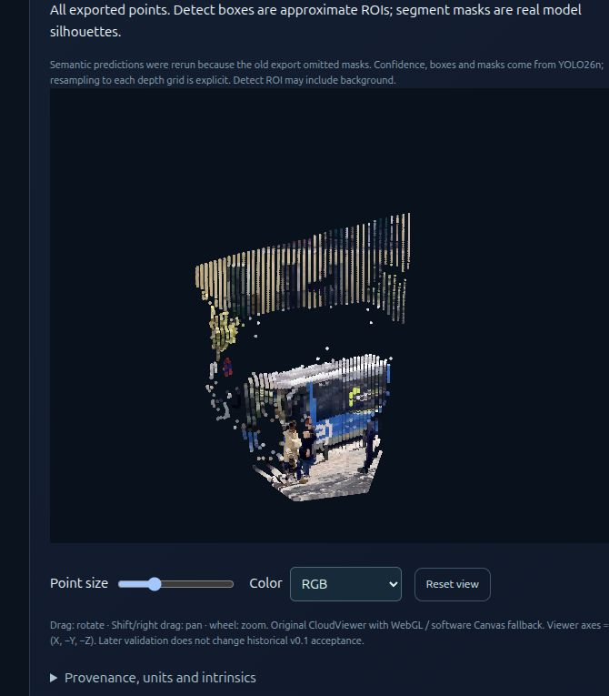
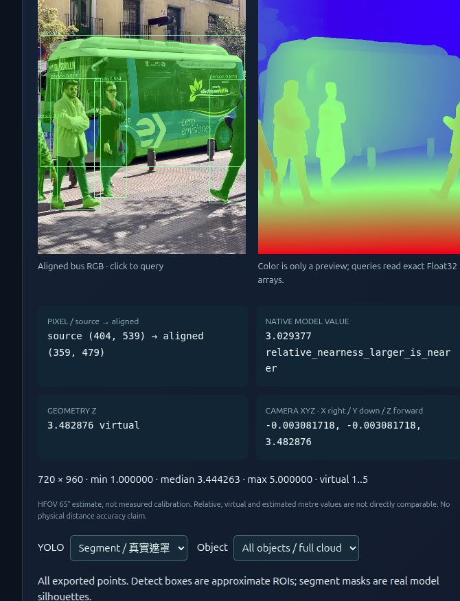
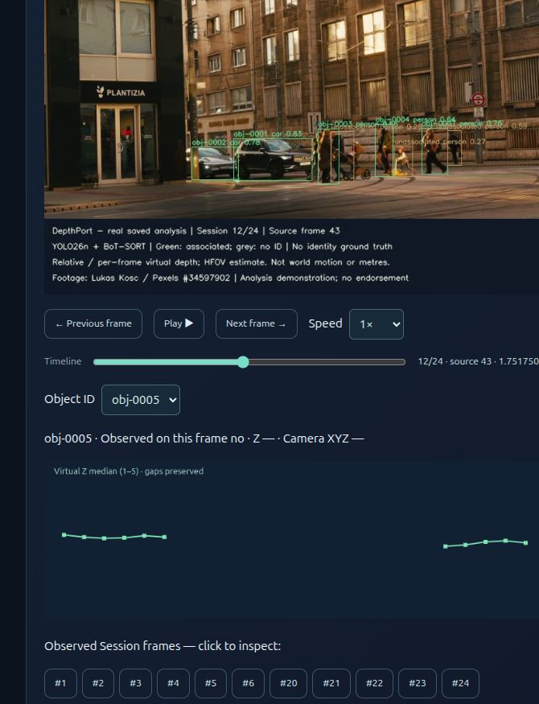
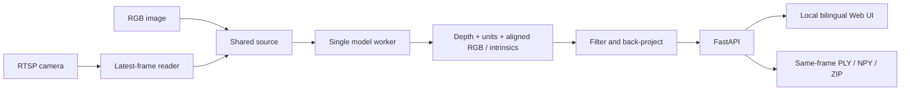

<div align="center">

# DepthPort

**Monocular depth & point cloud workbench**<br>
One camera · Four depth engines · Local-first

English · [繁體中文](README.zh-TW.md) · Experimental Alpha · [GNU AGPL v3](LICENSE)

</div>

Turn RGB images and RTSP frames into interactive **single-view point clouds**. Compare depth engines, inspect visible-surface geometry, and review saved frames with Object IDs in one local web interface. DepthPort integrates existing pretrained models; its focus is the application workflow, aligned data and inspectable exports.

**Download v0.3.0-alpha.2:** [Release notes](https://github.com/JShengP/depthport/releases/tag/v0.3.0-alpha.2) · [Source ZIP](https://github.com/JShengP/depthport/releases/download/v0.3.0-alpha.2/depthport-0.3.0-alpha.2-source.zip) · [SHA-256](https://github.com/JShengP/depthport/releases/download/v0.3.0-alpha.2/SHA256SUMS.txt)

[Quick start](#quick-start) · [Versions](#versions) · [Features](#features) · [Validation & limits](#validation-and-limits) · [Documentation](#documentation)

> [!IMPORTANT]
> **Experimental development preview.** Session storage is off by default. Long-occlusion recovery, physical RTSP, Windows pretrained inference/worker integration, endurance and calibrated distance accuracy remain open. [Validation record](docs/en/validation.md)

**Test results:** [Results Index](https://jshengp.github.io/depthport/results/?lang=en) — browse models, trackers and platforms with scoped results, same-cohort HOTA/IDSW/FN/FP charts, CI, failed gates and unverified items.

## Real-data interactive demos

Click a screenshot to open the **saved-result interactive website**. These are screenshots of the current Pages UI, not new live inference or historical Alpha acceptance.

<p align="center">
  <a href="https://jshengp.github.io/depthport/v0.1/?lang=en"></a>
  <a href="https://jshengp.github.io/depthport/v0.2/?lang=en"></a>
  <a href="https://jshengp.github.io/depthport/v0.3/?lang=en"></a>
</p>

**[v0.1 · Rotate real point clouds](https://jshengp.github.io/depthport/v0.1/?lang=en)** · **[v0.2 · Inspect native depth / XYZ / masks](https://jshengp.github.io/depthport/v0.2/?lang=en)** · **[v0.3 · Play real tracking results](https://jshengp.github.io/depthport/v0.3/?lang=en)**

Bus views reuse the original four-engine CUDA exports of [Ultralytics bus.jpg](https://github.com/ultralytics/assets/blob/53d4e2a8fd15f473c29a148c317a8477be559327/im/bus.jpg). The cloud image shows **DA3 Metric Large**; the inspector shows **V2 native nearness plus final virtual Z**, with new real YOLO masks. Intrinsics are estimated from 65° HFOV, not measured calibration. Relative/virtual depth is not metres; estimated metres are not verified physical distances. This later demonstration does not change v0.1's historical acceptance.

**Two separate tracking runs — do not mix IDs or counts:**

- **Current Pages run, 2026-10-20:** **9 IDs / 209 detections / 152 associated / 57 unassociated**, YOLO26n **8.4.115**. The original Session was unavailable, so the same hashed video and source frames 32–55 were rerun. The screenshot shows saved #12 = source #43 at 1.751750 s; `obj-0005` has no observation here, so Z/XYZ are blank and its history retains the gap.
- **Earlier screenshots, 2026-10-19:** **7 IDs / 230 detections / 125 associated / 105 unassociated**, YOLO26n **8.4.176**. [Original three-screen walkthrough](docs/en/tracking-replay-example.md). Those screenshots remain unchanged; matching ID strings across runs do not establish the same object. Different runs are not a controlled accuracy comparison.

Footage: **[Lukas Kosc via Pexels](https://www.pexels.com/video/urban-street-scene-with-people-crossing-34597902/)**, under its [own terms](https://www.pexels.com/terms-of-service/), not AGPL; no endorsement. Both examples span only **0.959 s**, have no identity GT, and do not validate long occlusion, ID-switch correctness or tracking accuracy. Unassociated detections are not ground-truth FN. V2 per-frame virtual depth and camera XYZ are not world motion or speed. Pages reads saved static packs; it offers no online model inference, private Session access or RTSP input.

[Full provenance, native units and limitations](docs/en/real-ai-pages.md) · [Screenshot states and hashes](docs/validation/readme-real-pages.json) · [Demo status and next gates](ROADMAP.md#current-pages--目前互動展示)

## Quick start

Use a **fresh Python 3.11 or 3.12 environment**. The source download excludes Python dependencies and model weights. For NVIDIA GPUs, install a compatible CUDA PyTorch/torchvision pair in the app environment before the remaining dependencies. [Full installation guide](docs/en/installation.md)

**Windows** — run from the extracted or cloned repository:

```bat
RUN_WINDOWS.bat
```

**Ubuntu:**

```bash
bash RUN_UBUNTU.sh
```

Open [http://127.0.0.1:8000/](http://127.0.0.1:8000/). First setup creates `.venv-depthport`; first use of a model may download its weights. The installer also accepts Python 3.10, but optional-package availability needs separate verification.

- **Viewer** `/`: upload an image → wait for a result → select another engine → **Apply / retry model**. The retained image is reprocessed. The Python host must be able to reach an RTSP source.
- **Spatial Analysis** `/spatial`: inspect depth/XYZ, compare engines and explore semantic fusion.
- **Sessions** `/sessions`: explicitly set `ENABLE_SESSION_STORAGE=1` locally and restart to enable manual saved-frame review. [Session guide](docs/en/sessions.md) · [Optional worker setup](docs/en/tracking-worker.md)

<details>
<summary>Explore real recorded examples and synthetic practice without installing AI dependencies</summary>

[Open the multi-version public showcase](https://jshengp.github.io/depthport/) — v0.1/v0.2 share four-model Float32 bus depth, interactive XYZRGB and actual YOLO masks. v0.3 plays a new saved 24-frame tracking run (source 32–55), with IDs and depth histories. The original three screenshots and separate synthetic exercises remain. [Data provenance, hashes and limits](docs/en/real-ai-pages.md). Build with Python’s standard library:

```bash
python tools/build_site.py
python -m http.server 8765 --directory _site --bind 127.0.0.1
```

Open [http://127.0.0.1:8765/](http://127.0.0.1:8765/). GitHub Pages serves recorded public media and separately labeled synthetic practice data. It does not run pretrained depth models, accept visitor uploads, or connect to RTSP. Numeric data is read from curated static packs; full NPY/PLY exports, original videos, weights and private Sessions stay local. Pages publishes reviewed changes merged to `main`.

</details>

## Versions

Each generation retains the earlier foundation. The separate guides explain **changes, architecture, contents and validation boundaries**.

- **[v0.1 · Viewer](docs/versions/v0.1/README.md)** — images/RTSP, four depth engines, interactive point clouds and same-frame exports.
- **[v0.2 · Spatial Analysis](docs/versions/v0.2/README.md)** — pixel XYZ, engine comparison, semantic fusion and calibration/error tools.
- **[v0.3 · Sessions & Tracking](docs/versions/v0.3/README.md)** — manual local archives, replay, Object IDs, isolated BoT-SORT and bookmark review. Experimental Alpha.

<details>
<summary>Compare version workflows — generated schematic</summary>


*Illustrative workflows, not UI screenshots, inference results or benchmark evidence.*

</details>

<details>
<summary>Release history and main documentation</summary>

Alpha.2 packages reviewed Pages/FastAPI/Hub/DA3 compatibility updates and version workflow illustrations; publishing it added no inference or hardware acceptance. Main may include newer documentation. Tags, original version READMEs and published packages remain fixed at their release snapshots and checksums.

Previous packages: [v0.3.0-alpha.1](https://github.com/JShengP/depthport/releases/tag/v0.3.0-alpha.1) · [v0.2 Alpha](https://github.com/JShengP/depthport/releases/tag/v0.2.0-alpha.1) · [Changelog](CHANGELOG.md)

</details>

## Features

### Viewer & data

- **Four depth engines:** YOLO26 Depth, Depth Anything V2 Small, DA3-Small and DA3Metric-Large; one loaded model at a time, with no backend restart to switch.
- **Images, RTSP & interactive 3D:** latest-frame processing, orbit/zoom/pan, colouring, point size and display-only stretch. WebGL has a Canvas2D fallback.
- **Traceable exports:** same-frame PLY, float32 NPY, original model output, aligned RGB and model/unit metadata. English/Traditional Chinese UI, with browser language persistence or `?lang=en` / `?lang=zh-TW`; language does not change data/API fields. Upstream diagnostics retain their original language.

<details>
<summary>Current Pages point-cloud interaction — saved real data</summary>

[](https://jshengp.github.io/depthport/v0.1/?lang=en)

*Rotate / zoom / pan saved model geometry. Estimated metres and HFOV intrinsics are uncalibrated; this later example is not historical v0.1 acceptance. [Original synthetic screenshot](docs/assets/preview.en.png) remains a separate reference.*

</details>

### Spatial Analysis

Inspect raw depth/camera-space XYZ, compare four engines sequentially on one image, fuse optional YOLO Detect/Segment instances with aligned points, and use checkerboard calibration, candidate-plane fitting and independent metric-error tools. Depth/model operations stay serialized in one worker.

[Spatial Analysis guide](docs/en/spatial-analysis.md) · [Models & geometry](docs/en/models-and-geometry.md)

<details>
<summary>Current Pages inspector — real depth, XYZ and YOLO masks</summary>

[](https://jshengp.github.io/depthport/v0.2/?lang=en)

*Native Float32 queries, not preview-color inversion. V2 final geometry uses virtual 1–5 units; K is an HFOV estimate. [Historical v0.2 CUDA screenshot](docs/assets/spatial-preview.en.png) remains unchanged.*

</details>

### Sessions & tracking review

- **Opt-in manual capture:** same-frame RGB/depth/PLY/raw NPY, SHA-256 integrity checks and offline replay; no automatic recording or inference during replay.
- **Review controls:** Object ID overlays, playback/speed/timeline, A/B loops, searchable bookmark notes/tags, JSON backup and guarded keyboard help. Notes and exports stay local.
- **Optional isolated BoT-SORT:** NumPy 2 worker separate from the NumPy 1 application. **Simple association stays default.** IDs are local associations, not identities or world trajectories.

[Session guide](docs/en/sessions.md) · [Worker setup](docs/en/tracking-worker.md) · [Tracking evaluation](docs/en/tracking-evaluation.md)

### Depth units

Estimated metres, relative depth and V2's virtual 1–5 display geometry remain distinct. Raw model output is retained separately. V2's per-frame mapping can change shape/scale; its XYZ must not be compared numerically with metric-model output.

<details>
<summary>Engine keys, checkpoints and geometry semantics</summary>

| Engine key | Default checkpoint | Geometry in this app |
|---|---|---|
| `yolo26` | `yolo26n-depth.pt` | API-provided estimated meters; field scale is unverified |
| `da2-small` | `depth-anything/Depth-Anything-V2-Small-hf` | **Virtual 1–5 display depth**, derived from relative scores; not meters |
| `da3-small` | `depth-anything/DA3-SMALL` | Raw positive relative depth; not meters |
| `da3-metric` | `depth-anything/DA3METRIC-LARGE` | Estimated meters using processed focal length / 300 |

[Model and geometry guide](docs/en/models-and-geometry.md) · [Upstream sources and licenses](THIRD_PARTY_NOTICES.md)

</details>

## Validation and limits

- **CI:** Ubuntu/Windows × Python 3.11/3.12 application contracts and real model API installation/import checks. CI uses no pretrained weights or inference and does not establish hardware or accuracy acceptance.
- **Real examples:** dated v0.2 single-image CUDA evidence and the short v0.3 replay example have separate source/runtime records. [Validation history](docs/en/validation.md) · [Replay conditions](docs/en/tracking-replay-example.md)
- **Pages compatibility:** exact Linux Chrome155 / Edge155 / Firefox157 builds pass B01–B07 in separate [native headed](docs/en/pages-headed-browsers.md) and [headless](docs/en/pages-standalone-browsers.md) studies,21 pass/3 not_run per mode. The unique matrix remains33 pass/31 not_run; modes are not extra browsers. Original failures remain recorded; Safari, physical phones, other OS/builds and natural fallback paths remain open.
- **Still open:** generalised long-occlusion/crossing/camera-motion reliability, physical RTSP, Windows pretrained inference/real worker integration, endurance/VRAM, NVIDIA hardware WebGL and independently calibrated distance accuracy. [Acceptance roadmap](ROADMAP.md)

<details>
<summary>Tracking studies and next experiments</summary>

Completed studies cover [2,700 frames / 27 runs](docs/en/tracking-expanded-acceptance.md), [1,179 new frames / 60 parameter runs](docs/en/tracking-parameter-acceptance.md), [ID-switch/false-positive diagnosis](docs/en/tracking-error-diagnosis.md), [72 confirmation/competition runs with fresh 8.4.176 caches](docs/en/tracking-admission-acceptance.md), and [16 exact-output association-cost reruns](docs/en/tracking-association-diagnosis.md) on the same 09/10 scenes. Longer confirmation trades FP for FN/lower identity scores; birth veto never triggers. Cost diagnosis identified ByteTrack missed-hypothesis weak-stage competition, with observed same-GT recovery risk. The [new MOT20-01 deferral control](docs/en/tracking-recovery-acceptance.md) passes its frozen research screen (FP −3, FN −102, IDSW −8), but recall remains 13.98%, fragmentation increases and no long-event endpoint pair is complete. [Unchanged moving-camera replication](docs/en/tracking-recovery-moving.md) adds 1,650 frames / 12 runs: FP −8, FN/IDSW unchanged, but bus-view HOTA slightly regresses and no long-event recovery improves, so the per-scene screen fails. [History diagnosis](docs/en/tracking-recovery-history.md) now separates below-gate retained states, CLEAR continuity and low-localisation HOTA losses; all flagged competitors were already assigned elsewhere. [Separate occupancy/equivalent-assignment controls](docs/en/tracking-exclusive-competition.md) use a fresh cache on a previously studied 1,050-frame static scene / 12 runs. Both new controls have zero vetoes and equal reference; legacy adds six misses, with FP unchanged. [GT-free exposure discovery/confirmation](docs/en/tracking-exposure-selection.md) now covers all 16 frozen sources / 17,984 frames: availability triggers only in discovery; equivalent assignment and both reserved scenes remain unexposed. Independent exposure and broader acceptance stay open; **defaults stay unchanged**.

[Frozen analysis of all 197 reference alternatives](docs/en/tracking-competition-structure.md) separates local gaps, global opportunity costs and accepted-update displacement. Exact optimizer ties are not validated identity ambiguity; next examine component-level temporal stability without fitting a new tolerance. Weak continuation and defaults remain unchanged.

[Frozen risk groups and temporal support](docs/en/tracking-temporal-support.md) retain all eight structural groups and all unknown states: next-frame support is 114 gate / 19 signed-gap / 69 selected-no-update. No temporal veto or fitted duration is introduced; the next candidate uses past accepted observations with explicit active/retained roles and update protection.

[Past-only support/protection controls on new KITTI sources](docs/en/tracking-past-support.md): 978 original frames, four arms × three equal repeats. Zero active alternatives/vetoes; unchanged scores pass harm checks but fail effective-exposure/quality gates. Next freeze GT-free exposure selection plus untouched reserved confirmation; no tuning or default promotion.

[Same-rule GT-free exposure study](docs/en/tracking-past-exposure.md): all 16 seen MOT discovery sources give past/protection/joint vetoes 40/8/2, selecting 09/10/MOT20-06 by order. Complete discovery seals before inference/tracking on untouched KITTI 0004/0005; both reserved sources have zero triggers. Independent exposure remains unverified; no GT scoring, tuning or default promotion, all zeros retained.

[Frozen numerical shadow and independent high-stage assignment audit](docs/en/tracking-estimator-shadow.md):611 original KITTI frames, all six complete reference JSONs/native outputs/final states unchanged. Four first invalid boxes follow unchanged shrinking corner velocities (three introduced by the last accepted update, one inherited);124 operations match detached shadows with zero numerical-screen failures. Four high-stage rows are rectangular-unassigned and one is gated out; forcing their five occupied edges swaps accepted row membership without adding updates.0005 has no estimator exposure. No GT/inference/tuning or intervention; the separate geometry-control follow-up below preserves weak continuation/defaults.

[Frozen prediction-geometry control](docs/en/tracking-geometry-validity.md):1,070 held-out KITTI frames plus611 seen mechanism frames /20 complete passes.0006 projects one retained-confirmed row, reducing invalid predictions9→0;0007 has48 prediction rows but zero projections. All per-scene observable harm screens pass, complete outputs remain unchanged, and old native reference bytes equal their original archive. The both-new-sources exposure gate **fails**; no recovery/identity benefit or default promotion. The separately frozen exposure follow-up is recorded below.

[GT-free geometry exposure search](docs/en/tracking-geometry-exposure.md):all24 seen sources /20,643 original frames retained;20 complete exact comparisons, four early Session-wrapper archives fail the frozen whole-file byte check despite equal full frame payloads.584 actual projections expose active-confirmed3/retained-confirmed581/tentative0; fixed-order candidates are MOT17-12-DPM/09-DPM. No GT scoring or tuning, weak stage/defaults unchanged. Unseen KITTI0008/0009 run only after the public discovery seal:2/1 retained-confirmed projections, invalid predictions8→0/3→0, unchanged complete outputs and equal repeats. Active/tentative confirmation exposure0; all formal replication flags remain false because the four discovery failures are retained. This exposure study does not establish identity benefit or true harm.

[Read-only carrier/role follow-up](docs/en/tracking-carrier-roles.md):four Session carriers reconstruct exactly;681/678 tentative rows are active zero-velocity seeds, with high/weak promotion or same-frame pruning. Retained-tentative projection is excluded under the pinned lifecycle; four missing histories and original failures remain unmeasured/failed, with no tuning or default promotion.

These results apply to the named public sequences, fixed caches and recorded versions, not newer detector profiles or other scenes. Only aggregates are distributed for these studies, without raw frames, GT, per-frame tracks or user bookmarks.

</details>

<details>
<summary>Run a separate real-inference check</summary>

After installation, stop the running app and use your own shareable image:

```powershell
# Windows
.\.venv-depthport\Scripts\python.exe check_env.py --all --image camera.jpg
```

```bash
# Ubuntu
.venv-depthport/bin/python check_env.py --all --image camera.jpg
```

Only a real successful model call prints `REAL_INFERENCE: PASS`. Failure is an error, never synthetic replacement data. PASS means the pipeline ran—not that its distance estimates are accurate. Use `--engine da2-small` to check just V2. Without `--image`, this command checks API imports only.

</details>

The app estimates visible-surface **2.5D**, not hidden surfaces, 360° reconstruction, SLAM, temporal fusion or certified safety distances. Fixed-camera frames do not add a new viewpoint; no tested FPS, VRAM budget or distance accuracy is claimed. [Benchmarking method](docs/en/benchmarking.md)

The backend has **one shared source/model**, defaults to localhost and has no login or tenant isolation. Keep it local; never commit private camera images, exports, credentials, weights or calibration. [Security policy](SECURITY.md)

## Documentation

- **Use:** [Installation / GPU / offline mode](docs/en/installation.md) · [Usage & troubleshooting](docs/en/usage.md) · [Sessions](docs/en/sessions.md)
- **Understand:** [Models & geometry](docs/en/models-and-geometry.md) · [Architecture & API](docs/en/architecture.md) · [Tracking evaluation](docs/en/tracking-evaluation.md)
- **Follow progress:** [Roadmap](ROADMAP.md) · [Changelog](CHANGELOG.md) · [Release notes](docs/releases/0.3.0-alpha.2.md)

<details>
<summary>Application architecture overview</summary>



[Architecture and API contract](docs/en/architecture.md)

</details>

<details>
<summary>Develop, test and contribute</summary>

```bash
python -m pip install -r requirements-base.txt -r requirements-test.txt
# Install a suitable torch separately; some adapter-contract tests use real CPU tensors.
python -m pytest -q
node tests/test_i18n.cjs
python tools/check_release.py
```

[Application CI](https://github.com/JShengP/depthport/actions/workflows/ci.yml) runs deterministic model-double/CPU tensor contracts. [Model compatibility CI](https://github.com/JShengP/depthport/actions/workflows/model-compatibility.yml) installs the explicit dependency recipe and imports all four actual APIs. Neither downloads pretrained weights nor runs inference; passing CI is **not hardware or accuracy acceptance**.

[Tracking Acceptance & Evaluation](docs/en/tracking-evaluation.md) · [Contributing](CONTRIBUTING.md) · [Roadmap](ROADMAP.md) · [Changelog](CHANGELOG.md) · [Release checklist](docs/en/publishing.md)

</details>

## License & acknowledgments

DepthPort application code is licensed under the **GNU Affero General Public License v3.0** (**SPDX: `AGPL-3.0-only`**; version 3 only, not “or later”); see [LICENSE](LICENSE) and [NOTICE](NOTICE). External code and weights retain their own licenses; this project cannot relicense them. Ultralytics offers AGPL and a separate Enterprise route. The selected V2 Small / DA3 Small / DA3Metric checkpoints have Apache-2.0 model cards; other sizes may differ.

Credit belongs to the [Ultralytics](https://docs.ultralytics.com/tasks/depth/), [Depth Anything V2](https://github.com/DepthAnything/Depth-Anything-V2) and [Depth Anything 3](https://github.com/ByteDance-Seed/Depth-Anything-3) authors for their models and research. DepthPort is independent and is not endorsed by these projects. See the [third-party notices](THIRD_PARTY_NOTICES.md) before redistribution or commercial integration.
