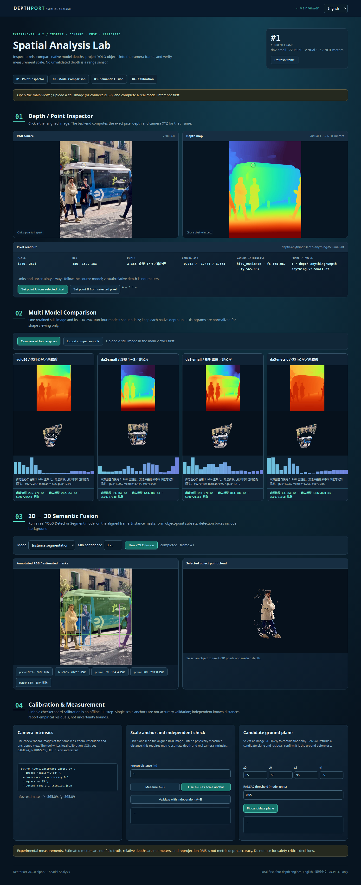
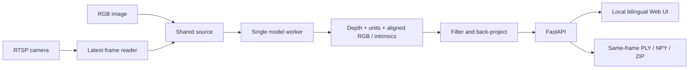

<div align="center">

# DepthPort

**Monocular depth & point cloud workbench**<br>
One camera · Four depth engines · Local-first

English · [繁體中文](README.zh-TW.md) · Experimental Alpha · AGPL-3.0-only

</div>

Turn RGB images and RTSP frames into interactive **single-view point clouds**. Compare depth engines, inspect visible-surface geometry, and review saved frames with Object IDs in one local web interface. DepthPort integrates existing pretrained models; its focus is the application workflow, aligned data and inspectable exports.

**Download v0.3.0-alpha.2:** [Release notes](https://github.com/JShengP/depthport/releases/tag/v0.3.0-alpha.2) · [Source ZIP](https://github.com/JShengP/depthport/releases/download/v0.3.0-alpha.2/depthport-0.3.0-alpha.2-source.zip) · [SHA-256](https://github.com/JShengP/depthport/releases/download/v0.3.0-alpha.2/SHA256SUMS.txt)

[Quick start](#quick-start) · [Versions](#versions) · [Features](#features) · [Validation & limits](#validation-and-limits) · [Documentation](#documentation)

> [!IMPORTANT]
> **Experimental development preview.** Session storage is off by default. Long-occlusion recovery, physical RTSP, Windows pretrained inference/worker integration, endurance and calibrated distance accuracy remain open. [Validation record](docs/en/validation.md)

## Real replay example

<p align="center">
  
</p>

*Actual Session UI with real YOLO26n + isolated BoT-SORT output; Traditional Chinese interface. Footage: [Lukas Kosc via Pexels](https://www.pexels.com/video/urban-street-scene-with-people-crossing-34597902/), used in edited documentation under the [Pexels terms](https://www.pexels.com/terms-of-service/).*

[View all three frames, source attribution & exact conditions →](docs/en/tracking-replay-example.md)

This 24-frame example shows local Object IDs, crossing, partial occlusion and missing/new observations. It has no identity ground truth and does not establish long-occlusion recovery.

<details>
<summary>Frame timing and evidence boundaries</summary>

The image shows Session #12 = source frame 43 at 1.752 s. Source video is 23.976 fps; the worker advances fixed 30-Hz steps and UI 1× targets 5 saved frames/s. The example reused a documented CUDA environment, not a fresh installation of the complete current dependency recipe. These documentation additions are in main after Alpha.2; published release tags/downloads remain fixed. Raw video, full Session archives, notes and weights are not distributed.

</details>

## Quick start

Use a **fresh Python 3.11 or 3.12 environment**. The source download excludes Python dependencies and model weights. For NVIDIA GPUs, install a compatible CUDA PyTorch/torchvision pair in the app environment before the remaining dependencies. [Full installation guide](docs/en/installation.md)

**Windows** — run from the extracted or cloned repository:

```bat
RUN_WINDOWS.bat
```

**Ubuntu:**

```bash
bash RUN_UBUNTU.sh
```

Open [http://127.0.0.1:8000/](http://127.0.0.1:8000/). First setup creates `.venv-depthport`; first use of a model may download its weights. The installer also accepts Python 3.10, but optional-package availability needs separate verification.

- **Viewer** `/`: upload an image → wait for a result → select another engine → **Apply / retry model**. The retained image is reprocessed. The Python host must be able to reach an RTSP source.
- **Spatial Analysis** `/spatial`: inspect depth/XYZ, compare engines and explore semantic fusion.
- **Sessions** `/sessions`: explicitly set `ENABLE_SESSION_STORAGE=1` locally and restart to enable manual saved-frame review. [Session guide](docs/en/sessions.md) · [Optional worker setup](docs/en/tracking-worker.md)

<details>
<summary>Try the synthetic viewer without installing AI dependencies</summary>

[Open the public synthetic demo](https://jshengp.github.io/depthport/), or build it locally with Python's standard library:

```bash
python tools/build_site.py
python -m http.server 8765 --directory _site --bind 127.0.0.1
```

Open [http://127.0.0.1:8765/](http://127.0.0.1:8765/). This static demo uses synthetic data; it does not run depth models, accept images or connect to RTSP. The included manual Pages workflow deploys the same synthetic-only viewer.

</details>

## Versions

Each generation retains the earlier foundation. The separate guides explain **changes, architecture, contents and validation boundaries**.

- **[v0.1 · Viewer](docs/versions/v0.1/README.md)** — images/RTSP, four depth engines, interactive point clouds and same-frame exports.
- **[v0.2 · Spatial Analysis](docs/versions/v0.2/README.md)** — pixel XYZ, engine comparison, semantic fusion and calibration/error tools.
- **[v0.3 · Sessions & Tracking](docs/versions/v0.3/README.md)** — manual local archives, replay, Object IDs, isolated BoT-SORT and bookmark review. Experimental Alpha.

<details>
<summary>Compare version workflows — generated schematic</summary>


*Illustrative workflows, not UI screenshots, inference results or benchmark evidence.*

</details>

<details>
<summary>Release history and main documentation</summary>

Alpha.2 packages reviewed Pages/FastAPI/Hub/DA3 compatibility updates and version workflow illustrations; publishing it added no inference or hardware acceptance. Main may include newer documentation. Tags, original version READMEs and published packages remain fixed at their release snapshots and checksums.

Previous packages: [v0.3.0-alpha.1](https://github.com/JShengP/depthport/releases/tag/v0.3.0-alpha.1) · [v0.2 Alpha](https://github.com/JShengP/depthport/releases/tag/v0.2.0-alpha.1) · [Changelog](CHANGELOG.md)

</details>

## Features

### Viewer & data

- **Four depth engines:** YOLO26 Depth, Depth Anything V2 Small, DA3-Small and DA3Metric-Large; one loaded model at a time, with no backend restart to switch.
- **Images, RTSP & interactive 3D:** latest-frame processing, orbit/zoom/pan, colouring, point size and display-only stretch. WebGL has a Canvas2D fallback.
- **Traceable exports:** same-frame PLY, float32 NPY, original model output, aligned RGB and model/unit metadata. English/Traditional Chinese UI, with browser language persistence or `?lang=en` / `?lang=zh-TW`; language does not change data/API fields. Upstream diagnostics retain their original language.

<details>
<summary>Original viewer screenshot — synthetic data</summary>


*Actual UI with explicitly synthetic data; no camera or AI model produced this point cloud.*

</details>

### Spatial Analysis

Inspect raw depth/camera-space XYZ, compare four engines sequentially on one image, fuse optional YOLO Detect/Segment instances with aligned points, and use checkerboard calibration, candidate-plane fitting and independent metric-error tools. Depth/model operations stay serialized in one worker.

[Spatial Analysis guide](docs/en/spatial-analysis.md) · [Models & geometry](docs/en/models-and-geometry.md)

<details>
<summary>Spatial Analysis screenshot — real single-image CUDA inference</summary>



*Real pretrained inference on the public [Ultralytics bus example](https://github.com/ultralytics/assets/blob/53d4e2a8fd15f473c29a148c317a8477be559327/im/bus.jpg). This is not a physical IP-camera capture or distance-accuracy benchmark. [Screenshot provenance](docs/assets/README.md)*

</details>

### Sessions & tracking review

- **Opt-in manual capture:** same-frame RGB/depth/PLY/raw NPY, SHA-256 integrity checks and offline replay; no automatic recording or inference during replay.
- **Review controls:** Object ID overlays, playback/speed/timeline, A/B loops, searchable bookmark notes/tags, JSON backup and guarded keyboard help. Notes and exports stay local.
- **Optional isolated BoT-SORT:** NumPy 2 worker separate from the NumPy 1 application. **Simple association stays default.** IDs are local associations, not identities or world trajectories.

[Session guide](docs/en/sessions.md) · [Worker setup](docs/en/tracking-worker.md) · [Tracking evaluation](docs/en/tracking-evaluation.md)

### Depth units

Estimated metres, relative depth and V2's virtual 1–5 display geometry remain distinct. Raw model output is retained separately. V2's per-frame mapping can change shape/scale; its XYZ must not be compared numerically with metric-model output.

<details>
<summary>Engine keys, checkpoints and geometry semantics</summary>

| Engine key | Default checkpoint | Geometry in this app |
|---|---|---|
| `yolo26` | `yolo26n-depth.pt` | API-provided estimated meters; field scale is unverified |
| `da2-small` | `depth-anything/Depth-Anything-V2-Small-hf` | **Virtual 1–5 display depth**, derived from relative scores; not meters |
| `da3-small` | `depth-anything/DA3-SMALL` | Raw positive relative depth; not meters |
| `da3-metric` | `depth-anything/DA3METRIC-LARGE` | Estimated meters using processed focal length / 300 |

[Model and geometry guide](docs/en/models-and-geometry.md) · [Upstream sources and licenses](THIRD_PARTY_NOTICES.md)

</details>

## Validation and limits

- **CI:** Ubuntu/Windows × Python 3.11/3.12 application contracts and real model API installation/import checks. CI uses no pretrained weights or inference and does not establish hardware or accuracy acceptance.
- **Real examples:** dated v0.2 single-image CUDA evidence and the short v0.3 replay example have separate source/runtime records. [Validation history](docs/en/validation.md) · [Replay conditions](docs/en/tracking-replay-example.md)
- **Still open:** generalised long-occlusion/crossing/camera-motion reliability, physical RTSP, Windows pretrained inference/real worker integration, endurance/VRAM, NVIDIA hardware WebGL and independently calibrated distance accuracy. [Acceptance roadmap](ROADMAP.md)

<details>
<summary>Tracking studies and next experiments</summary>

Completed studies cover [2,700 frames / 27 runs](docs/en/tracking-expanded-acceptance.md), [1,179 new frames / 60 parameter runs](docs/en/tracking-parameter-acceptance.md), [ID-switch/false-positive diagnosis](docs/en/tracking-error-diagnosis.md), [72 confirmation/competition runs with fresh 8.4.176 caches](docs/en/tracking-admission-acceptance.md), and [16 exact-output association-cost reruns](docs/en/tracking-association-diagnosis.md) on the same 09/10 scenes. Longer confirmation trades FP for FN/lower identity scores; birth veto never triggers. Cost diagnosis identified ByteTrack missed-hypothesis weak-stage competition, with observed same-GT recovery risk. The [new MOT20-01 deferral control](docs/en/tracking-recovery-acceptance.md) passes its frozen research screen (FP −3, FN −102, IDSW −8), but recall remains 13.98%, fragmentation increases and no long-event endpoint pair is complete. [Unchanged moving-camera replication](docs/en/tracking-recovery-moving.md) adds 1,650 frames / 12 runs: FP −8, FN/IDSW unchanged, but bus-view HOTA slightly regresses and no long-event recovery improves, so the per-scene screen fails. [History diagnosis](docs/en/tracking-recovery-history.md) now separates below-gate retained states, CLEAR continuity and low-localisation HOTA losses; all flagged competitors were already assigned elsewhere. [Separate occupancy/equivalent-assignment controls](docs/en/tracking-exclusive-competition.md) use a fresh cache on a previously studied 1,050-frame static scene / 12 runs. Both new controls have zero vetoes and equal reference; legacy adds six misses, with FP unchanged. [GT-free exposure discovery/confirmation](docs/en/tracking-exposure-selection.md) now covers all 16 frozen sources / 17,984 frames: availability triggers only in discovery; equivalent assignment and both reserved scenes remain unexposed. Independent exposure and broader acceptance stay open; **defaults stay unchanged**.

[Frozen analysis of all 197 reference alternatives](docs/en/tracking-competition-structure.md) separates local gaps, global opportunity costs and accepted-update displacement. Exact optimizer ties are not validated identity ambiguity; next examine component-level temporal stability without fitting a new tolerance. Weak continuation and defaults remain unchanged.

[Frozen risk groups and temporal support](docs/en/tracking-temporal-support.md) retain all eight structural groups and all unknown states: next-frame support is 114 gate / 19 signed-gap / 69 selected-no-update. No temporal veto or fitted duration is introduced; the next candidate uses past accepted observations with explicit active/retained roles and update protection.

These results apply to the named public sequences, fixed caches and recorded versions, not newer detector profiles or other scenes. Only aggregates are distributed for these studies, without raw frames, GT, per-frame tracks or user bookmarks.

</details>

<details>
<summary>Run a separate real-inference check</summary>

After installation, stop the running app and use your own shareable image:

```powershell
# Windows
.\.venv-depthport\Scripts\python.exe check_env.py --all --image camera.jpg
```

```bash
# Ubuntu
.venv-depthport/bin/python check_env.py --all --image camera.jpg
```

Only a real successful model call prints `REAL_INFERENCE: PASS`. Failure is an error, never synthetic replacement data. PASS means the pipeline ran—not that its distance estimates are accurate. Use `--engine da2-small` to check just V2. Without `--image`, this command checks API imports only.

</details>

The app estimates visible-surface **2.5D**, not hidden surfaces, 360° reconstruction, SLAM, temporal fusion or certified safety distances. Fixed-camera frames do not add a new viewpoint; no tested FPS, VRAM budget or distance accuracy is claimed. [Benchmarking method](docs/en/benchmarking.md)

The backend has **one shared source/model**, defaults to localhost and has no login or tenant isolation. Keep it local; never commit private camera images, exports, credentials, weights or calibration. [Security policy](SECURITY.md)

## Documentation

- **Use:** [Installation / GPU / offline mode](docs/en/installation.md) · [Usage & troubleshooting](docs/en/usage.md) · [Sessions](docs/en/sessions.md)
- **Understand:** [Models & geometry](docs/en/models-and-geometry.md) · [Architecture & API](docs/en/architecture.md) · [Tracking evaluation](docs/en/tracking-evaluation.md)
- **Follow progress:** [Roadmap](ROADMAP.md) · [Changelog](CHANGELOG.md) · [Release notes](docs/releases/0.3.0-alpha.2.md)

<details>
<summary>Application architecture overview</summary>



[Architecture and API contract](docs/en/architecture.md)

</details>

<details>
<summary>Develop, test and contribute</summary>

```bash
python -m pip install -r requirements-base.txt -r requirements-test.txt
# Install a suitable torch separately; some adapter-contract tests use real CPU tensors.
python -m pytest -q
node tests/test_i18n.cjs
python tools/check_release.py
```

[Application CI](https://github.com/JShengP/depthport/actions/workflows/ci.yml) runs deterministic model-double/CPU tensor contracts. [Model compatibility CI](https://github.com/JShengP/depthport/actions/workflows/model-compatibility.yml) installs the explicit dependency recipe and imports all four actual APIs. Neither downloads pretrained weights nor runs inference; passing CI is **not hardware or accuracy acceptance**.

[Tracking Acceptance & Evaluation](docs/en/tracking-evaluation.md) · [Contributing](CONTRIBUTING.md) · [Roadmap](ROADMAP.md) · [Changelog](CHANGELOG.md) · [Release checklist](docs/en/publishing.md)

</details>

## License & acknowledgments

DepthPort application code is provided under **AGPL-3.0-only**; see [LICENSE](LICENSE) and [NOTICE](NOTICE). External code and weights retain their own licenses; this project cannot relicense them. Ultralytics offers AGPL and a separate Enterprise route. The selected V2 Small / DA3 Small / DA3Metric checkpoints have Apache-2.0 model cards; other sizes may differ.

Credit belongs to the [Ultralytics](https://docs.ultralytics.com/tasks/depth/), [Depth Anything V2](https://github.com/DepthAnything/Depth-Anything-V2) and [Depth Anything 3](https://github.com/ByteDance-Seed/Depth-Anything-3) authors for their models and research. DepthPort is independent and is not endorsed by these projects. See the [third-party notices](THIRD_PARTY_NOTICES.md) before redistribution or commercial integration.
