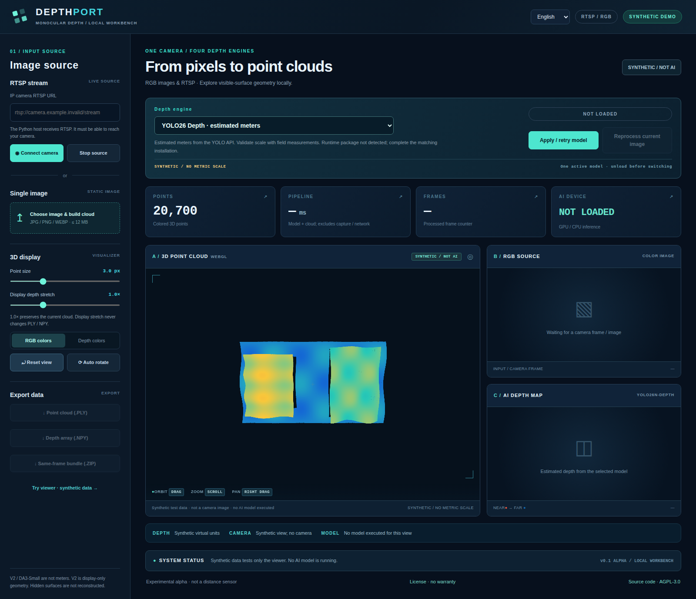
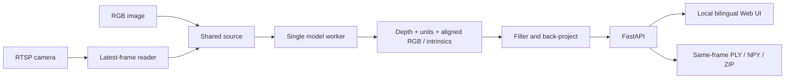

<div align="center">

# DepthPort
### Monocular depth & point cloud workbench

**One camera. Four depth engines. A new perspective.**

English · [繁體中文](README.zh-TW.md)

**Experimental 0.2 alpha** · **Local-first** · **English / 繁體中文** · **AGPL-3.0-only**

</div>

Turn RGB images and RTSP camera frames into interactive, **single-view point clouds**. Switch depth engines, inspect visible-surface geometry, and export the data behind the visualization—all in one local web interface.

DepthPort integrates existing pretrained models; it does **not** introduce a new depth network. Its contribution is the model lifecycle, stream handling, explicit depth semantics, aligned geometry, browser interaction and inspectable exports.



*Screenshot: the actual UI showing synthetic test data. No camera or AI model produced this point cloud.*

> **Status:** source-release alpha, not a production or metrology system. Automated tests validate application contracts, geometry and UI behavior; they do not prove pretrained-model inference. Real-model runs, fresh installation on target systems, CUDA, physical cameras and depth accuracy are not yet validated. Read the [validation record](docs/en/validation.md).

## New in v0.2 — Spatial Analysis Lab

Open **[Spatial Analysis](/spatial)** on a running local server (`http://127.0.0.1:8000/spatial`): clickable camera-space XYZ / raw depth inspector, sequential four-engine still-image comparison with native-unit histograms and 3D previews, optional YOLO26 Detect/Segment instance-to-point fusion, and pinhole checkerboard calibration / candidate plane fitting / independent metric-error checks. The original viewer, four depth engines, image/RTSP input, exports and bilingual UI remain available. Analysis is a single-worker experimental feature: **models/RTSP/hardware have not been physically validated**.

[English implementation & acceptance](docs/en/spatial-analysis.md) · [繁體中文實作與驗收](docs/zh-TW/spatial-analysis.md)

## What you can explore

- **Four selectable engines:** YOLO26 Depth, Depth Anything V2 Small, DA3-Small and DA3Metric-Large. One loaded engine at a time; no backend restart to switch.
- **Images and RTSP:** retain an uploaded image for sequential comparisons, or process the latest camera frame without a growing application queue.
- **Interactive 3D:** orbit, zoom, pan, recolor, adjust point size, and change display-only depth stretch. WebGL with a Canvas2D fallback.
- **Traceable data:** PLY, float32 NPY, raw model output, aligned RGB, model identifiers and unit metadata in a same-frame ZIP.

English and Traditional Chinese are available in the top-right language menu. The choice persists in the browser; `?lang=en` or `?lang=zh-TW` explicitly selects a language. It does not affect model state, numeric output or API field names. Upstream diagnostic messages remain in their original language.

## Depth is not one interchangeable unit

| Engine key | Default checkpoint | Geometry in this app |
|---|---|---|
| `yolo26` | `yolo26n-depth.pt` | API-provided estimated meters; field scale is unverified |
| `da2-small` | `depth-anything/Depth-Anything-V2-Small-hf` | **Virtual 1–5 display depth**, derived from relative scores; not meters |
| `da3-small` | `depth-anything/DA3-SMALL` | Raw positive relative depth; not meters |
| `da3-metric` | `depth-anything/DA3METRIC-LARGE` | Estimated meters using processed focal length / 300 |

The app preserves model raw output separately. V2's display mapping is **not physical inversion** and may alter shape/scale between frames. Do not compare its XYZ numerically with metric-model output. [Model and geometry guide](docs/en/models-and-geometry.md) · [Upstream sources and licenses](THIRD_PARTY_NOTICES.md)

## Start locally

Use a **fresh Python 3.11 or 3.12 environment**. Python 3.10 is accepted by the installer, but availability of all optional dependencies must be checked. Do not reuse another project's virtual environment. Weights and Python packages are **not** included in this source repository.

**Windows** — from the extracted/cloned repository:

```bat
RUN_WINDOWS.bat
```

**Ubuntu**:

```bash
bash RUN_UBUNTU.sh
```

Open **http://127.0.0.1:8000/**. First setup creates `.venv-depthport`; first use of each model may download its weights. GPU users should install a compatible CUDA PyTorch/torchvision pair in that environment **before** installing the remaining dependencies.

Upload an image → wait for a real result → choose another engine → **Apply / retry model**. The retained image is automatically reprocessed. For RTSP, enter the camera's actual stream URL; the **Python host**, not the browser, must reach that camera.

[Installation, GPU, partial setup and offline mode](docs/en/installation.md) · [Usage and troubleshooting](docs/en/usage.md)

### Try the viewer without any AI dependency

Only Python's standard library is needed to build and serve the **synthetic static demo**:

```bash
python tools/build_site.py
python -m http.server 8765 --directory _site --bind 127.0.0.1
```

Open **http://127.0.0.1:8765/**. Image inference and RTSP controls are intentionally disabled. The same files can be published to GitHub Pages using the included, manually triggered workflow. This is not a hosted AI service.

## Verify real inference separately

After installation, stop the running app and use your own shareable image:

```powershell
# Windows
.\.venv-depthport\Scripts\python.exe check_env.py --all --image camera.jpg
```

```bash
# Ubuntu
.venv-depthport/bin/python check_env.py --all --image camera.jpg
```

Only a real successful model call prints `REAL_INFERENCE: PASS`. Failure is an error, never synthetic replacement data. PASS means the pipeline ran—not that its distance estimates are accurate. Use `--engine da2-small` to check just V2. Without `--image`, this command checks API imports only.

## Architecture



[Architecture and API contract](docs/en/architecture.md)

## Scope and limitations

This is visible-surface **2.5D**, not 360° scanning, hidden-surface reconstruction, SLAM, temporal fusion or a safety-distance sensor. Fixed-camera frames do not provide a new geometric viewpoint. No tested FPS, VRAM budget or distance accuracy is claimed. [How to record a fair benchmark](docs/en/benchmarking.md)

The app has **one shared source and model**, not per-browser sessions. Default binding is localhost; there is no login, tenant isolation or production security boundary. Do not expose this backend to the Internet. Do not commit credentials, camera images, exports, weights or private calibration. [Security policy](SECURITY.md)

## Develop and contribute

```bash
python -m pip install -r requirements-base.txt -r requirements-test.txt
# Install a suitable torch separately; some adapter-contract tests use real CPU tensors.
python -m pytest -q
node tests/test_i18n.cjs
python tools/check_release.py
```

The CI workflow runs deterministic, fake-backed application tests without downloading pretrained weights. A passing CI badge is **not** a four-model hardware benchmark. No remote CI result is asserted by this repository snapshot.

[Public/private repository boundary](docs/en/public-private-boundary.md) · [Contributing](CONTRIBUTING.md) · [Roadmap](ROADMAP.md) · [Changelog](CHANGELOG.md) · [Release checklist](docs/en/publishing.md)

## License and acknowledgments

DepthPort application code is provided under **AGPL-3.0-only**; see [LICENSE](LICENSE) and [NOTICE](NOTICE). External code and weights retain their own licenses; this project cannot relicense them. Ultralytics offers AGPL and a separate Enterprise route. The selected V2 Small / DA3 Small / DA3Metric checkpoints have Apache-2.0 model cards; other sizes may differ.

Credit belongs to the [Ultralytics](https://docs.ultralytics.com/tasks/depth/), [Depth Anything V2](https://github.com/DepthAnything/Depth-Anything-V2) and [Depth Anything 3](https://github.com/ByteDance-Seed/Depth-Anything-3) authors for their models and research. DepthPort is independent and is not endorsed by these projects. See the [third-party notices](THIRD_PARTY_NOTICES.md) before redistribution or commercial integration.
