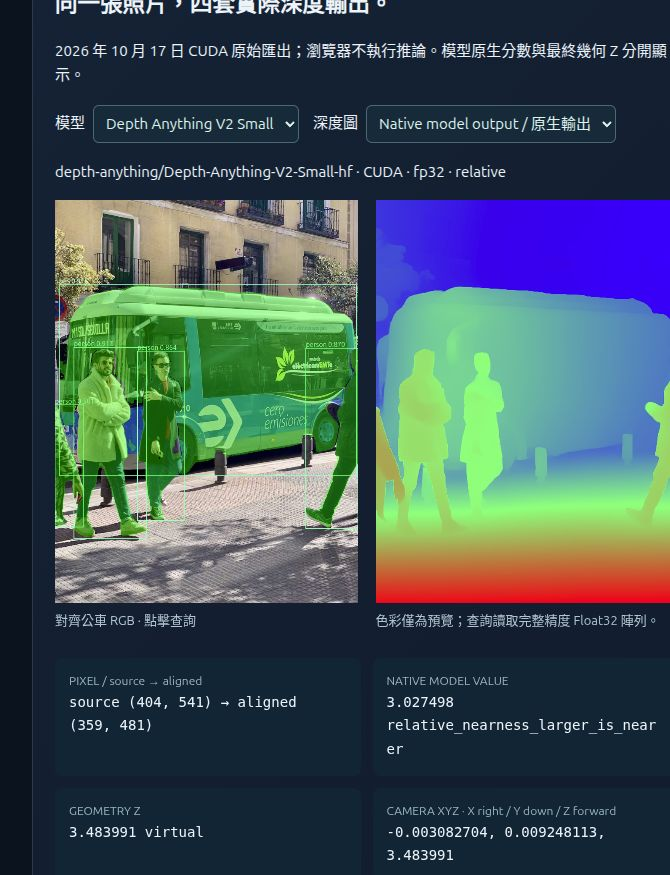
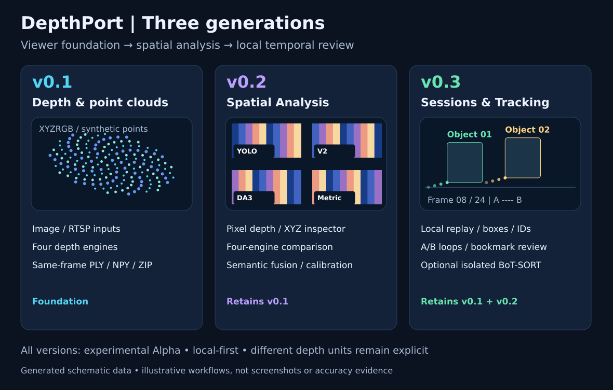
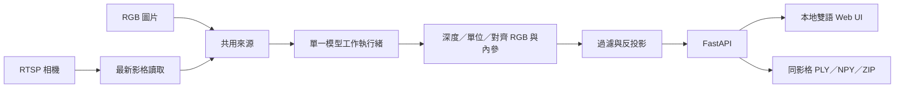

<div align="center">

# DepthPort

**單目深度與點雲工作台**<br>
一支相機 · 四種深度引擎 · 本地執行

[English](README.md) · 繁體中文 · 實驗性 Alpha · [GNU AGPL v3](LICENSE)

</div>

將 RGB 圖片與 RTSP 影格轉成可互動的**單視角點雲**。在同一個本地 Web 介面切換深度模型、檢查可見表面幾何，並透過 Object ID 回看已存影格。DepthPort 整合既有預訓練模型，著重應用流程、資料對齊與可檢查的匯出。

**下載 v0.3.0-alpha.2：** [Release 說明](https://github.com/JShengP/depthport/releases/tag/v0.3.0-alpha.2) · [原始碼 ZIP](https://github.com/JShengP/depthport/releases/download/v0.3.0-alpha.2/depthport-0.3.0-alpha.2-source.zip) · [SHA-256 校驗檔](https://github.com/JShengP/depthport/releases/download/v0.3.0-alpha.2/SHA256SUMS.txt)

[快速開始](#快速開始) · [版本導覽](#版本導覽) · [功能](#功能) · [驗證與限制](#驗證與限制) · [文件與開發](#文件與開發)

> [!IMPORTANT]
> **實驗性開發預覽。** Session 儲存預設關閉；長遮擋恢復、實體 RTSP、Windows 真權重／worker 整合、長時穩定性與標定距離精度仍待驗證。[驗證紀錄](docs/zh-TW/validation.md)

**測試結果總覽：** [Results Index](https://jshengp.github.io/depthport/results/?lang=zh-TW) — 依模型、追蹤器與平台查看實測、CI、未通過與未驗證項目。

## 真實資料互動展示

點擊截圖即可開啟**保存結果的互動網站**。圖中是目前 Pages 的實際介面，不是新的即時推論，也不代表歷史 Alpha 已完成驗收。

<p align="center">
  <a href="https://jshengp.github.io/depthport/v0.1/?lang=zh-TW"></a>
  <a href="https://jshengp.github.io/depthport/v0.2/?lang=zh-TW"></a>
  <a href="https://jshengp.github.io/depthport/v0.3/?lang=zh-TW"></a>
</p>

**[v0.1 · 旋轉真實點雲](https://jshengp.github.io/depthport/v0.1/?lang=zh-TW)** · **[v0.2 · 查詢原生深度／XYZ／遮罩](https://jshengp.github.io/depthport/v0.2/?lang=zh-TW)** · **[v0.3 · 播放真實追蹤結果](https://jshengp.github.io/depthport/v0.3/?lang=zh-TW)**

公車畫面沿用 [Ultralytics bus.jpg](https://github.com/ultralytics/assets/blob/53d4e2a8fd15f473c29a148c317a8477be559327/im/bus.jpg) 的原始四模型 CUDA 匯出。點雲圖為 **DA3 Metric Large**；檢查器為 **V2 原生相對接近度＋最終虛擬 Z**，搭配新執行的真 YOLO 遮罩。內參由 65° HFOV 估計，未經實測標定；相對／虛擬深度不是公尺，估計公尺也不等於已驗證物理距離。此後續展示不回填為 v0.1 歷史驗收。

**兩次追蹤執行分開呈現，不混用 ID 與數量：**

- **目前 Pages 新執行，2026-10-20：9 IDs／209 筆偵測／152 筆關聯／57 筆未關聯**，YOLO26n **8.4.115**。原 Session 未找回，因此以相同雜湊影片與來源影格 32–55 重跑。圖中保存 #12＝來源 #43，1.751750 秒；`obj-0005` 在此格沒有觀測，Z／XYZ 留白，歷史保留缺口。
- **先前截圖執行，2026-10-19：7 IDs／230 筆偵測／125 筆關聯／105 筆未關聯**，YOLO26n **8.4.176**。[原三張截圖與條件](docs/zh-TW/tracking-replay-example.md)保持不變；不同執行中同名 ID 不代表相同物件，不把兩次數量差異解讀為受控精度比較。

影片來源：**[Lukas Kosc／Pexels](https://www.pexels.com/video/urban-street-scene-with-people-crossing-34597902/)**，保留[自身條款](https://www.pexels.com/terms-of-service/)，不因程式 AGPL 改授權或暗示背書。兩次片段都僅 **0.959 秒**、沒有身分 GT，不代表長遮擋、換 ID 正確性或追蹤精度已通過；未關聯不等於真值漏檢。V2 逐格虛擬深度與 Camera XYZ 不是世界軌跡或速度。Pages 只讀靜態保存結果，不提供線上模型推論、私人 Session 或 RTSP 接入。

[完整來源、原生單位與限制](docs/zh-TW/real-ai-pages.md) · [截圖狀態與雜湊](docs/validation/readme-real-pages.json) · [展示進度與下一步](ROADMAP.md#current-pages--目前互動展示)

## 快速開始

使用**全新的 Python 3.11 或 3.12 環境**。原始碼下載不含 Python 依賴與模型權重；NVIDIA GPU 請先在應用環境安裝相容的 CUDA PyTorch／torchvision，再裝其他依賴。[完整安裝指南](docs/zh-TW/installation.md)

**Windows** — 在解壓縮或 clone 後的專案資料夾執行：

```bat
RUN_WINDOWS.bat
```

**Ubuntu：**

```bash
bash RUN_UBUNTU.sh
```

開啟 [http://127.0.0.1:8000/](http://127.0.0.1:8000/)。首次設定會建立 `.venv-depthport`，各模型首次使用可能需要下載權重。安裝器也接受 Python 3.10，但選配套件可用性需另行確認。

- **主檢視器** `/`：上傳圖片 → 等待結果 → 選擇另一模型 → **套用模型／重試載入**；程式重跑保留的原圖。RTSP 來源需能從 Python 後端主機連線。
- **空間分析** `/spatial`：檢查深度／XYZ、比較模型與語意融合。
- **工作階段** `/sessions`：在本機明確設定 `ENABLE_SESSION_STORAGE=1` 並重啟，再啟用手動保存與回放。[Session 操作](docs/zh-TW/sessions.md) · [選配 worker 安裝](docs/zh-TW/tracking-worker.md)

<details>
<summary>不安裝 AI，體驗真實記錄範例與合成互動練習</summary>

[開啟多版本展示網站](https://jshengp.github.io/depthport/)：v0.1／v0.2 共用同一張 bus.jpg 的四模型 Float32 真實深度、互動 XYZRGB 與 YOLO 遮罩；v0.3 提供來源影格 32–55 的 24 格真實追蹤新執行回放、ID 及深度歷史，另保留舊三張截圖與合成練習。[資料來源、雜湊與限制](docs/zh-TW/real-ai-pages.md)。用 Python 標準函式庫建立：

```bash
python tools/build_site.py
python -m http.server 8765 --directory _site --bind 127.0.0.1
```

開啟 [http://127.0.0.1:8765/](http://127.0.0.1:8765/)。GitHub Pages 使用經確認來源的公開素材，另保留明確標示的合成互動練習；不執行 AI 模型、不接收訪客上傳或 RTSP。數值來自經審查的靜態資料包；完整 NPY／PLY、原影片、權重與私人 Session 保留本機。Website 在經審核的變更合併至 `main` 後自動部署。

</details>

## 版本導覽

各版延續前一代基礎；分版 README 說明**差異、架構、功能內容與驗證界線**。

- **[v0.1 · 深度與點雲檢視器](docs/versions/v0.1/README.md)** — 圖片／RTSP、四模型、互動點雲及同影格匯出。
- **[v0.2 · 空間分析](docs/versions/v0.2/README.md)** — 像素 XYZ、模型比較、語意融合及標定／誤差工具。
- **[v0.3 · Session 與追蹤回放](docs/versions/v0.3/README.md)** — 手動本機封存、回放、Object ID、獨立 BoT-SORT 與書籤檢查，維持實驗性 Alpha。

<details>
<summary>展開各版流程比較圖 — 程式生成示意</summary>



*功能流程示意圖，不是實際介面截圖、推論結果或效能驗收。*

</details>

<details>
<summary>版本歷程與 main 文件</summary>

Alpha.2 封裝已驗證的 Pages／FastAPI／Hub／DA3 相容性更新與各版流程圖，發布本身沒有新增推論或實機驗收。main 可包含較新的文件；Tag、各版原始 README 與下載包固定在對應發行快照，請依該版校驗檔核對。

先前封裝：[v0.3.0-alpha.1](https://github.com/JShengP/depthport/releases/tag/v0.3.0-alpha.1) · [v0.2 Alpha](https://github.com/JShengP/depthport/releases/tag/v0.2.0-alpha.1) · [Changelog](CHANGELOG.md)

</details>

## 功能

### 檢視器與資料

- **四套深度引擎：** YOLO26 Depth、Depth Anything V2 Small、DA3-Small、DA3Metric-Large；一次載入一個活動模型，切換不需重啟後端。
- **圖片、RTSP 與互動 3D：** 最新影格處理、旋轉／縮放／平移、著色、點大小與僅供展示的深度拉伸。WebGL 另有 Canvas2D 備援。
- **可追溯匯出：** 同影格 PLY、float32 NPY、原始模型輸出、對齊 RGB 與模型／單位資訊。英文／繁中選擇保留在瀏覽器，也可用 `?lang=en`／`?lang=zh-TW`；不改變資料與 API 欄位，上游診斷保留原文。

<details>
<summary>目前 Pages 點雲互動 — 真實保存資料</summary>

[](https://jshengp.github.io/depthport/v0.1/?lang=zh-TW)

*旋轉／縮放／平移保存的模型幾何。估計公尺與 HFOV 內參未經標定；後續展示不算歷史 v0.1 驗收。[原合成截圖](docs/assets/preview.zh-TW.png)另作參考。*

</details>

### 空間分析

檢查原始深度／相機座標 XYZ、同圖四模型依序比較、選配 YOLO 偵測／分割與對齊點雲融合，以及棋盤格標定、候選平面與獨立量測誤差工具。深度與模型操作維持單一 worker 依序執行。

[空間分析指南](docs/zh-TW/spatial-analysis.md) · [模型與幾何](docs/zh-TW/models-and-geometry.md)

<details>
<summary>目前 Pages 檢查器 — 真實深度、XYZ 與 YOLO 遮罩</summary>

[](https://jshengp.github.io/depthport/v0.2/?lang=zh-TW)

*直接查詢 Float32，不從預覽色彩反推。V2 最終幾何採虛擬 1–5，內參為 HFOV 估計。[歷史 v0.2 CUDA 截圖](docs/assets/spatial-preview.zh-TW.png)保持不變。*

</details>

### Session 與追蹤檢查

- **選用手動封存：** 同影格 RGB／深度／PLY／原始 NPY、SHA-256 完整性檢查與離線回放；不自動錄影，回放不重跑推論。
- **檢查工具：** Object ID 疊圖、播放／速度／進度條、A/B 循環、書籤備註／標籤／搜尋、JSON 備份與輸入防誤觸快捷鍵。備註與匯出留在本機。
- **選配獨立 BoT-SORT：** NumPy 2 worker 與 NumPy 1 應用隔離；**預設仍為簡易關聯**。ID 代表局部關聯，不是身分或世界軌跡。

[Session 操作](docs/zh-TW/sessions.md) · [worker 安裝](docs/zh-TW/tracking-worker.md) · [追蹤驗收評估](docs/zh-TW/tracking-evaluation.md)

### 深度單位

估計公尺、相對深度與 V2 的 1～5 虛擬展示幾何分開處理，原始模型輸出另存。V2 的逐影格映射可能改變形狀／尺度，不可把其 XYZ 與公尺模型直接數值比較。

<details>
<summary>引擎 key、預設權重與幾何語義</summary>

| 引擎 key | 預設權重 | 本程式建立的幾何 |
|---|---|---|
| `yolo26` | `yolo26n-depth.pt` | 保留 API 估計公尺，現場尺度未驗證 |
| `da2-small` | `depth-anything/Depth-Anything-V2-Small-hf` | 相對分數映射為 **1～5 虛擬展示深度**，不是公尺 |
| `da3-small` | `depth-anything/DA3-SMALL` | 保留正的原始相對深度，不是公尺 |
| `da3-metric` | `depth-anything/DA3METRIC-LARGE` | 依處理後焦距／300 換算估計公尺 |

[模型與幾何說明](docs/zh-TW/models-and-geometry.md) · [上游來源與授權](THIRD_PARTY_NOTICES.md)

</details>

## 驗證與限制

- **CI：** Ubuntu／Windows × Python 3.11／3.12 的應用契約與真模型 API 安裝／匯入；不含預訓練權重或推論，不等於實機或精度驗收。
- **真實範例：** 已記錄日期的 v0.2 單圖 CUDA 與 v0.3 短片回放各有獨立來源／環境條件。[驗證歷程](docs/zh-TW/validation.md) · [回放條件](docs/zh-TW/tracking-replay-example.md)
- **Pages 相容性：** 確切 Linux Chrome155／Edge155／Firefox157 build 分別完成[原生有視窗](docs/zh-TW/pages-headed-browsers.md)與[無頭](docs/zh-TW/pages-standalone-browsers.md)驗證，各模式 B01–B07 通過、共21通過／3未測；模式不重複算瀏覽器，唯一矩陣仍33通過／31未測。原失敗保留，Safari、實體手機、其他 OS／build 及自然備援路徑仍待驗證。
- **仍待驗證：** 長遮擋／交會／移動相機的泛化追蹤、實體 RTSP、Windows 真權重／真 worker 整合、長時 VRAM／穩定性、NVIDIA 硬體 WebGL 與獨立標定距離精度。[驗收路線圖](ROADMAP.md)

<details>
<summary>追蹤研究與下一步實驗</summary>

已完成 [2,700 格／27 次比較](docs/zh-TW/tracking-expanded-acceptance.md)、[另一組 1,179 格／60 次參數驗證](docs/zh-TW/tracking-parameter-acceptance.md)、[換 ID／誤追診斷](docs/zh-TW/tracking-error-diagnosis.md)、[8.4.176 快取的 72 次確認／競爭實驗](docs/zh-TW/tracking-admission-acceptance.md)，以及[同一組 09／10 場景的 16 次原輸出不變成本診斷](docs/zh-TW/tracking-association-diagnosis.md)。延長確認的 FP／FN 取捨與出生閘門未觸發保留；診斷選出的控制點為 ByteTrack 漏格假設的弱階段競爭，已觀察到同 GT 恢復風險，[新 MOT20-01 延後接回實驗](docs/zh-TW/tracking-recovery-acceptance.md)通過凍結研究篩選（FP −3、FN −102、換 ID −8），但召回僅 13.98%、碎裂增加，長事件無完整端點；[移動相機不調參重驗](docs/zh-TW/tracking-recovery-moving.md)另測 1,650 格／12 次：FP −8、FN／換 ID 不變，但公車 HOTA 微降、長事件無改善，未通過逐場景篩選；[歷史診斷](docs/zh-TW/tracking-recovery-history.md)再區分保留假說低於閘門、CLEAR 連續性及低定位框 HOTA 損失，[分開的占用／一對一替代控制](docs/zh-TW/tracking-exclusive-competition.md)另以先前研究場景的新快取測試 1,050 格／12 次：新控制都零觸發、等同對照，舊組多 6 筆漏追、FP 不變；[GT-free 曝光發現／確認](docs/zh-TW/tracking-exposure-selection.md)完整檢查 16 段／17,984 格，未配對組只在發現觸發，等價組與兩段保留皆無曝光；獨立重現與長遮擋尚未驗收，**原預設不變**。

[197 個參考替代的凍結分析](docs/zh-TW/tracking-competition-structure.md)已拆開同欄差、完整機會成本與有效更新置換；數值平手尚不代表身分歧義。下一點為分量內跨格穩定性，不從已見差值挑新容差；弱偵測延續與預設不變。

[凍結風險分組與跨格支援](docs/zh-TW/tracking-temporal-support.md)保留八個結構組與全部未知：下一格支援為過門檻 114／有號差 19／原列未更新 69。不新增時間 veto 或擬合時長；下一候選只用過去已接受觀測，區分活躍／保留角色並保護更新置換。

[新KITTI來源的決策前支援／更新保護控制](docs/zh-TW/tracking-past-support.md)：978原格、四組×三次一致重複，零活躍替代／零veto，分數不變；傷害檢查通過，但有效曝光／品質未通過。下一步凍結不看GT的曝光選取及未見保留確認，不調參、不升預設。

[同規則GT-free曝光研究](docs/zh-TW/tracking-past-exposure.md)：完整16段已見MOT發現、三控制veto40／8／2，依序選09／10／MOT20-06。發現先封存才推論／追蹤未見KITTI0004／0005，兩段均零觸發；獨立曝光未驗證，不讀GT／分數、不調參或升預設，零值完整保留。

[凍結數值影子重播與獨立高階段指派稽核](docs/zh-TW/tracking-estimator-shadow.md)：611原格、六份完整參考JSON／原生輸出／最終狀態不變。四個首次異常均由不變的角點縮小速度外推，三個由最後接受更新引入、一個繼承；124操作與獨立副本相同，數值檢查失敗0。高階段四列矩形未配對、一列套gate後未接受；五條候選皆已占用，強制改配只置換更新對象，不增加接受數。0005無估計器曝光。不讀GT、不推論、不調參或新增介入；後續幾何控制如下，弱延續／預設保留。

[凍結預測幾何控制](docs/zh-TW/tracking-geometry-validity.md)：新組1,070原格＋已見機制611格／20次完整執行。0006投影一次保留確認列，非正預測9→0；0007雖有48次預測但投影0。逐場景代理傷害全通過、完整輸出不變，舊原生參考等於原封存；兩段新來源都需觸發的門檻 **未通過**，不宣稱恢復／身分效益或升預設。另凍結的實際投影曝光選取見下項，零值／失敗、弱延續與參數保留。

[GT-free幾何曝光選取](docs/zh-TW/tracking-geometry-exposure.md)：24段已見來源／20,643原格全保留；20段完成精確對照，四份早期Session包裝封存雖完整影格清單相同，仍未通過整檔位元組門檻。584次實際投影：活躍確認3／保留確認581／未確認0，依原順序選MOT17-12-DPM／09-DPM。不做新GT計分或調參，弱階段／預設不變；公開發現封存後才執行未見KITTI0008／0009，分別投影2／1次保留確認，非正8→0／3→0、完整輸出及重複相同；活躍／未確認曝光0，四個發現失敗保留，正式重現皆false。曝光研究不等於身分效益或真傷害驗收。

[只讀外層／角色後續稽核](docs/zh-TW/tracking-carrier-roles.md)：四份Session精確重建；681／678個未確認列皆活躍零速度seed，下一格高／弱升格或同格刪除，原生命週期下保留未確認投影被排除。四段缺歷史與原失敗仍未量測／失敗，不調參或升預設。

研究結果限指定公開序列、固定快取與已記錄版本，不能外推為新版偵測器或其他場景的表現。這些研究只散布彙總，不發布原始影像、GT、逐格追蹤或使用者書籤。

</details>

<details>
<summary>另外執行真模型推論檢查</summary>

完成安裝、停止網站後，使用自己有權處理的 `camera.jpg`：

```powershell
# Windows
.\.venv-depthport\Scripts\python.exe check_env.py --all --image camera.jpg
```

```bash
# Ubuntu
.venv-depthport/bin/python check_env.py --all --image camera.jpg
```

只有真模型呼叫成功才輸出 `REAL_INFERENCE: PASS`；失敗會報錯，**不以合成深度替代**。PASS 只表示鏈路執行完成，不代表距離準確。單測 V2 可加 `--engine da2-small`；不加 `--image` 時僅檢查 API 匯入。

</details>

應用只估計可見表面的 **2.5D**，不還原遮擋區域、不提供 360° 重建、SLAM、時間融合或認證安全測距。固定鏡頭影格不會增加幾何視角，目前不宣稱實測 FPS、VRAM 預算或距離精度。[公平量測方法](docs/zh-TW/benchmarking.md)

後端為**單一共用來源／模型**，預設 localhost，沒有登入或多人隔離；請保留本機使用，不提交私人相機影像、匯出、帳密、權重或標定資料。[安全政策](SECURITY.md)

## 文件與開發

- **操作：** [安裝／GPU／離線模式](docs/zh-TW/installation.md) · [使用與疑難排解](docs/zh-TW/usage.md) · [Session](docs/zh-TW/sessions.md)
- **原理：** [模型與幾何](docs/zh-TW/models-and-geometry.md) · [架構與 API](docs/zh-TW/architecture.md) · [追蹤驗收評估](docs/zh-TW/tracking-evaluation.md)
- **進度：** [Roadmap](ROADMAP.md) · [版本紀錄](CHANGELOG.md) · [Release 說明](docs/releases/0.3.0-alpha.2.md)

<details>
<summary>應用架構概覽</summary>



[架構與 API 契約](docs/zh-TW/architecture.md)

</details>

<details>
<summary>開發、測試與貢獻</summary>

```bash
python -m pip install -r requirements-base.txt -r requirements-test.txt
# 另裝相容的 torch；部分 adapter 契約測試使用真 CPU tensor。
python -m pytest -q
node tests/test_i18n.cjs
python tools/check_release.py
```

[應用 CI](https://github.com/JShengP/depthport/actions/workflows/ci.yml)執行確定性的替身／CPU tensor 契約測試；[模型相容性 CI](https://github.com/JShengP/depthport/actions/workflows/model-compatibility.yml)安裝明列依賴並匯入四套實際 API。兩者均不下載預訓練權重或執行推論，**不等於實機／精度驗收**。

[Tracking 驗收評估](docs/zh-TW/tracking-evaluation.md)・[貢獻指南](CONTRIBUTING.md)・[Roadmap](ROADMAP.md)・[版本紀錄](CHANGELOG.md)・[發布檢查](docs/zh-TW/publishing.md)

</details>

## 授權與致謝

DepthPort 應用程式碼採用 **GNU Affero General Public License v3.0**（**SPDX：`AGPL-3.0-only`**，僅限第 3 版，不含自動升級至後續版本的選項）；見 [LICENSE](LICENSE) 與 [NOTICE](NOTICE)。外部程式及權重保留各自授權，本專案不能替它們重新授權。Ultralytics 有 AGPL 與另行提供的 Enterprise 路線；本版選定的 V2 Small／DA3 Small／DA3Metric 模型卡標示 Apache-2.0，不代表其他尺寸也相同。

模型與研究成果歸屬 [Ultralytics](https://docs.ultralytics.com/tasks/depth/)、[Depth Anything V2](https://github.com/DepthAnything/Depth-Anything-V2)、[Depth Anything 3](https://github.com/ByteDance-Seed/Depth-Anything-3) 作者。DepthPort 是獨立專案，不代表上游背書。散布或商用整合前請閱讀[第三方聲明](THIRD_PARTY_NOTICES.md)。
