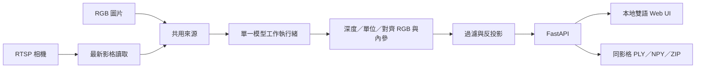

<div align="center">

# DepthPort
### 單目深度與點雲工作台

**一支相機。四種深度引擎。另一個觀察視角。**

[English](README.md) · 繁體中文

**v0.3 Alpha** · **實驗性開發預覽** · **本地執行** · **英文／繁體中文** · **AGPL-3.0-only**

</div>

**下載 v0.3.0-alpha.2：** [Release 說明與下載](https://github.com/JShengP/depthport/releases/tag/v0.3.0-alpha.2) · [原始碼 ZIP](https://github.com/JShengP/depthport/releases/download/v0.3.0-alpha.2/depthport-0.3.0-alpha.2-source.zip) · [SHA-256 校驗檔](https://github.com/JShengP/depthport/releases/download/v0.3.0-alpha.2/SHA256SUMS.txt)

前一個 v0.3 封裝：[v0.3.0-alpha.1](https://github.com/JShengP/depthport/releases/tag/v0.3.0-alpha.1)。前一代：[v0.2 Alpha — 空間分析](https://github.com/JShengP/depthport/releases/tag/v0.2.0-alpha.1)。版本歷程見 [Changelog](CHANGELOG.md)，後續驗收見[路線圖](ROADMAP.md)。

下載包僅含公開原始碼，Python 依賴與預訓練模型權重需另行安裝。

Alpha.2 納入已驗證的 Pages／FastAPI／Hub／DA3 相容性更新與各版流程圖；沒有新增推論或實機驗收。已發布套件固定在版本 Tag，下載時請以該 Release 的校驗檔為準。

## 版本導覽


*功能示意圖，並非實際介面截圖、模型推論結果或效能驗收。各版細節、架構與驗證界線見下方 README。*

各版延續前一版基礎；各自 README 分開說明差異、架構、功能內容與驗證限制：

- **[v0.1 — 深度與點雲檢視器](docs/versions/v0.1/README.md)：** 圖片／RTSP → 四深度模型 → 單視角點雲與匯出。
- **[v0.2 — 空間分析](docs/versions/v0.2/README.md)：** 新增像素 XYZ、模型比較、語意融合與標定／誤差工具。
- **[v0.3 — Session 與追蹤回放](docs/versions/v0.3/README.md)：** 新增手動本機封存、回放、Object ID、獨立 BoT-SORT 與書籤檢查，維持實驗性 Alpha。

v0.1／v0.2 的原始碼與原版 README 保留在各自 Tag；新的版本導覽整理差異，不改寫舊 Release。

將 RGB 圖片與 RTSP 相機影格轉成可互動的**單視角點雲**。在同一個本地 Web 介面切換深度模型、觀察可見表面的幾何，並匯出產生畫面所使用的數據。

DepthPort 整合既有預訓練模型，**不是新的深度網路或研究模型**。本專案的貢獻在於模型生命週期、串流處理、明確的深度語義、影像／內參對齊、瀏覽器操作與可檢查的資料匯出。


*截圖來自實際 UI 的合成測試資料；不是由相機或 AI 模型產生的點雲。*

> **狀態：** `v0.3.0-alpha.2` 是 **Alpha Pre-release／實驗性開發預覽**。Session 預設關閉，僅供本機明確啟用。應用與模型 API 安裝相容性 CI 不等於預訓練推論或實機驗收；長遮擋恢復、實體 RTSP、Windows 真權重／worker 整合、長時穩定性與標定距離精度仍待驗證。詳見[驗證紀錄](docs/zh-TW/validation.md)與[本版說明](docs/releases/0.3.0-alpha.2.md)。

## v0.3 — Session、回放與離線追蹤

- **手動、僅本機 Session：** 封存同影格 RGB／深度／PLY／原始 NPY，SHA-256 核對後回放；不自動錄影，回放不重新推論。
- **追蹤檢查：** 疊加追蹤框／Object ID，提供播放、速度、進度條、A／B 循環、書籤備註、搜尋／篩選、JSON 備份與快捷鍵說明。備註與匯出保留在本機。
- **選配 Roboflow BoT-SORT：** 使用獨立 NumPy 2 worker；應用維持 NumPy 1，預設仍是簡易關聯。Object ID 不代表身份辨識或世界座標軌跡。

依 [Session 操作說明](docs/zh-TW/sessions.md)在本機設定 `ENABLE_SESSION_STORAGE=1` 並重啟，再開啟 `/sessions`。[獨立 worker 安裝](docs/zh-TW/tracking-worker.md) · [追蹤驗收與評估](docs/zh-TW/tracking-evaluation.md)

### 真實追蹤回放範例


*實際 Session 介面的真 YOLO26n＋獨立 BoT-SORT 結果，非合成資料。素材：[Lukas Kosc／Pexels](https://www.pexels.com/video/urban-street-scene-with-people-crossing-34597902/)，依 [Pexels 條款](https://www.pexels.com/terms-of-service/)編入文件作品。Session #12＝來源第 43 格，1.752 秒。*

[三張連續影格導覽、來源授權及完整條件](docs/zh-TW/tracking-replay-example.md)。24 格範例呈現局部 ID、交會、部分遮擋與觀測消失／新 ID；無身分真值，不宣稱長遮擋恢復通過。來源 23.976 fps、worker 固定 30 Hz 步長、UI 1× 每秒 5 個保存影格。此文件於 Alpha.2 後補入 main，既有下載包不變。

### 追蹤研究證據與下一步

已完成[三場景 2,700 格／27 次比較](docs/zh-TW/tracking-expanded-acceptance.md)、[另一組 1,179 格／60 次參數驗證](docs/zh-TW/tracking-parameter-acceptance.md)及[新增換 ID／誤追診斷](docs/zh-TW/tracking-error-diagnosis.md)。降低啟用門檻的覆蓋改善伴隨更多換 ID／FP；長遮擋恢復仍未通過。下一步分開驗證新 ID 確認／競爭、偵測框品質與遮擋恢復。**維持原預設。**

以上為指定公開序列、固定偵測快取與已記錄版本的研究結果，不能直接外推至新版依賴或其他場景；僅公開彙總，未發布原始影像、GT、逐格追蹤與書籤資料。

## v0.2 延續功能 — 空間分析工作台

啟動本地服務後開啟 **http://127.0.0.1:8000/spatial**，可進行像素深度／XYZ 檢查、同圖四模型依序比較、YOLO 偵測／分割 2D→3D 融合，以及相機標定、候選平面與獨立量測誤差記錄。原本四模型、RTSP、主檢視器、匯出及雙語操作均保留。真單圖 CUDA 推論已在上述主機驗證；實體相機與距離精度尚未驗證。

[English implementation & acceptance](docs/en/spatial-analysis.md) · [繁體中文實作與驗收](docs/zh-TW/spatial-analysis.md)

<details>
<summary>展開 v0.2 完整截圖（真模型推論）</summary>


*公開 [Ultralytics 公車範例](https://github.com/ultralytics/assets/blob/53d4e2a8fd15f473c29a148c317a8477be559327/im/bus.jpg)的真模型推論，非實體 IPCam 或測距精度驗證。[截圖來源](docs/assets/README.md)。*

</details>

## 可以探索什麼？

- **四模型切換：** YOLO26 Depth、Depth Anything V2 Small、DA3-Small、DA3Metric-Large。一次載入一個活動模型，切換不必重啟後端。
- **圖片與 RTSP：** 保留單張原圖供依序比較；串流只保留最新影格，不累積應用層待推論佇列。
- **互動 3D：** 旋轉、縮放、平移、著色、點大小及僅影響畫面的深度拉伸；WebGL 不可用時使用 Canvas2D 備援。
- **可追溯數據：** PLY、float32 NPY、原始模型輸出、對齊 RGB、模型名稱與單位資訊，包成同影格 ZIP。

右上角可切換 **English／繁體中文**，瀏覽器會記住選擇；也可用 `?lang=en` 或 `?lang=zh-TW` 指定。語言不影響模型狀態、數值或 API 欄位名稱。上游套件的技術錯誤訊息保留原文，避免翻譯失真。

## 四種深度不能當成同一個單位

| 引擎 key | 預設權重 | 本程式建立的幾何 |
|---|---|---|
| `yolo26` | `yolo26n-depth.pt` | 保留 API 估計公尺，現場尺度未驗證 |
| `da2-small` | `depth-anything/Depth-Anything-V2-Small-hf` | 相對分數映射為 **1～5 虛擬展示深度**，不是公尺 |
| `da3-small` | `depth-anything/DA3-SMALL` | 保留正的原始相對深度，不是公尺 |
| `da3-metric` | `depth-anything/DA3METRIC-LARGE` | 依處理後焦距／300 換算估計公尺 |

原始模型輸出另存，不會被展示資料覆寫。V2 的映射**不是物理反演**，逐影格可能改變形狀與尺度，不可與公尺模型直接比較 XYZ。[模型與幾何說明](docs/zh-TW/models-and-geometry.md)・[上游來源與授權](THIRD_PARTY_NOTICES.md)

## 本機啟動

使用**全新的 Python 3.11 或 3.12 環境**。安裝器也接受 3.10，但需另確認所有選配依賴能安裝；不要沿用其他專案的虛擬環境。原始碼套件**不含權重或 Python 套件**。

**Windows**，在解壓縮或 clone 後的專案資料夾執行：

```bat
RUN_WINDOWS.bat
```

**Ubuntu：**

```bash
bash RUN_UBUNTU.sh
```

開啟 **http://127.0.0.1:8000/**。首次建立 `.venv-depthport`；各模型第一次使用可能需要下載權重。使用 NVIDIA GPU 時，先在此環境裝好相容的 CUDA PyTorch／torchvision，再安裝其他依賴。

上傳圖片 → 等待真實結果 → 選擇另一模型 → **套用模型／重試載入**。程式自動重跑保留的原圖。RTSP 需使用相機實際路徑，且必須能從 **Python 後端主機**連線，不是瀏覽器直接接流。

[安裝、GPU、部分安裝與離線模式](docs/zh-TW/installation.md)・[操作與疑難排解](docs/zh-TW/usage.md)

### 不安裝 AI，也能試用檢視器

使用 Python 標準函式庫即可建立並啟動**合成資料靜態示範**：

```bash
python tools/build_site.py
python -m http.server 8765 --directory _site --bind 127.0.0.1
```

開啟 **http://127.0.0.1:8765/**。圖片推論與 RTSP 控制會刻意停用。也可使用內附的手動觸發 workflow，將這些檔案發布到 GitHub Pages；它不是雲端 AI 服務。

## 真模型需要另外驗證

完成安裝、停止網站後，使用自己有權處理的 `camera.jpg`：

```powershell
# Windows
.\.venv-depthport\Scripts\python.exe check_env.py --all --image camera.jpg
```

```bash
# Ubuntu
.venv-depthport/bin/python check_env.py --all --image camera.jpg
```

只有真模型呼叫成功才輸出 `REAL_INFERENCE: PASS`；失敗會報錯，**不以合成深度替代**。PASS 只表示鏈路執行完成，不代表距離準確。單測 V2 可加 `--engine da2-small`；不加 `--image` 時僅檢查 API 匯入。

## 架構



[架構與 API 契約](docs/zh-TW/architecture.md)

## 範圍與限制

只估計可見表面的 **2.5D**，不是完整 360° 掃描、遮擋區域還原、SLAM、時間融合或安全距離感測器。固定鏡頭逐張取樣不會增加新的幾何視角。目前不宣稱任何實測 FPS、VRAM 預算或測距精度。[公平量測紀錄方法](docs/zh-TW/benchmarking.md)

應用使用**單一共用來源與模型**，不是每個瀏覽器各自一套工作階段。預設僅綁定 localhost，沒有登入、多租戶隔離或正式資安邊界；請勿直接開到網際網路。不要提交帳密、相機畫面、匯出結果、權重或私人標定資料。[安全政策](SECURITY.md)

## 開發與貢獻

```bash
python -m pip install -r requirements-base.txt -r requirements-test.txt
# 另裝相容的 torch；部分 adapter 契約測試使用真 CPU tensor。
python -m pytest -q
node tests/test_i18n.cjs
python tools/check_release.py
```

[應用 CI](https://github.com/JShengP/depthport/actions/workflows/ci.yml)執行確定性的替身／CPU tensor 契約測試；[模型相容性 CI](https://github.com/JShengP/depthport/actions/workflows/model-compatibility.yml)安裝明列依賴並匯入四套實際 API。兩者均不下載預訓練權重或執行推論，**不等於實機／精度驗收**。

[Tracking 驗收評估](docs/zh-TW/tracking-evaluation.md)・[貢獻指南](CONTRIBUTING.md)・[Roadmap](ROADMAP.md)・[版本紀錄](CHANGELOG.md)・[發布檢查](docs/zh-TW/publishing.md)

## 授權與致謝

DepthPort 應用程式碼採用 **AGPL-3.0-only**；見 [LICENSE](LICENSE) 與 [NOTICE](NOTICE)。外部程式及權重保留各自授權，本專案不能替它們重新授權。Ultralytics 有 AGPL 與另行提供的 Enterprise 路線；本版選定的 V2 Small／DA3 Small／DA3Metric 模型卡標示 Apache-2.0，不代表其他尺寸也相同。

模型與研究成果歸屬 [Ultralytics](https://docs.ultralytics.com/tasks/depth/)、[Depth Anything V2](https://github.com/DepthAnything/Depth-Anything-V2)、[Depth Anything 3](https://github.com/ByteDance-Seed/Depth-Anything-3) 作者。DepthPort 是獨立專案，不代表上游背書。散布或商用整合前請閱讀[第三方聲明](THIRD_PARTY_NOTICES.md)。
