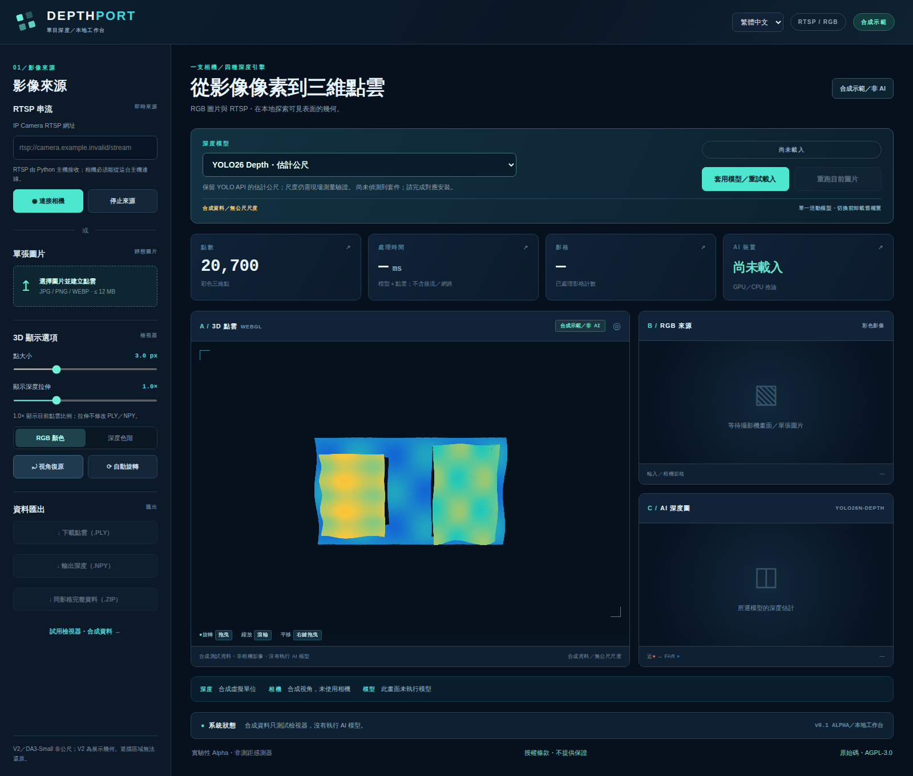
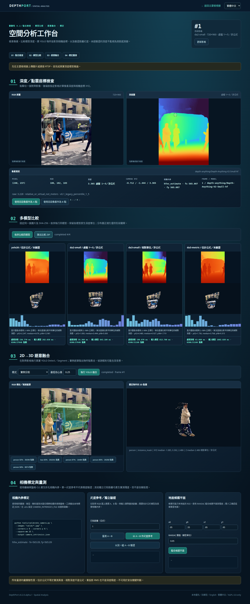
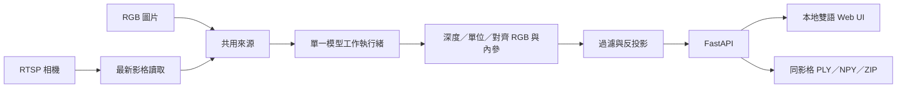

<div align="center">

# DepthPort
### 單目深度與點雲工作台

**一支相機。四種深度引擎。另一個觀察視角。**

[English](README.md) · 繁體中文

**實驗性 Alpha** · **本地執行** · **英文／繁體中文** · **AGPL-3.0-only**

</div>

將 RGB 圖片與 RTSP 相機影格轉成可互動的**單視角點雲**。在同一個本地 Web 介面切換深度模型、觀察可見表面的幾何，並匯出產生畫面所使用的數據。

DepthPort 整合既有預訓練模型，**不是新的深度網路或研究模型**。本專案的貢獻在於模型生命週期、串流處理、明確的深度語義、影像／內參對齊、瀏覽器操作與可檢查的資料匯出。



*截圖來自實際 UI 的合成測試資料；不是由相機或 AI 模型產生的點雲。*

> **目前發布版：v0.1.0-alpha.1。** `main` 仍是原本的檢視器；這裡的[驗證紀錄](docs/zh-TW/validation.md)記錄 2026-10-16 的初版原始碼。另行開發的 v0.2 已在 Ubuntu／RTX 4090 通過真單圖 CUDA smoke test，見下方預覽。實體 RTSP、測距精度及正式產品驗收仍未完成。

## 開發版預覽 — 空間分析 v0.2

`main` 目前保留原本的檢視器版本；另有 [v0.2 開發分支](https://github.com/JShengP/depthport/tree/feature/spatial-analysis-v0.2)，加入像素 XYZ、多模型比較與 YOLO 2D→3D 融合。[最新驗證紀錄](https://github.com/JShengP/depthport/blob/feature/spatial-analysis-v0.2/docs/zh-TW/validation.md)包含 Ubuntu／RTX 4090 的真單圖 CUDA 測試，結果適用該開發分支。功能 PR 為 [#5](https://github.com/JShengP/depthport/pull/5)。

<details>
<summary>展開 v0.2 完整截圖（真模型推論）</summary>



*此圖來自 v0.2，功能尚未包含在本 `main` 版本。使用公開 [Ultralytics 範例](https://github.com/ultralytics/assets/blob/53d4e2a8fd15f473c29a148c317a8477be559327/im/bus.jpg)，不是實體相機或測距精度示範。[圖像來源](docs/assets/README.md)。*

</details>

## 可以探索什麼？

- **四模型切換：** YOLO26 Depth、Depth Anything V2 Small、DA3-Small、DA3Metric-Large。一次載入一個活動模型，切換不必重啟後端。
- **圖片與 RTSP：** 保留單張原圖供依序比較；串流只保留最新影格，不累積應用層待推論佇列。
- **互動 3D：** 旋轉、縮放、平移、著色、點大小及僅影響畫面的深度拉伸；WebGL 不可用時使用 Canvas2D 備援。
- **可追溯數據：** PLY、float32 NPY、原始模型輸出、對齊 RGB、模型名稱與單位資訊，包成同影格 ZIP。

右上角可切換 **English／繁體中文**，瀏覽器會記住選擇；也可用 `?lang=en` 或 `?lang=zh-TW` 指定。語言不影響模型狀態、數值或 API 欄位名稱。上游套件的技術錯誤訊息保留原文，避免翻譯失真。

## 四種深度不能當成同一個單位

| 引擎 key | 預設權重 | 本程式建立的幾何 |
|---|---|---|
| `yolo26` | `yolo26n-depth.pt` | 保留 API 估計公尺，現場尺度未驗證 |
| `da2-small` | `depth-anything/Depth-Anything-V2-Small-hf` | 相對分數映射為 **1～5 虛擬展示深度**，不是公尺 |
| `da3-small` | `depth-anything/DA3-SMALL` | 保留正的原始相對深度，不是公尺 |
| `da3-metric` | `depth-anything/DA3METRIC-LARGE` | 依處理後焦距／300 換算估計公尺 |

原始模型輸出另存，不會被展示資料覆寫。V2 的映射**不是物理反演**，逐影格可能改變形狀與尺度，不可與公尺模型直接比較 XYZ。[模型與幾何說明](docs/zh-TW/models-and-geometry.md)・[上游來源與授權](THIRD_PARTY_NOTICES.md)

## 本機啟動

使用**全新的 Python 3.11 或 3.12 環境**。安裝器也接受 3.10，但需另確認所有選配依賴能安裝；不要沿用其他專案的虛擬環境。原始碼套件**不含權重或 Python 套件**。

**Windows**，在解壓縮或 clone 後的專案資料夾執行：

```bat
RUN_WINDOWS.bat
```

**Ubuntu：**

```bash
bash RUN_UBUNTU.sh
```

開啟 **http://127.0.0.1:8000/**。首次建立 `.venv-depthport`；各模型第一次使用可能需要下載權重。使用 NVIDIA GPU 時，先在此環境裝好相容的 CUDA PyTorch／torchvision，再安裝其他依賴。

上傳圖片 → 等待真實結果 → 選擇另一模型 → **套用模型／重試載入**。程式自動重跑保留的原圖。RTSP 需使用相機實際路徑，且必須能從 **Python 後端主機**連線，不是瀏覽器直接接流。

[安裝、GPU、部分安裝與離線模式](docs/zh-TW/installation.md)・[操作與疑難排解](docs/zh-TW/usage.md)

### 不安裝 AI，也能試用檢視器

使用 Python 標準函式庫即可建立並啟動**合成資料靜態示範**：

```bash
python tools/build_site.py
python -m http.server 8765 --directory _site --bind 127.0.0.1
```

開啟 **http://127.0.0.1:8765/**。圖片推論與 RTSP 控制會刻意停用。也可使用內附的手動觸發 workflow，將這些檔案發布到 GitHub Pages；它不是雲端 AI 服務。

## 真模型需要另外驗證

完成安裝、停止網站後，使用自己有權處理的 `camera.jpg`：

```powershell
# Windows
.\.venv-depthport\Scripts\python.exe check_env.py --all --image camera.jpg
```

```bash
# Ubuntu
.venv-depthport/bin/python check_env.py --all --image camera.jpg
```

只有真模型呼叫成功才輸出 `REAL_INFERENCE: PASS`；失敗會報錯，**不以合成深度替代**。PASS 只表示鏈路執行完成，不代表距離準確。單測 V2 可加 `--engine da2-small`；不加 `--image` 時僅檢查 API 匯入。

## 架構



[架構與 API 契約](docs/zh-TW/architecture.md)

## 範圍與限制

只估計可見表面的 **2.5D**，不是完整 360° 掃描、遮擋區域還原、SLAM、時間融合或安全距離感測器。固定鏡頭逐張取樣不會增加新的幾何視角。目前不宣稱任何實測 FPS、VRAM 預算或測距精度。[公平量測紀錄方法](docs/zh-TW/benchmarking.md)

應用使用**單一共用來源與模型**，不是每個瀏覽器各自一套工作階段。預設僅綁定 localhost，沒有登入、多租戶隔離或正式資安邊界；請勿直接開到網際網路。不要提交帳密、相機畫面、匯出結果、權重或私人標定資料。[安全政策](SECURITY.md)

## 開發與貢獻

```bash
python -m pip install -r requirements-base.txt -r requirements-test.txt
# 另裝相容的 torch；部分 adapter 契約測試使用真 CPU tensor。
python -m pytest -q
node tests/test_i18n.cjs
python tools/check_release.py
```

CI 執行確定性的替身測試，不下載預訓練權重。CI 通過**不等於四模型硬體 benchmark**；這份原始碼快照也不宣稱已在 GitHub 遠端 CI 通過。

[貢獻指南](CONTRIBUTING.md)・[Roadmap](ROADMAP.md)・[版本紀錄](CHANGELOG.md)・[發布檢查](docs/zh-TW/publishing.md)

## 授權與致謝

DepthPort 應用程式碼採用 **AGPL-3.0-only**；見 [LICENSE](LICENSE) 與 [NOTICE](NOTICE)。外部程式及權重保留各自授權，本專案不能替它們重新授權。Ultralytics 有 AGPL 與另行提供的 Enterprise 路線；本版選定的 V2 Small／DA3 Small／DA3Metric 模型卡標示 Apache-2.0，不代表其他尺寸也相同。

模型與研究成果歸屬 [Ultralytics](https://docs.ultralytics.com/tasks/depth/)、[Depth Anything V2](https://github.com/DepthAnything/Depth-Anything-V2)、[Depth Anything 3](https://github.com/ByteDance-Seed/Depth-Anything-3) 作者。DepthPort 是獨立專案，不代表上游背書。散布或商用整合前請閱讀[第三方聲明](THIRD_PARTY_NOTICES.md)。
