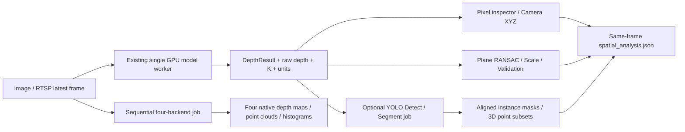

# Spatial Analysis v0.2 — implementation & verification

[繁體中文](../zh-TW/spatial-analysis.md) · [Home](../../README.md)

**2026-10-17 update:** real four-engine CUDA inference, YOLO Detect/Segment and browser-to-HTTP smoke tests passed on one Ubuntu / RTX 4090 host. Deterministic FakeEngine tests remain a separate layer. Physical RTSP, Windows and measured depth accuracy are still pending. See the [validation record](validation.md).

**Status: experimental branch `v0.2.0-alpha.1`, NOT a production distance sensor.** All default automated tests use explicit fake depth engines. No CUDA, pretrained model, physical IP camera or distance accuracy is implied.

Open `/spatial` after starting DepthPort. This page shares the existing single source and model. Its backend endpoints are same-origin/localhost only. Use the original web UI at `/` to upload an image or connect an RTSP source. The 0.2 extensions never replace the four existing depth models, the existing exports or the English/Traditional Chinese language switch.

## Architecture



**Job policy:** Comparison is accepted **only** for a retained still image; a single frozen source SHA-256 is shared by the four sequential inferences. Semantic inference operates once on the last completed depth frame (still or RTSP). Both jobs use the same worker as the primary depth engine; the active depth model is unloaded first and restored afterward. Streaming updates pause while analysis jobs run. Changing input or depth model clears stale analyses using generation checks. This is not synchronized multi-GPU inference.

## 1 — Point Inspector

Click the aligned RGB or depth image; the UI maps its displayed pixels into the current `(H,W)` depth grid. `GET /api/spatial/inspect?u=...&v=...&frame_id=N` returns RGB, raw model output, geometry depth, camera XYZ (X right, **Y down**, Z forward), viewer XYZ (X right, Y up, Z negative), K, units, model and frame provenance. Stale frame returns HTTP **409**, invalid pixel returns **422**. RTSP can update between selection and query; the user must click on a new frame. No interpolation/fabricated depth is performed.

## 2 — Four-model Comparison

POST `/api/spatial/compare` with an optional distinct subset of four engine keys; GET `/api/spatial/compare/status` polls progress and explicit per-model failures; GET `/api/spatial/compare/results` returns previews and compact 3D points; GET `/api/spatial/compare/export.zip` saves `comparison.json` plus per-engine native `depth.npy`, `raw_depth.npy`, `pointcloud.ply`, aligned RGB and metrics.

Each histogram uses its *own* 2nd–98th percentile min/max, normalized only to visualize distribution *shape*. **Different depth units, postprocessing and model input sizes must not be treated as a fair absolute numerical/FPS benchmark.** Wall time includes per-engine adapter/geometry and excludes loading (shown separately), capture and browser transport. Cold cache/download durations are not inferential latencies.

## 3 — 2D-to-3D Semantic Fusion

POST `/api/spatial/semantic` with `mode=segment|detect` and `confidence`, followed by status/result polling. Defaults: `SEMANTIC_SEGMENT_MODEL=yolo26n-seg.pt`, `SEMANTIC_DETECT_MODEL=yolo26n.pt`. These are **additional separate Ultralytics pretrained models**, not the YOLO26 Depth model. First use may download weights. Segment uses aligned masks (`retina_masks=True`, reject mismatched mask grids rather than guessing crop/padding); Detect uses a **bounding-box ROI** containing background, explicitly labeled as an approximation. No unseen back geometry, tracking or validated 3D bounding boxes are generated. The segmentation request does **not** silently fall back to boxes when masks are unavailable. Returned object median XYZ/depth and packed point subsets retain the depth engine's units.

For memory safety, semantic is a **user-triggered one-frame job**, not an always-on pipeline, and only one model inference job runs at a time. Source/model changes invalidate results. A segmented person's 3D points represent only estimated *visible* pixels.

## 4 — Calibration and error-aware measurement

1. Acquire eight or more real checkerboard images with the **same physical IP camera/lens, zoom, resolution and uncropped stream profile**, including varied positions and orientations, then run:

   ```bash
   python tools/calibrate_camera.py --images 'calib/*.jpg' --corners-x 9 --corners-y 6 --square-mm 25 --output camera_intrinsics.json
   ```

2. Set `CAMERA_INTRINSICS_FILE=camera_intrinsics.json` in your *local* `.env` and restart. Record checkerboard RMS reprojection in pixels (not metric depth error). Mask invalid image borders and assess distortion separately if it matters; this PoC does not support fisheye camera models.
3. Click pixels A and B and measure an independently known real distance. `POST /api/spatial/calibration/scale` accepts an anchor **only** when the active depth type is `estimated_m` **and** actual intrinsics JSON was loaded. An anchor adjusts displayed measurements **for that same frame only**; **PLY/NPY are never silently rescaled**. V2 virtual 1–5 and DA3 Small relative outputs cannot be converted to meters by a single arbitrary anchor.
4. Pick a **different** reference pair and run `/api/spatial/calibration/validate`. The API records signed error, absolute error and relative percent error. Repeated checks provide empirical MAE. `uncertainty_m` remains `null`: a handful of measurements cannot justify a general confidence interval or safety accuracy. All reported distances are estimates, not certified.
5. Select a likely-floor ROI and run `/api/spatial/calibration/plane`. RANSAC + SVD returns a **candidate** plane and inlier RMS in model units; neither proves that the selected surface is a floor nor establishes real-world Z without camera pose and metric validation.

Read `/api/spatial/report.json` for current-frame analysis metadata. The pre-existing `/api/export.zip` now **also** includes `spatial_analysis.json` for compatible same-frame observations; it still exports raw depth, geometry depth, PLY, aligned RGB and model metadata. No cross-frame calibration persistence is claimed.

## Verification commands

```bash
python -m pytest -q
node --check static/spatial.js
node tests/test_spatial_i18n.cjs
python tools/check_release.py
python tools/http_smoke.py
# Optional: explicit fake-engine Chromium UI test (requires Playwright + browser)
python tools/spatial_browser_smoke.py
```

The new tests check exact projection arithmetic, invalid and stale pixels, native depth preservation, histogram normalization, mask-to-points and box warnings, planar RANSAC, scale-anchor vs independent validation, comparison generation/source identity and exports, semantic job failure without synthetic fallback, and APIs. **FakeEngine-based passing tests are not real-model benchmarks.**

### Acceptance gates before a production designation

- Install Python 3.11/3.12 on clean Ubuntu/Windows and run all four **real** Depth models with `check_env.py --all --image ...`. Confirm a fifth real YOLO Detect or Segment weight only for semantic functionality.
- Record exact model checkpoint SHA-256, input RGB SHA-256, calibration source, device, PyTorch/CUDA/driver versions, and warm/cold latency, CPU/GPU memory and streaming end-to-end timestamps.
- Measure known distances at near/medium/far positions using a reference instrument, include multiple independent validation pairs and ground-plane observations, report errors by model and scene. Never use unvalidated estimates as safety-critical distances.
- Test RTSP authentication, H.264/H.265, exposure-to-browser latency, 30+ min stability, browser GPU rendering, and source/model switch cancellation on actual hardware.
- Conduct credential, privacy and authorization review before any public hosted service; this app still has no multi-user authentication boundary.

Official inference reference: [Ultralytics Instance Segmentation](https://docs.ultralytics.com/tasks/segment), [Detection](https://docs.ultralytics.com/tasks/detect), and [Depth](https://docs.ultralytics.com/tasks/depth). See [original depth model contracts](models-and-geometry.md) and [existing benchmarking guide](benchmarking.md).
