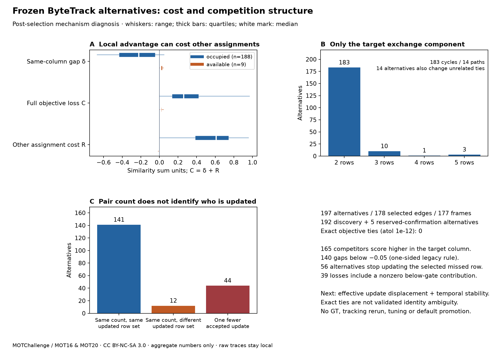

# Frozen alternative costs and competition structure — 2026-10-19

[繁體中文](../zh-TW/tracking-competition-structure.md) · [ROADMAP](../../ROADMAP.md) · [Previous exposure study](tracking-exposure-selection.md) · [Aggregate record](../validation/v0.3-competition-structure.json)

**Exact objective equality is an optimizer-tie test, not a validated proxy for the identity ambiguity we want to control.** All 197 recorded reference alternatives have positive full-assignment opportunity cost. Most competitors already support another accepted update; accepting the same number of pairs can still displace the missed hypothesis. The next control point is **effective update displacement inside the target exchange component, followed by temporal stability**, with no new veto, threshold or default change in this study.

**Follow-up:** [Frozen risk groups and temporal support](tracking-temporal-support.md) now analyzes recorded observation-history extensions without retuning or GT. Gate support, signed-gap support and missing observations differ; no temporal veto is added. The structure results below are unchanged.



## Scope and reconciliation

Read only the complete hash-locked reference (`activation_control`) traces from the prior 16-source / 17,984-frame study. Reconstruct each original unfiltered weak assignment with the same NumPy 2.2.6 / SciPy 1.18.1 runtime, force each already-recorded competitor onto the selected column, then solve the residual matrix and apply the original .10 gate afterwards. Every original accepted edge, forced objective cost and accepted-count change reconciles with its stored trace. All frozen implementation hashes and discovery/confirmation seal are checked. No detector/tracker rerun, GT/evaluator access or parameter search.

This is **post-selection descriptive mechanism analysis** of the already inspected legacy candidate cohort, not a fresh preregistered experiment or independent quality confirmation. Keep discovery (192 alternatives) and original reserved confirmation (5) separate. MOT20-05's zero remains in the ledger. The 197 alternatives represent 178 selected edges in 177 frames and 147 distinct directed local hypothesis pairs; repeated frames, competitors and hypotheses are not independent people/events. The complete trace was traversed, with costs solved only for the fixed candidate cohort; this is not an all-edge uniqueness search.

Original controls, activation .30 / high .60 / buffer 30 / confirmation 2, signed legacy margin .05, objective roundoff allowance 1e-12, weak detections and application/worker defaults remain unchanged. The prior bus HOTA failure remains open. Diagnostics, raw matrices, trace events, local paths and frame/ID locations stay local; public files contain code, synthetic tests, fixed aggregate counts/quantiles and an aggregate figure only.

## Local column scores are not full alternative costs

For the selected missed row `r`, target column `c` and active competitor `q`, let `S` be the stored similarity matrix, `M` the original unfiltered one-to-one assignment and `M′` the solver-returned assignment constrained to include `(q,c)`.

- **Signed local gap:** `δ = S[r,c] − S[q,c]`.
- **Full opportunity cost:** `C = sum(S on M) − sum(S on M′)`.
- **Other-assignment contribution:** `R = sum(M excluding (r,c)) − sum(M′ excluding (q,c))`; exactly `C = δ + R`.

The historical candidate test is one-sided `δ <= .05`, not `abs(δ) <= .05`. Of 197 alternatives, **165** competitors score higher in that column; **140** gaps are below `−.05`. These counts describe the existing rule and do not introduce a symmetric gate. A locally much stronger competitor can still be a costly global replacement because its other assignment is stronger still.

| Competitor accepted occupancy | Alternatives | Median δ | Full cost C: min / median / max | Median R |
| --- | ---: | ---: | --- | ---: |
| Already accepted elsewhere | 188 | −.223642 | .000298 / .258345 / .967319 | .607424 |
| No accepted update elsewhere | 9 | .012623 | .002049 / .012623 / .043510 | 0 |

All **188 occupied** cases have positive `R`. All **9 available** competitors are nevertheless assigned a below-gate pair by the unfiltered solver: accepted-unmatched is not solver-unmatched. Their `R` is nonpositive (range `−.013992–0`); forcing the target replaces the selected missed row's update in all nine. Reference alternatives are hypothetical; these nine are not the eight vetoes in the treatment's diverged history.

As a synthetic illustration, `S=[[.4,.1],[.6,.9]]` has original diagonal sum `1.3`; forcing row 1 to column 0 yields `.6+.1=.7`. The competitor's local advantage is `.2`, but full cost is `.6` because the other-assignment contribution is `.8`. This illustrates accounting, not a labelled physical identity error.

## Exchange structure and gate consequences

Take the symmetric difference of `M` and `M′` as a bipartite graph and isolate the connected component containing target column `c`. Because both are matchings, changed components are alternating paths/cycles. The target component is a **cycle in 183** alternatives and a **path in 14**. It contains **2 rows in 183**, **3 in 10**, **4 in 1**, and **5 in 3** alternatives. Component size and path/cycle type are separate counts.

In **14** alternatives the residual solve also changes rows in disconnected components. Their objective contribution is zero within the original 1e-12 roundoff allowance; do not count these incidental tied solutions as a larger target competition. All 197 full costs equal the target-component costs within that allowance. No claim that the solver enumerates all optimal alternatives.

After applying the original gate:

- **141** alternatives keep the accepted row set and pair count, though accepted detection-to-row associations change.
- **12** keep the count but replace one updated row with another (9 available, 3 occupied).
- **44** reduce accepted updates by one (all occupied).
- Thus **56** alternatives stop updating the selected missed hypothesis (47 occupied + 9 available); **39** full costs include nonzero below-gate contributions (`−.099119–.072852`). Those rejected pairs affect optimization but do not update a track.

A whole-matrix objective and a count-preservation check therefore hide which hypothesis receives which observation. The hypothetical assignments are diagnostic only: they are not installed, and the real controls still veto selected edges rather than reassign detections.

## Complete phase ledger

Frames here count candidate-containing frames, not a new sample selection. Full source lengths and all negative source checks remain in the [original ledger](tracking-exposure-selection.md).

| Source | Original phase | Candidate frames | Selected edges | Alternatives | Occupied | Missed row loses update |
| --- | --- | ---: | ---: | ---: | ---: | ---: |
| MOT17-09-DPM | discovery | 18 | 18 | 27 | 27 | 7 |
| MOT17-10-DPM | discovery | 16 | 16 | 16 | 15 | 2 |
| MOT17-11-DPM | discovery | 4 | 4 | 4 | 4 | 3 |
| MOT17-13-DPM | discovery | 4 | 4 | 4 | 4 | 1 |
| MOT17-04-DPM | discovery | 1 | 1 | 1 | 1 | 0 |
| MOT20-01 | discovery | 5 | 5 | 5 | 5 | 1 |
| MOT20-02 | discovery | 54 | 55 | 59 | 57 | 15 |
| MOT20-06 | discovery | 16 | 16 | 16 | 14 | 7 |
| MOT20-07 | discovery | 1 | 1 | 1 | 1 | 0 |
| MOT20-08 | discovery | 6 | 6 | 6 | 5 | 2 |
| MOT17-07-DPM | discovery | 10 | 10 | 12 | 12 | 1 |
| MOT17-08-DPM | discovery | 24 | 24 | 26 | 24 | 8 |
| MOT17-12-DPM | discovery | 4 | 4 | 4 | 4 | 2 |
| MOT17-14-DPM | discovery | 9 | 9 | 11 | 10 | 6 |
| MOT20-03 | confirmation | 5 | 5 | 5 | 5 | 1 |
| MOT20-05 | confirmation | 0 | 0 | 0 | 0 | 0 |

Discovery: 192 alternatives / 183 occupied / 55 selected-row update losses; cost `.000298–.967319`. Original reserved confirmation: 5 alternatives / all occupied / 1 selected-row update loss; cost `.154712–.807459`. Neither contains an exact tie. This follow-up has now inspected both groups; neither is an unseen reserve for the next experiment.

## What equality establishes, and the next control point

An equality test establishes another optimizer-returned assignment with indistinguishable total similarity under the numerical allowance. It does not calibrate uncertainty in boxes, motion or identity. **Zero exact ties among these 197 forced alternatives does not prove physical identity is unambiguous**, nor prove the entire weak matrix has a unique optimum. Conversely, a positive score difference does not establish that the higher-scoring assignment has the correct identity. No GT identity-ambiguity labels were read, so sensitivity, specificity and benefit of a proxy remain unmeasured.

**Choose effective update displacement as the next mechanism to control, with temporal stability as the next diagnostic.** Freeze complete groups by competitor accepted occupancy, selected-row update loss, and accepted-update replacement/loss within the target component; separately trace whether competing support persists across adjacent frames using immutable observation history. This avoids using unrelated zero-cost ties or below-gate accounting as evidence of an identity conflict. Occupancy and update-set changes identify structural risk, not which association is correct; they are not an approved veto by themselves.

Before a new intervention: freeze the temporal definition, complete risk groups, any independently justified observation/motion uncertainty model and per-scene harm criteria. A perturbation-stability study, if chosen, must fix its perturbations without fitting them to these 197 gaps. Then separately freeze the proposed rule and use genuinely new confirmation sources; only afterwards score full FN/FP/IDSW/IDF1/HOTA and report harms, including long-occlusion support loss and the prior bus issue. Do not relax 1e-12 to obtain exposure, pick a tolerance from these quantiles, replace zero-confirmation scenes or promote defaults. **Mechanism diagnosis complete; identity validity, control usefulness and independent replication remain open.**

## Source terms and reproduction

Same local noncommercial research sources as the [prior source record](tracking-exposure-selection.md): [MOT17](https://motchallenge.net/data/MOT17/) / [MOT20](https://motchallenge.net/data/MOT20/), MOTChallenge / Milan, Leal-Taixé, Reid, Roth & Schindler (MOT16) and Dendorfer et al. (MOT20), CC BY-NC-SA 3.0 with any additional original-source conditions retained. No new sequence downloaded, no imagery/GT redistributed, no leaderboard submission. Program AGPL does not relicense dataset material.

Use the original pinned NumPy/SciPy research environment; paths below refer to ignored local inputs. Public aggregate output is a separate, reviewed export. No absolute machine path is needed.

```bash
python tools/diagnose_tracking_competition.py \
  --protocol docs/validation/v0.3-exposure-selection-protocol.json \
  --phase docs/validation/v0.3-exposure-discovery.json artifacts/tracking-exposure-selection/discovery \
  --phase docs/validation/v0.3-exposure-confirmation.json artifacts/tracking-exposure-selection/confirmation \
  --output artifacts/competition-summary.json \
  --local-details artifacts/competition/alternatives.local.json
python tools/plot_tracking_competition.py \
  --summary artifacts/competition-summary.json --output artifacts/competition.png
```

Synthetic contracts cover signed-gap/full-cost decomposition, occupied and below-gate competitors, rectangular paths, multi-row cycles, disconnected ties, equal-cost gate loss, raw-hash/assignment reconciliation, privacy of the summary whitelist and randomized small exact assignments. Application tests: **363 passed / 20 optional skipped** (one existing Starlette/httpx deprecation warning). Pinned NumPy 2 contracts, including real weak continuation/recovery: **46 passed**, with `RUN_TRACKERS_CONTRACTS=1`. Two complete diagnostic traversals produce byte-identical public aggregates and local details; repeat equality is not extra independent evidence. Public allowlist/link/obvious-secret checks, source archive and synthetic-only site build pass. No website deployment or release upload.
