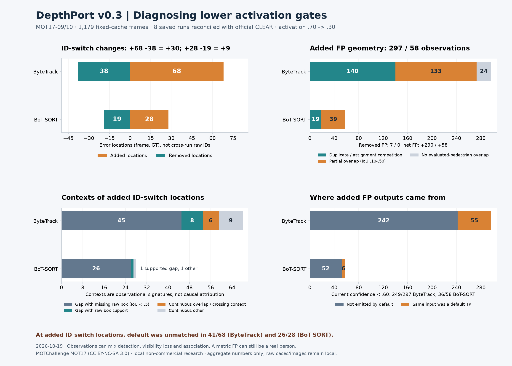

# Lower-activation tracking error diagnosis — 2026-10-19

[繁體中文](../zh-TW/tracking-error-diagnosis.md) · [Parameter experiment](tracking-parameter-acceptance.md)

**Decision:** keep current defaults. Prioritise new-track confirmation and duplicate/competition controls, separate detector localisation from association, and instrument recovery costs before changing association gates or adding ReID. This diagnosis does not claim a fix or a passed long-occlusion gate.



[Machine-readable counts, signals and qualified visual observations](../validation/v0.3-tracking-error-diagnosis.json).

## Inputs and reconciliation

Reuse the immutable MOT17-09/10 detector caches and saved **default vs activation-only** outputs from the previous 1,179-frame study. Activation changes .70→.30; high-confidence split stays .60, lost buffer one second, other settings unchanged. There is no new detector/tracker run or adaptive parameter search. Eight saved runs (two profiles × two backends × two scenes) are reconstructed, with canonical prediction/cache/video/official GT/archive hashes checked. Preview-to-GT scaling and +1 MOT origin are retained.

The new offline tool reconstructs the pinned [TrackEval CLEAR](https://github.com/JonathonLuiten/TrackEval/blob/12c8791b303e0a0b50f753af204249e622d0281a/trackeval/metrics/clear.py) matching decisions: previous-step identity continuity has priority over IoU, with IoU≥.5 and switches against the last historical GT match. Empty-frame behavior is retained. Every run must exactly reconcile **TP, FP, FN and IDSW** with both the unmodified official evaluator and the published parameter record; all eight pass. This is distinct from the earlier independent per-frame Hungarian endpoint diagnostic.

IDSW locations pair by **(frame, GT)**. Shared locations need not have the same transition; IDs are never compared numerically across profiles. FP locations pair by **(frame, immutable cache detection index)**, using unique geometry/confidence mapping after official distractor preprocessing; ambiguous mappings fail. Public counts are observations, not counts of unique people or independent incidents.

## Added errors versus net change

In ByteTrack / BoT-SORT order:

- IDSW default→candidate: **140→170 / 49→58**. Added locations **68 / 28**, removed **38 / 19**, shared **102 / 30**. Net changes are **+30 / +9**.
- FP default→candidate: **828→1,118 / 382→440**. Added observations **297 / 58**, removed **7 / 0**, shared **821 / 382**. Net changes are **+290 / +58**.
- At **41/68 / 26/28 added IDSW locations**, default did not match that GT. The remaining **27 / 2** had a default match but no default switch at that location. More recall can expose identity instability that the default hid as FN; not every added switch is a regression of a previously successful match.
- Of added FP observations, **242 / 52 were not emitted by default**. The same input boxes in **55 / 6** had been default TP and became candidate FP under full-frame assignment. None in this comparison is explained by default-only distractor removal.

## Detection, visibility loss and association evidence

The exclusive **context signatures** for added IDSW are:

- Match gap containing at least one GT-present frame without a raw box at IoU≥.5: **45/68 / 26/28**.
- Match gap with raw geometric support throughout its GT-present frames: **8 / 1**.
- Continuous matching near projected overlap/crossing: **6 / 0**.
- Other continuous changes: **9 / 1**, still unresolved between localisation, association and scoring sensitivity.

These signatures are not exclusive causal diagnoses. A raw box can be below the high-confidence gate, belong to another crowded target or have uncertain alignment. Support is per-GT geometry, not a one-to-one detector evaluation. Annotation absence is tracked separately. A "missing raw box" can mean a partial-body/localisation mismatch, not a frame with no detection whatsoever.

Non-exclusive signals reinforce the mixed picture: low visibility occurs in **35 / 21** added switches; a long-low-visibility event is near **9 / 5**, and an order-exchange event near **11 / 4**. Current GT boxes overlap another GT in **49 / 19**; the candidate ID recently belonged to another matched GT in **25 / 4**. A gap contains partial raw overlap (.10≤IoU<.50) in **42 / 26**, no raw overlap (IoU<.10) in **17 / 10**. A sufficiently visible gap frame still lacks a matching raw box in **17 / 11**, while low-visibility missing-box frames occur in **30 / 20**. Signals overlap and must not be added as a partition.

Added FP geometry is **140 / 19 duplicate-or-assignment-competition**, **133 / 39 partial overlap (.10≤IoU<.50)**, and **24 / 0 no evaluated-pedestrian overlap**. The competition label means an unmatched output overlaps an evaluated GT at IoU≥.5; it does not prove two detections depict the same physical person. Zero selected added FP overlap an excluded annotation at IoU≥.5, which still does not establish complete annotation coverage.

Current confidence is **below .60 in 249/297 / 36/58 added FP**. These are outputs of existing tracks, not the confidence at initial birth: lowering activation can allow a track to start on ≥.60 input and later continue on weaker detections. Added FP occupy **102 / 19 contiguous track/category episodes**, median **2 / 2 frames**, maximum **16 / 12**. Episode boundaries split on sequence, track, category or missing frames; they are not unique objects. **38 / 17** added FP belong to a predicted track with no official TP anywhere in that sequence; **164 / 4** belong to tracks that matched more than one GT at some point. Neither signal alone proves a physical cause.

## Visual case review

The deterministic selector takes one example per available backend/error/context category: longest FP episode or largest IDSW match gap, with stable ties. All **12 cases** (seven IDSW, five FP), **72 default/candidate panels / 33 unique source frames**, were visually inspected. The sample is selected for diagnosis, not random, exhaustive or an estimate of root-cause prevalence.

The reviewed examples support:

- A person pictured on an illuminated advertising display becomes an extra ByteTrack track: a concrete background false-activation example.
- A real person behind a planter produces torso-sized boxes against full-body GT for both backends. Metric FP here is a localisation/visibility issue, not evidence of a nonexistent person. The two backend views share this scene condition.
- Extra outputs compete over nearby pedestrian boxes, and crowded/partly visible people show short-gap identity changes despite raw detections. Association and weak-box ambiguity are plausible; these are not established physical 3D crossings.
- Long gaps show mixed weak/localised detections, visibility loss and changing identity ownership. Small, continuously visible targets also show unexplained adjacent-frame churn; one default was unmatched. The available boxes do not isolate a single cause.

Only semantic observations and aggregate counts are public. Source images, crops, frame locations, object IDs, detection indices, per-frame traces and the case-to-frame review mapping stay local.

## Improvement decision

1. **Next controlled experiment: separate new-track admission from continuation.** Compare the existing two-frame confirmation against 3/5-frame or confidence-history confirmation; delay a new ID when it competes with a compatible active/lost track. Preserve weak detections for existing-track recovery. Measure TP gains as well as FP/IDSW costs; blindly filtering every low-score output could remove recovered true positives. Poster persistence shows duration alone may not fix every false activation.
2. **Isolate detection localisation.** Hold tracker settings fixed while comparing input resolution/detection settings on separate sequences, explicitly inspecting partial-body/full-body mismatch and small targets. Keep the official IoU gate unchanged; reducing the evaluator threshold is not a fix.
3. **Instrument association/recovery before further tuning.** Record local association costs, motion/IoU gates and competing active/lost hypotheses. Inspect short gaps where detections remain and IDs with another recent GT owner. A longer buffer alone cannot explain gaps shorter than its current budget. ReID is a later option, not an assumed remedy for detector boxes or duplicate activation.
4. **Evaluate cohorts separately.** Preserve added/removed/shared counts, default-matched versus default-unmatched locations and all-subject missing-endpoint denominators. Validate each proposed change separately on an independent group before changing defaults.

These are prioritised follow-up experiments, not implemented tracker behavior changes or claims of improvement. The current commit adds reproducible diagnosis and evidence.

## Reproduce and terms

Use the previous local manifest, cached predictions/MOT files, public parameter aggregate and clean pinned TrackEval in the separate NumPy 2 environment:

```bash
.venv-trackers/bin/python tools/diagnose_tracking_errors.py \
  --manifest local/mot17-new-group.json \
  --validation-record docs/validation/v0.3-mot17-parameters.json \
  --runs-dir outputs/mot17-parameters --trackeval-root local/TrackEval \
  --work-dir outputs/tracking-diagnosis --output outputs/tracking-diagnosis-summary.json
```

The tool does not download, run models or upload. It writes raw local case lists/ID maps and a selection file to the work directory; only the aggregate output is a publication candidate. Visual context in the published JSON is added after assisted review, not generated by automatic labels. CI uses synthetic contracts, not these images or model weights.

Attribution: MOTChallenge contributors, [MOT17/MOT16 annotations](https://motchallenge.net/data/MOT17/), [CC BY-NC-SA 3.0](https://creativecommons.org/licenses/by-nc-sa/3.0/) and applicable original-source conditions. Use is local non-commercial research; no dataset material/per-frame results are redistributed. The program's AGPL terms do not relicense the data. This is an observational reanalysis of compressed training previews, not a new held-out benchmark, causal ablation, RTSP/3D/endurance or Windows real-model acceptance.
