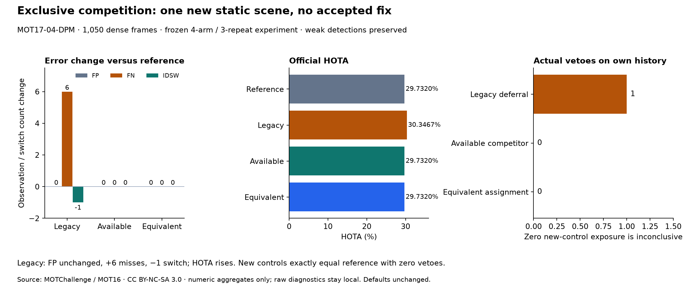

# Competitor occupancy and one-to-one alternative controls — 2026-10-19

[繁體中文](../zh-TW/tracking-exclusive-competition.md) · [ROADMAP](../../ROADMAP.md) · [Prior history diagnosis](tracking-recovery-history.md) · [Frozen protocol](../validation/v0.3-exclusive-competition-protocol.json) · [Aggregate](../validation/v0.3-exclusive-competition.json)

**Separate controls and a new-sequence comparison are complete; no treatment passes the research screen.** Legacy deferral adds six misses, removes one switch and leaves FP unchanged. Both new controls have zero actual vetoes and exactly reproduce the reference. Excluding this occupied competitor does not establish an effective new control. Weak continuation, application/worker/defaults and releases remain unchanged.



## Freeze before execution

After synthetic/pinned-library contracts and the common detection cache, freeze configuration, implementation and input hashes before any tracking output or evaluation on this cohort. This is a local freeze, not external preregistration. Protocol SHA-256: `0a7194897430f935c922c62b14b05a97f9c5b115e48aab7f735fb48f537f0c50`. No conditions, parameters or sequences are changed after results; zero exposure does not justify relaxing the rule.

Four fresh-tracker arms run three times each in rotating order: **12 comparison runs**, plus unhooked-reference and unchanged-original-control audits. Within each arm, canonical predictions and complete diagnostic hashes agree across repeats. Reference predictions equal unhooked upstream; legacy predictions equal the untouched original control. Audits/repeats do not add independent samples.

## Four separate arms

Common activation `.3`, high confidence `.6`, buffer `30`, confirmation `2`, fixed source-FPS steps, weak IoU gate `.10` and column margin `.05`. High-stage association, births/confirmation, lifecycle and state/box/score updates are unchanged; no ReID/CMC. Every original weak cache detection reaches upstream. Deferred detections remain upstream output with ID `-1`; inputs are not filtered.

1. **`activation_control`:** original reference, no veto.
2. **`defer_competing_recovery`:** original rule defers a selected missed confirmed weak edge when an active confirmed row has an admissible close same-column score, even if assigned elsewhere.
3. **`defer_available_competitor`:** separately requires an eligible competitor without another gate-accepted match in the original weak assignment. Does not also require equivalent replacement cost.
4. **`defer_equivalent_assignment`:** separately forces the eligible competitor into the target column and solves the remaining full one-to-one problem. Veto only if objective loss is at most `1e-12` solver roundoff and the gate-admissible pair count is no lower than the actual original result. Occupied competitors are allowed; availability is not also required.

The alternative retains upstream **assignment before gating**. The tolerance is numerical roundoff, not a new fitted tracking threshold. Only the fixed solver-returned alternative is tested; equally optimal alternatives are not exhaustively enumerated. Alternative matching is evidence only: **never install it or rematch residual edges**. Decide all vetoes against the unchanged original assignment; remove only eligible missed-row pairs. This does not prove the competitor is the correct owner.

## New scene, provenance and terms

Use full **MOT17-04-DPM**, **1,050 frames / 30 fps**, from the [official MOT17 train page](https://motchallenge.net/data/MOT17/): night pedestrian street, elevated stationary camera. GT is 1920×1080; official compressed preview is 960×540, scaled exactly 2× for evaluation. There are 47,557 valid pedestrian GT observations. This scene was not used in earlier project tracking studies, but remains public training data, not an official hidden test set.

Attribution: MOTChallenge; Milan, Leal-Taixe, Reid, Roth and Schindler, [MOT16 benchmark](https://arxiv.org/abs/1603.00831). The official page specifies [CC BY-NC-SA 3.0](https://creativecommons.org/licenses/by-nc-sa/3.0/); local non-commercial research only, no source-media/GT/raw-diagnostic redistribution. The selected table row has no additional third-party source link; retrieved terms and official labels ZIP hashes are recorded. Other third-party scenes were excluded when original terms could not be verified. MOT20-02 preview was downloaded but excluded before tracking because its full length exceeds the unchanged 1,800-frame limit; no result-driven replacement or clipping.

Shared detector: unchanged **YOLO26n / Ultralytics 8.4.176, CPU, confidence .10, imgsz 640, class 0, max_det 64, NMS .7**, same weight hash. **20,133 detections; zero capped frames**. DPM names the source sequence/GT; supplied DPM detections are not used. Inference uses an isolated package overlay and tracking stays in NumPy 2; the running application environment is not upgraded.

## Comparison

Pinned [TrackEval](https://github.com/JonathonLuiten/TrackEval/tree/12c8791b303e0a0b50f753af204249e622d0281a), official MOT17 pedestrian preprocessing, CLEAR IoU .5, Identity and HOTA over 19 localisation thresholds. Immutable error locations reconcile exactly with official CLEAR; no cross-arm numeric native-ID comparisons.

| Arm | FN | FP | IDSW | IDF1 | HOTA | Actual vetoes |
| --- | ---: | ---: | ---: | ---: | ---: | ---: |
| Reference | 38,587 | 703 | 7 | 27.5974% | 29.7320% | 0 |
| Legacy column rule | 38,593 | 703 | 6 | 29.2570% | 30.3467% | 1 |
| Available competitor | 38,587 | 703 | 7 | 27.5974% | 29.7320% | 0 |
| Equivalent assignment | 38,587 | 703 | 7 | 27.5974% | 29.7320% | 0 |

- Legacy versus reference: **six added / zero removed FN, zero added / one removed IDSW; identical FP locations**. HOTA rises about **.6147 percentage points**, fragmentation falls 88→87. Identity gains do not cancel increased FN and absent FP benefit; the frozen research screen fails.
- Each arm's own full history has **one legacy-eligible edge / one alternative competitor**. The competitor already matches another detection. Forcing it preserves admissible pair count but has positive total-objective loss. Both new controls reject it and have zero vetoes; complete prediction hashes equal the reference. This is an actual full-run result, not a counterfactual derived by deleting previous events.
- **Zero intervention means insufficient effective exposure**, not an accepted fix. Relative to legacy, new arms recover six observations but add one switch and lower HOTA, merely returning to the reference trade-off. They do not retain legacy identity gains or resolve the earlier bus failure.

The two long-low-visibility subject events have **zero complete endpoint pairs / zero same-ID recoveries** in every arm. Crossing proxy: 43 events / 86 subjects, 15 complete same-ID endpoint pairs in every arm, no recovery gain. Reference recall is only **18.8616%**. Preserving weak inputs does not guarantee coverage; these GT proxies are not physical-occlusion or identity proof.

## Decision and next gate

**No default promotion, numerical retuning or fix acceptance.** Separate implementation, freeze and new-scene comparison are complete; effectiveness when an available competitor or equivalent alternative genuinely triggers remains unverified. Next freeze an exposure-oriented cohort/selection procedure, select only on GT-free competition exposure and disclose every examined scene, separating discovery from independent confirmation. Do not select clips using FP/HOTA outcomes, append favourable scenes here or relax equivalence to manufacture triggers.

Low recall/localisation needs a separate detector-resolution control, not joint competition/confirmation/buffer tuning. The earlier bus HOTA failure remains. Moving-camera generalisation, long occlusion, physical RTSP, Windows pretrained inference/worker, 3D and throughput remain unverified.

Application tests: **341 passed / 17 optional skipped**; pinned NumPy 2 recovery/history/new-control contracts: **21 passed**. Tests cover occupied versus free competitors, equal objective with admissible-pair loss, instance-hook restoration and real weak continuation/uncontested recovery. Public allowlist/link checks, source packaging and synthetic-only site build pass; no website deployment or release upload.

## Reproduction and public scope

```bash
python tools/validate_tracking_exclusive.py \
  --protocol docs/validation/v0.3-exclusive-competition-protocol.json \
  --manifest local/manifest.json --trackeval-root local/TrackEval \
  --work-dir artifacts/exclusive/run --output artifacts/exclusive/aggregate.json
```

Supply lawfully held local inputs. The tool verifies frozen code/input/package/upstream-class hashes and a clean evaluator; mismatches fail closed. Public scope is code, protocol, fixed-label aggregate counts, numeric figures and provenance hashes. Media, GT, frame/ID locations, full matrices/assignments and cases stay local; no private paths/data are published. Existing release/tag snapshots remain unchanged.
