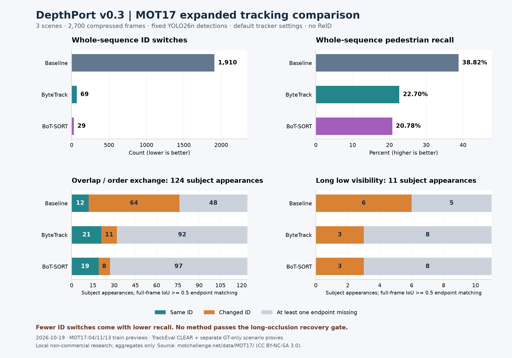

# Expanded MOT17 tracking acceptance — 2026-10-19

Follow-up: [fixed activation/split/buffer sensitivity on two new scenes](tracking-parameter-acceptance.md). Results from the two groups are kept separate.

[繁體中文](../zh-TW/tracking-expanded-acceptance.md) · [Tracking evaluation](tracking-evaluation.md)

**Status: expanded research evidence, not a passed long-occlusion or release gate.** This adds three scenes to the earlier MOT15 pilot. Different sources and conditions mean their scores must not be pooled with that pilot.



[Machine-readable source hashes, configuration, per-sequence scores and timing trials](../validation/v0.3-mot17-expanded.json).

## Inputs and terms

Official [MOT17 training data](https://motchallenge.net/data/MOT17/) is provided under [CC BY-NC-SA 3.0](https://creativecommons.org/licenses/by-nc-sa/3.0/), with original-source conditions potentially applying too. Attribution: MOTChallenge contributors, MOT17/MOT16 sequence annotations. This run uses the material locally for non-commercial research. Videos, GT, per-frame boxes/IDs, event windows, model weights and audit images are not redistributed. The public record contains aggregates and source/configuration identifiers only; the application's AGPL license does not relicense the dataset.

- **MOT17-04-DPM:** 1,050 frames at 30 fps; fixed elevated night pedestrian view (fixed viewpoint visually checked).
- **MOT17-11-DPM:** 900 frames at 30 fps; moving camera in a busy shopping mall.
- **MOT17-13-DPM:** 750 frames at 25 fps; a bus moving through an intersection.

Only one detector-labelled variant of each physical sequence is counted. These are **2,700 compressed preview frames at 960×540**, not original benchmark JPEGs. Official GT is 1920×1080. Frame count, FPS, original metadata and hashes are checked; predicted coordinates are uniformly scaled **2×**, then x/y shifted **+1** into MOT pixel coordinates. Other aspect ratios or non-integer scaling are rejected. The initial dimension guard caught this difference before scoring.

## Fixed comparison

YOLO26n runs once per sequence on CPU: Ultralytics 8.4.115, image size 640, confidence 0.10, NMS IoU 0.70, person class 0, max 64 detections. No frame hit the cap. All trackers read the exact same immutable detection cache and continuous frames. Weight SHA-256 and cache hashes are in the JSON.

DepthPort Baseline and Roboflow 2.6.1 ByteTrack/BoT-SORT run in a separate NumPy 2.2.6 environment; the depth environment stays at NumPy 1.26.4. Defaults are retained except source FPS; **no tuning or ReID**. This comparison uses direct library calls, not worker IPC. There are three fresh runs per method/sequence, with rotated order and OpenCV RNG seed 0 / one OpenCV thread. All 27 runs have identical canonical IDs, boxes and scores across repetitions. Timing includes the first update, excludes detection, decoding and startup, and reports the median of the three trial P50/P95 values rather than a pooled percentile. It is descriptive single-host timing, not real-time acceptance.

Official whole-sequence metrics use clean pinned [TrackEval](https://github.com/JonathonLuiten/TrackEval/tree/12c8791b303e0a0b50f753af204249e622d0281a), MOT17 pedestrian preprocessing (including distractors/zero-marked GT), CLEAR IoU 0.5, Identity and HOTA. Deprecated NumPy aliases are supplied in memory only. Combined metrics use TrackEval's own sequence combiners.

## Results and interpretation

Across all three sequences, in **Baseline / ByteTrack / BoT-SORT** order:

- ID switches: **1,910 / 69 / 29**; fragmentations: **1,351 / 220 / 100**.
- Recall: **38.82% / 22.70% / 20.78%**; IDF1: **18.42% / 29.76% / 28.80%**.
- HOTA: **20.70% / 30.02% / 28.86%**.

For the two moving-camera sequences combined: ID switches **1,130 / 51 / 21**, Recall **49.26% / 33.69% / 32.08%**, and IDF1 **21.56% / 37.11% / 38.24%**. This is a cross-scene result, not a causal camera-motion-compensation ablation.

BoT-SORT lowers ID switches but also retains fewer observations. **Lower IDSW alone is not success.** ByteTrack has the highest combined IDF1/HOTA here; BoT-SORT has the highest moving-camera IDF1/HOTA. Neither establishes a generally best tracker. Confidence/activation filtering and weak detections remain material coverage issues. No application default is changed from this experiment.

## Long visibility loss and crossing proxies

Events are selected from GT **before inspecting tracker results**:

- Long low visibility: visibility ≤0.30 for at least one second, with visibility ≥0.60 anchors within one second before/after. **11 events / 11 subjects** qualify.
- Projected overlap/order exchange: GT box IoU ≥0.10; overlap index gaps merge up to ceil(0.5×fps) frame steps; horizontal centre order flips between sufficiently visible before/after anchors. **62 events / 124 subject appearances** qualify. The same GT can participate in multiple events.

These are annotation/image-plane proxies, not certified physical occlusions or 3D crossings. Visual spot-checks inspect the longest low-visibility event and first GT-ID-sorted order-exchange event in each sequence: **6 of 73 candidates, 18 before/event/after frames**. Samples are consistent with visibility loss and projected order exchange; the bus example also shows why projected exchange is not physical 3D crossing. This is assisted visual inspection, not exhaustive independent human annotation. Raw audits stay local.

Scenario diagnostics use full-frame one-to-one Hungarian IoU≥0.5 matching **after TrackEval preprocessing**, never subset rematching. The last matched eligible pre-anchor and first matched post-anchor are compared. Missing endpoints are reported separately. These diagnostics are not official scenario IDF1/HOTA/CLEAR scores.

- **Long low visibility:** no method retained the same ID in any of the 11 events. Both anchors were matched in **6 / 3 / 3** events; all those matched endpoints changed ID. At least one endpoint was missing in **5 / 8 / 8**. This does **not** pass long-occlusion recovery acceptance.
- **Overlap/order exchange:** same ID retained for **12 / 21 / 19 of 124** subject appearances. Both endpoints matched for **76 / 32 / 27**; those cohorts contain **64 / 11 / 8** changes. At least one endpoint was missing for **48 / 92 / 97**. Reporting only retention among matched endpoints would hide the large coverage difference.

Next work should compare detection coverage and fixed activation/buffer settings on separate sequences before considering ReID or changing defaults. Physical RTSP, Windows real-model/worker, endurance, calibrated 3D and held-out/generalisation testing remain separate gates. v0.3 Alpha remains an experimental development preview; this study does not close those acceptance gates.

## Reproduce locally

Use the licensed official MP4 URLs, MOT17Labels.zip and exact hashes from the JSON. Keep inputs/output outside the public manifest. In the existing depth-model environment, create each cache:

```bash
.venv-depthport/bin/python tools/cache_video_detections.py \
  --video local/MOT17-04-DPM-raw.mp4 --model models/yolo26n.pt \
  --output outputs/mot17/04-detections.json --classes 0 --max-detections 64 \
  --confidence .1 --imgsz 640 --nms-iou .7 --device cpu
```

In a separate Python 3.12 environment install `requirements-tracking-worker.txt` (the recorded run uses SciPy 1.18.1), and clone TrackEval at the commit above without edits. Prepare a local manifest with `checked_on`, `labels_archive`, `labels_archive_sha256`, and `sequences`. Each sequence supplies `name`, `video`, `detections`, `gt`, `seqinfo`, `video_sha256`, `gt_sha256`, the official `video_url`, Boolean `camera_motion` and source `description`. Paths are local; archive GT/metadata bytes must match the supplied files. Duplicate physical sequences, even with different DPM/FRCNN/SDP suffixes, are rejected.

```bash
.venv-trackers/bin/python tools/validate_mot_tracking.py \
  --manifest local/mot17-manifest.json --trackeval-root local/TrackEval \
  --work-dir outputs/mot17-run --output outputs/mot17-summary.json --repeats 3
```

The tool performs no download or upload. Its work directory contains private evaluation artifacts. Review aggregate output before publication; manual audit/context notes in the published JSON accompany, rather than replace, the machine-produced metrics. CI uses synthetic contracts and does not rerun the downloaded dataset or weights.
