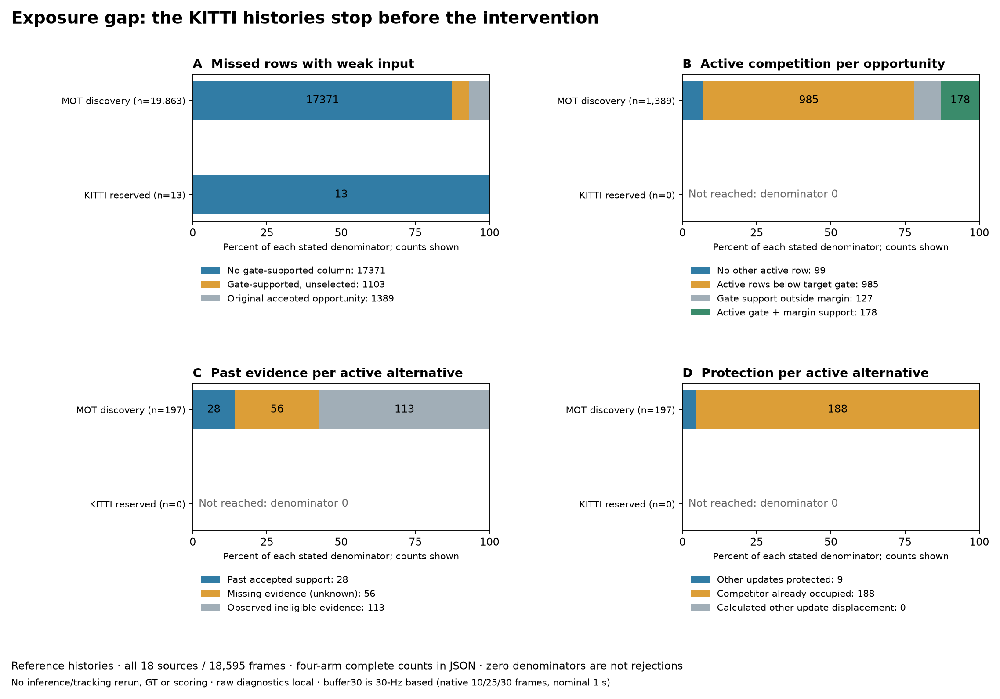

# Exposure-gap diagnosis on frozen histories — 2026-10-19

Follow-up: [Frozen read-only prediction, birth and expiry observation](tracking-upstream-lifecycle.md) now completes the proposed KITTI reference telemetry with original canonical output equality. This report retains the earlier no-rerun historical diagnosis.

[繁體中文](../zh-TW/tracking-exposure-gap.md) · [ROADMAP](../../ROADMAP.md) · [Source discovery/confirmation](tracking-past-exposure.md) · [Definitions](../validation/v0.3-exposure-gap-protocol.json) · [Aggregate](../validation/v0.3-exposure-gap.json) · [Buffer erratum](../validation/v0.3-buffer-semantics-erratum.json)

**The KITTI gap occurs before the intervention's accepted missed-row weak update.** KITTI-0004 has 13 missed-row/weak-input row observations in five frames; all 13 have no column reaching the original association gate, so no original accepted opportunity exists. KITTI-0005 has 46 detections, all weak, no high-stage birth seed and no hypothesis rows to continue. Neither source reaches active-competition/past-support/protection eligibility. Their zero vetoes therefore do not show that past qualification or update protection rejected recovery, and do not establish accuracy, safe identity or efficacy.



## Scope and frozen definitions

Accepted local definition freeze **`8b6b4230454626c87cb4f8fa54dccaf75d7d8eabf9cc56d706ed248869f9b66d`** at `2026-10-19T15:18:48.082172+00:00`, after 15 synthetic/pinned contracts and before new funnel extraction. Original 40/8/2 exposure outcomes were already known; this is descriptive post-hoc mechanism analysis, not independent confirmation or external preregistration. A pre-execution reconciliation typo (`joint` in the inherited schema versus diagnostic `joint_alternatives`) was corrected before the first trace traversal; the [preflight record](../validation/v0.3-exposure-gap-preflight.json) retains original/accepted hashes and the reversible one-line change. The unused initial definition/runner/seal remain local. No definitions, parameters or outcomes were selected after seeing the new funnel.

Read **all 18 original sources / 18,595 source frames / 74,380 trace frames**, all four arms' own first-repeat full histories, original source/cache/phase/trace seals and the ten original exposure counters. No new inference/tracking, labels, GT score or evaluator call; no new source, window, gate or default. Histories differ across arms and are not independent people or events. Do not pool them as new sample size or match native IDs across streams.

Reconstruct the native pre-veto matching from post-veto accepted pairs **union** deferred edges, verifying native maximize-similarity then gate, one-to-one assignments and unmatched partitions. Rebuild each stream's append-only accepted `(source frame, immutable cache detection index)` history, recording high then weak actual updates and never deferred edges or invented birth keys. Check every current competitor, past reason/key, original protection outcome and actual veto. **482,828 accepted-history age checks / 402,366 accepted observations** reconcile across four streams. Original IoU is float32, including current signed-gap arithmetic; past context uses the original Python-float comparison. Runtime/upstream hashes bind both conventions.

## Four distinct stages and denominators

1. **Missed weak-update opportunity:** confirmed pre-update age≥2 weak-stage row with weak input. Partition such rows into no gate-supported column, gate-supported but unselected by the original global assignment, and an original accepted missed-row weak edge. Only the last is an intervention opportunity. This diagnoses the recorded tracker state, not a GT miss or detection failure.
2. **Active competition per accepted edge:** no other active confirmed age1 row; active rows but no target gate support; target gate support outside the unchanged signed margin; or at least one gate+margin active competitor. Only remaining weak-stage rows are candidates here; hypotheses already matched in the high stage are outside this set. No active row does not mean no active track anywhere. Retained/unconfirmed alternatives remain separate. Opportunity edges and competitor alternatives have different denominators.
3. **Past support per active alternative:** supported, missing evidence, or observed ineligible evidence. Missing recorded history, missing same-stage comparison and competitor without accepted observation are unknown. Observed retained/unconfirmed role, below-gate and outside-margin evidence are distinct ineligibility, not missing. Keep original reason precedence; birth indices remain unrecorded.
4. **Update protection per active alternative:** already occupied, otherwise calculated replacement preserves other accepted row/detection pairs, or calculated replacement displaces another update. The occupied branch returns before alternative computation: occupied rejection is not measured displacement. Cross past supported/missing/ineligible with these three outcomes; retain all nine cells and zeros.

Conditional ratios use `null` for zero denominators. The KITTI active-competition/past/protection denominators are all zero: those stages were **not reached**, not measured as a 0% rejection or 0% success. Phase rates sum counts/durations before division, never average per-scene percentages. Nominal source time is685.0s for discovery /61.1s for confirmation, not execution throughput.

## Reference-history gap and all sources

MOT reference discovery has **19,863 missed rows with weak input**: 17,371 lack a gate-supported column; 1,103 have a gate-supported column but lose the original assignment; **1,389 accepted opportunities** remain (6.99% of these row observations;77.24 per1,000 source frames). Of 1,389 opportunities, 99 have no other active row, 985 only below-gate active rows, 127 gate support outside the margin, and **178 have active competition** (12.81%). These yield 197 active alternatives plus 8 eligible retained alternatives, never counted as active.

| Source | Weak-input missed rows | Below gate | Gate/unselected | Opportunities | Active competition edges | Past supported alternatives | Past missing | Protection pass | Occupied rejection | Displacement rejection |
| --- | ---: | ---: | ---: | ---: | ---: | ---: | ---: | ---: | ---: | ---: |
| MOT17-09-DPM | 1158 | 1057 | 40 | 61 | 18 | 2 | 13 | 0 | 27 | 0 |
| MOT17-10-DPM | 1289 | 1172 | 38 | 79 | 16 | 5 | 6 | 1 | 15 | 0 |
| MOT17-11-DPM | 1231 | 1197 | 14 | 20 | 4 | 1 | 3 | 0 | 4 | 0 |
| MOT17-13-DPM | 903 | 878 | 2 | 23 | 4 | 1 | 0 | 0 | 4 | 0 |
| MOT17-04-DPM | 594 | 548 | 5 | 41 | 1 | 0 | 0 | 0 | 1 | 0 |
| MOT20-01 | 360 | 269 | 60 | 31 | 5 | 0 | 0 | 0 | 5 | 0 |
| MOT20-02 | 3926 | 3164 | 443 | 319 | 55 | 8 | 8 | 2 | 57 | 0 |
| MOT20-06 | 1042 | 709 | 210 | 123 | 16 | 4 | 4 | 2 | 14 | 0 |
| MOT20-07 | 458 | 390 | 46 | 22 | 1 | 0 | 0 | 0 | 1 | 0 |
| MOT20-08 | 538 | 473 | 26 | 39 | 6 | 1 | 2 | 1 | 5 | 0 |
| MOT17-07-DPM | 731 | 664 | 28 | 39 | 10 | 1 | 6 | 0 | 12 | 0 |
| MOT17-08-DPM | 1907 | 1734 | 104 | 69 | 24 | 3 | 8 | 2 | 24 | 0 |
| MOT17-12-DPM | 1275 | 1232 | 8 | 35 | 4 | 1 | 2 | 0 | 4 | 0 |
| MOT17-14-DPM | 1599 | 1521 | 25 | 53 | 9 | 0 | 4 | 1 | 10 | 0 |
| MOT20-03 | 2212 | 1818 | 54 | 340 | 5 | 1 | 0 | 0 | 5 | 0 |
| MOT20-05 | 640 | 545 | 0 | 95 | 0 | 0 | 0 | 0 | 0 | 0 |
| KITTI-0004 | 13 | 13 | 0 | 0 | 0 | 0 | 0 | 0 | 0 | 0 |
| KITTI-0005 | 0 | 0 | 0 | 0 | 0 | 0 | 0 | 0 | 0 | 0 |


KITTI-0004:191 inputs / 164 weak / 68 weak-input frames; 70 missed rows in 25 frames, but only 13 row observations in five frames coexist with weak input and all 13 fail the original gate. There are no gate-supported-but-unselected rows: all 13 lack a passing column regardless of which global assignment is returned; the native solver still runs before gating. This is a score/state finding only: without GT or recorded predicted-box coordinates it does not identify detector localisation error, a wrong retained hypothesis, camera-motion error or a correct association.

KITTI-0005:46 inputs /46 weak in 39 frames; no high input, no remaining hypothesis rows, no accepted observations and no missed-row opportunities. Native births use unmatched high-stage inputs; weak continuation needs an existing hypothesis. Weak inputs are still passed through unchanged. This source supplies no initialization seed under the fixed high split; it does not prove absence of real people or that lowering the threshold is safe.

## Past evidence and update-protection rejection in discovery

For the **197 reference active alternatives**, 28 have past accepted active support, 56 have missing evidence (**51 missing same-stage comparison /5 competitor without accepted observation**), and 113 have observed ineligibility (**21 past retained /30 below gate /62 outside margin**). Missing recorded history and past-unconfirmed reasons are zero. Thus the 56 unknowns are not absent entire recorded prefixes; births still remain unindexed, and an absent same-stage comparison is not automatically an earlier-stage update or physical-identity negative.

Protection: **188 already occupied /9 preserve other updates /0 calculated displacement rejection**. The 188 occupied cases were not passed into forced-alternative computation; do not report them as 188 proven lost updates. All nine available solver-returned alternatives preserve other original accepted pairs, but this does not prove the selected missed-row update is safe to remove or that every possible alternative is safe. The displacement-rejection branch has no observed exposure here.

| Reference past category | Already occupied | Other updates protected | Calculated displacement |
| --- | ---: | ---: | ---: |
| Supported |26|2|0|
| Missing / unknown |54|2|0|
| Observed ineligible |108|5|0|

Only **two** reference alternatives meet both qualifications on the same competitor. All four discovery streams are reported separately below; in particular reference 28 supported alternatives cannot be subtracted from past-only 40 actual vetoes as a fixed-cohort causal effect. Vetoes alter later histories. All KITTI streams have the same upstream zero-opportunity result.

| Discovery arm | Opportunities | Active competition edges | Active alternatives | Past supported / missing / ineligible | Protected / occupied / displaced | Actual vetoes |
| --- | ---: | ---: | ---: | --- | --- | ---: |
| activation_control | 1389 | 178 | 197 | 28 / 56 / 113 | 9 / 188 / 0 | 0 |
| past_support_only | 1384 | 182 | 207 | 41 / 52 / 114 | 7 / 200 / 0 | 40 |
| update_protection_only | 1399 | 174 | 193 | 27 / 54 / 112 | 8 / 185 / 0 | 8 |
| past_support_and_protection | 1393 | 175 | 194 | 27 / 55 / 112 | 8 / 186 / 0 | 2 |


## Corrected buffer interpretation, unchanged execution

**The earlier description of buffer 30 as30 native KITTI frames /3seconds was wrong.** Pinned Roboflow scales this30-Hz-based parameter as `max(1, ceil(frame_rate /30 * lost_track_buffer))` for positive values. With the unchanged parameter 30, configured maximum missed frames are **10 at 10 Hz /25 at 25 Hz /30 at 30 Hz**, nominally **one second** in each profile; the native time budget is also30/30=1s. Snapshot ages and the age≥2 eligibility stay in native-frame units. Lifecycle boundary conditions/sampling are not a certified physical timeout.

The [erratum](../validation/v0.3-buffer-semantics-erratum.json) binds original protocol and helper hashes. Human-readable prior reports/ROADMAP are corrected; original frozen JSON prose, configuration, predictions, diagnostics and their hashes remain intact. This is a frozen-prose/implementation discrepancy: these runs follow the pinned native scaling, not the stated 3 second interpretation, and cannot validate a native 30-frame / 3-second policy at 10 Hz. The correction is not retuning or a new causal explanation for the gap. No result was rerun or rescored because of it.

## Decision and next step

**Keep the intervention, weak continuation and defaults unchanged. Prioritize upstream observability, not a fitted new gate.** First freeze read-only telemetry for prediction boxes/states and birth/prune reasons on the same immutable inputs, then augment only an unhooked reference execution and require exact canonical prediction equality to the existing seal. Focus on KITTI-0004's13 below-gate rows and KITTI-0005's lack of high-input seeds. Current IoU matrices cannot uniquely recover predicted-box geometry, so that rerun/telemetry would be new work and was **not performed here**.

Separate low-score observation availability, confirmed-hypothesis availability, expiry and geometric mismatch before deciding a control or detector experiment. Do not infer which physical identity is correct or a safe lower activation/high threshold from these GT-free counts. All these sources are now seen. Any new exposure search still needs its own frozen ordered discovery and genuinely untouched confirmation; independent exposure and the prior GT per-scene/paired harm gates remain open. Prior bus-HOTA, long-occlusion, hardware and calibrated 3D limits stay open.

## Reproduction, tests and public boundary

```bash
# Original pinned research runtime; no detector, tracker or GT path is used.
python tools/diagnose_tracking_exposure_gap.py analyze \
  --protocol docs/validation/v0.3-exposure-gap-protocol.json \
  --seal artifacts/tracking-exposure-gap/freeze.local.json \
  --discovery-inputs artifacts/tracking-past-exposure/discovery-inputs.local.json \
  --confirmation-inputs artifacts/tracking-past-exposure/confirmation-inputs.local.json \
  --raw-root artifacts/tracking-past-exposure \
  --output artifacts/tracking-exposure-gap/reproduced-summary.local.json \
  --local-details artifacts/tracking-exposure-gap/reproduced-cases.local.jsonl
python tools/plot_tracking_exposure_gap.py \
  --summary docs/validation/v0.3-exposure-gap.json \
  --output artifacts/tracking-exposure-gap/summary.png
```

Two complete traversals produce **byte-identical public aggregates and local case files**; repeat analysis does not add independent evidence. Pinned related contracts **113 passed**, including 15 new diagnostic contracts; base application suite **422 passed /34 optional skipped**. A base-profile fixture injects the project's existing tiny exhaustive solver only into these synthetic tests so SciPy need not become a base dependency; opt-in research tests and every actual diagnostic traversal use the original pinned SciPy solver. Frozen diagnostic/control/test bodies are unchanged by that test-only fixture; it adds no runtime path or analysis intervention.

Public allowlist/links/obvious-secret checks, source archive and synthetic-only site build checked; figure visually inspected. Original [source terms and attribution](tracking-past-exposure.md#reproduction-terms-and-public-boundary) remain in force: local noncommercial research, no media/GT/raw-result redistribution or dataset relicensing. Public output contains fixed definitions, source hashes, all-source counts/ratios/reasons, the erratum and numeric plots. Raw rows/matrices, frame positions, ownership tokens, accepted observations and cases stay in ignored local artifacts.
