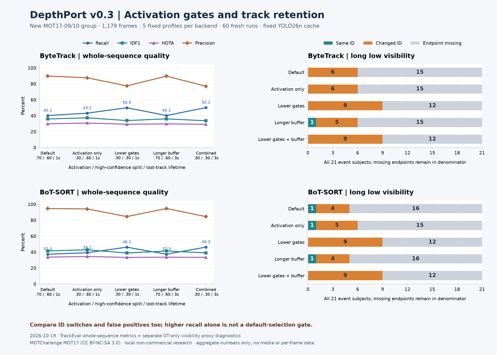

# Tracking parameter acceptance — 2026-10-19

Follow-up [activation-error diagnosis](tracking-error-diagnosis.md) reconciles added/removed CLEAR errors, reviews local cases and prioritises improvement experiments.

[繁體中文](../zh-TW/tracking-parameter-acceptance.md) · [Previous three-scene comparison](tracking-expanded-acceptance.md)

This is a fixed-profile sensitivity study on a new sequence group. It assesses whether lower activation gates and a longer lost-track buffer improve missing tracks and long-visibility-loss ID continuity. It does not select a production default or establish held-out benchmark accuracy.



[Fixed protocol](../validation/v0.3-tracking-tuning-protocol.json) · [Complete aggregate record](../validation/v0.3-mot17-parameters.json)

## Sources and terms

The official [MOT17 archive](https://motchallenge.net/data/MOT17/) provides [CC BY-NC-SA 3.0](https://creativecommons.org/licenses/by-nc-sa/3.0/) terms; original-source conditions can also apply. Attribution: MOTChallenge contributors, MOT17/MOT16 annotations. MOT17-09-DPM (525 frames, fixed low-angle pedestrian view, visually checked) and MOT17-10-DPM (654 frames, moving camera at night) are used locally for non-commercial research. Both are 30 fps. No 04/11/13 sequence from the previous acceptance is reused, and detector-labelled variants are not counted as separate scenes.

The 1,179 compressed preview frames are 960×540, while GT is 1920×1080. Official archive/GT/metadata and video/cache hashes are verified. Predictions scale 2× into GT resolution, then x/y shift +1 into MOT coordinates. Only aggregates, configuration/source identifiers, hashes and the chart are public. Media, GT, event windows/identities, per-frame predictions, weights, audit images and local paths remain local; the application's AGPL terms do not relicense dataset material.

## Fixed design

Candidates were frozen before any tracker run on this group in the locally timestamped protocol (not an independent study registration). One real CPU YOLO26n cache per scene is shared by every profile: Ultralytics 8.4.115, image size 640, confidence .10, NMS .70, person class 0, cap 64. No detector or model change from the previous comparison. Roboflow Trackers 2.6.1 runs in the separate NumPy 2.2.6 environment; the application keeps NumPy 1.26.4. No ReID, CMC ablation, worker IPC or app-default change.

Five profiles apply equally to ByteTrack and BoT-SORT. Values are **activation / high-confidence split / lost buffer**:

- **Default:** .70 / .60 / 30.
- **Activation only:** .30 / .60 / 30.
- **Lower gates:** .30 / .30 / 30.
- **Longer buffer:** .70 / .60 / 90.
- **Lower gates + longer buffer:** .30 / .30 / 90.

The buffer is expressed in **30-fps reference frames**: 30 is one second, 90 is three seconds; the library scales it to source FPS. Every other parameter stays at its pinned default (including two-frame confirmation, association thresholds and BoT-SORT CMC). A new track must pass the high-confidence split as well as activation; lowering activation below an unchanged .60 split cannot admit .30–.60 detections as new tracks. Lowering the split also changes which association stage sees detections, and BoT-SORT's foreground mask for CMC; this is not a pure activation-only effect.

The tool verifies effective backend thresholds and time budget. Three fresh runs per backend/profile/scene, rotated order, OpenCV RNG seed 0 / one OpenCV thread give **60 completed runs**. Timing includes first update and excludes detector/decode/startup; median trial P50/P95 is descriptive single-host timing, not end-to-end acceptance. A preliminary run was discarded after correcting the 09 camera annotation from moving to fixed during visual audit; the complete recorded run uses the corrected annotation and unchanged candidate parameters.

Whole-sequence CLEAR (IoU .5), Identity and HOTA use clean pinned [TrackEval](https://github.com/JonathonLuiten/TrackEval/tree/12c8791b303e0a0b50f753af204249e622d0281a), with official MOT17 pedestrian/distractor preprocessing. NumPy aliases are supplied in memory only; combined scores use the evaluator's combiners.

## Results

Combined official metrics over 18,164 pedestrian GT observations; each line lists **Recall / Precision / IDF1 / HOTA** (percent), followed by **ID switches / false positives**. Per-scene counts, fragmentation, timing and canonical prediction hashes remain in JSON. All repeated canonical predictions agree.

**ByteTrack**
- **Default:** 40.15 / 89.80 / 35.87 / 29.85; **140 / 828**.
- **Activation only:** 43.21 / 87.53 / 37.38 / 30.82; **170 / 1,118**.
- **Lower gates:** 50.02 / 77.40 / 33.91 / 29.29; **432 / 2,652**.
- **Longer buffer:** 40.25 / 89.63 / 36.04 / 29.77; **139 / 846**.
- **Lower gates + longer buffer:** 50.14 / 76.99 / 33.67 / 29.25; **449 / 2,722**.

**BoT-SORT**
- **Default:** 37.34 / 94.67 / 41.51 / 33.71; **49 / 382**.
- **Activation only:** 39.21 / 94.18 / 42.96 / 34.52; **58 / 440**.
- **Lower gates:** 46.21 / 84.59 / 38.88 / 33.39; **205 / 1,529**.
- **Longer buffer:** 37.34 / 94.67 / 41.43 / 33.66; **49 / 382**.
- **Lower gates + longer buffer:** 46.29 / 84.55 / 39.05 / 33.40; **201 / 1,537**.

**Activation-only is the modest coverage candidate here:** Recall rises 40.15→43.21% for ByteTrack and 37.34→39.21% for BoT-SORT, with higher IDF1/HOTA. It still only admits new tracks above the unchanged .60 split. Its cost is IDSW 140→170 and 49→58, and FP 828→1,118 and 382→440; it is not an unconditional improvement.

**Lowering both gates is more aggressive:** Recall reaches 50.02% / 46.21%, but Precision falls to 77.41% / 84.59%, IDSW rises to 432 / 205, and combined IDF1/HOTA is lower than each backend default. Longer retention adds little coverage on top of these gates and does not recover long-event IDs. We do not promote the .30/.30 profiles or change any application/worker default.


## Scenario evidence and limits

GT-only rules from the previous comparison are retained: visibility ≤.30 for ≥1s, with ≥.60 visible anchors within 1s either side; projected box overlap IoU ≥.10 plus horizontal order exchange defines crossing candidates. **21 long-low-visibility events / 21 subjects** and **23 overlap/order-exchange events / 46 subject appearances** qualify. Custom endpoint diagnostics use full-frame one-to-one IoU≥.5 matching after official preprocessing; they are separate from official scenario MOT metrics. Missing endpoints stay in the all-subject denominator.

Paired diagnostics compare each candidate with its own backend default on the exact same event/subject cohort. They count same-ID gains from changed/missing endpoints, losses, and endpoint-coverage gains/losses. IDs are compared within a run, never by raw ID number across runs.

Visual spot-checks cover each scene's longest low-visibility candidate and first GT-ID-sorted crossing candidate: **4 of 44 candidates, 12 before/event/after frames**. They support visibility loss and image-plane order exchange, not certified physical occlusion or 3D crossing. Raw audit images stay local. A separate synthetic real-library contract confirms .40 detections cannot spawn behind the .60 split, that lowering both gates permits activation, and that a stationary track can survive a 45-frame gap with the three-second buffer. This mechanism check is not real-video recovery evidence.

In profile order (Default / Activation only / Lower gates / Longer buffer / Combined), **same-ID long-event counts out of 21** are **0 / 0 / 0 / 1 / 0 for ByteTrack**, **1 / 1 / 0 / 1 / 0 for BoT-SORT**. At least one endpoint is missing in **15 / 15 / 12 / 15 / 12** and **16 / 15 / 12 / 16 / 12**, respectively.

The paired check confirms ByteTrack's longer buffer changes **one previously changed-ID event into same-ID**, with no loss of a default same-ID event; this case is in moving-camera sequence 10. BoT-SORT gains no long-event continuity from retention alone. Both lower-gate BoT-SORT profiles **lose the default's one same-ID event** in fixed-view sequence 09. The lower gates recover matched endpoints for 3 ByteTrack / 4 BoT-SORT subjects, but those additional endpoints do not become same-ID recovery.

For crossing proxies, same-ID counts out of 46 are ByteTrack **16 / 17 / 17 / 16 / 17**, BoT-SORT **23 / 25 / 26 / 23 / 24**. Missing endpoints are **15 / 12 / 10 / 14 / 9** and **18 / 15 / 11 / 18 / 11**. This coverage gain also needs the whole-sequence false-positive/IDSW trade-off above.

The one ByteTrack gain and one BoT-SORT regression received additional before/event/after visual checks for default versus candidate (two targeted cases, 12 rendered panels). They support the annotated subject's visibility loss and endpoint-state changes, without proving uninterrupted correct identity through the event. Raw images and match IDs stay local. **One recovery among 21 subjects is not a passed general long-occlusion gate.** Keep activation-only as a research candidate; next evaluate ID-switch/false-positive causes and association under motion before selecting defaults or adding ReID. No further parameters were searched on these results.


This group is new to this project's comparison but belongs to MOT17 training previews. It is an exploratory sensitivity study, not an unbiased final selection/test split. Long-low-visibility is not necessarily a detection-free interval; same endpoint ID does not prove continuous correct tracking or identity purity through the event. No real RTSP, calibrated 3D, Windows real-model/worker, endurance or end-to-end throughput gate is closed here.

## Reproduce

Create the two caches with the same flags as [the previous reproduction](tracking-expanded-acceptance.md#reproduce-locally), using official URLs and hashes from the aggregate JSON. Use a separate environment with `requirements-tracking-worker.txt`, the recorded SciPy version and clean pinned TrackEval. Prepare the local manifest format described there, with 09 marked fixed and 10 moving. The sweep rejects earlier 04/11/13 scenes.

```bash
.venv-trackers/bin/python tools/validate_mot_tracking.py \
  --manifest local/mot17-new-group.json --trackeval-root local/TrackEval \
  --work-dir outputs/mot17-parameters --output outputs/mot17-parameters.json \
  --repeats 3 --parameter-sweep

# Optional real-library mechanism contracts in that same isolated environment:
# Install pytest>=8,<10 there; this does not install it in the depth environment.
RUN_TRACKERS_CONTRACTS=1 .venv-trackers/bin/python -m pytest -q tests/test_tracking_parameters.py
```

`run_video_tracker(..., parameters={...})` accepts only bounded direct-library activation/split/buffer overrides. Unknown keys, invalid numbers and worker/Baseline overrides fail explicitly. Default callers keep the prior behavior. The tool performs no network operation; review aggregate output before publication. CI uses synthetic contracts and leaves the real-library contracts opt-in; it does not download datasets, trackers or model weights.
