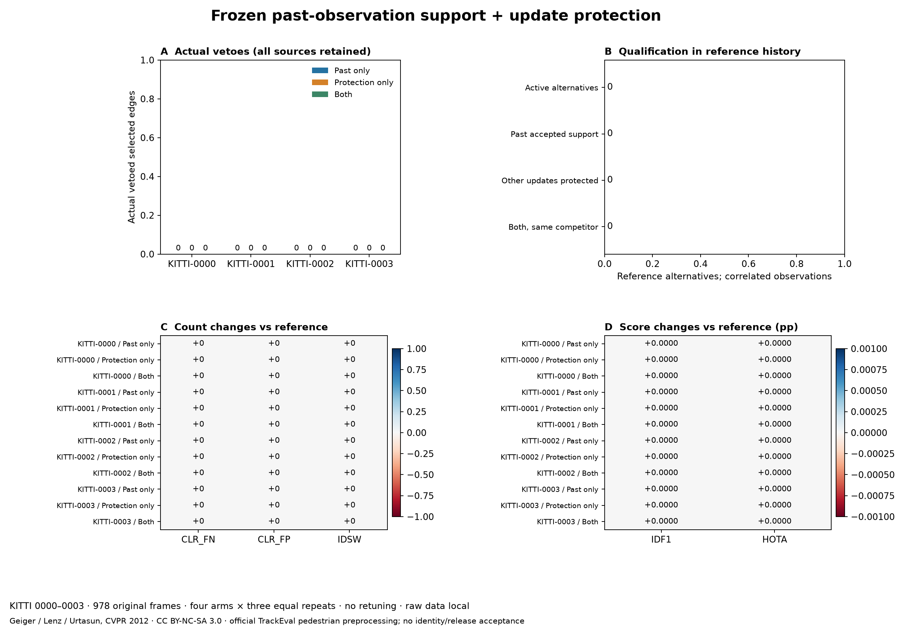

# Frozen past-observation support and update protection — 2026-10-19

[繁體中文](../zh-TW/tracking-past-support.md) · [ROADMAP](../../ROADMAP.md) · [Prior temporal diagnosis](tracking-temporal-support.md) · [Protocol](../validation/v0.3-past-support-protocol.json) · [Input lock](../validation/v0.3-past-support-inputs.json) · [Aggregate](../validation/v0.3-past-support.json) · [Reporting amendment](../validation/v0.3-past-support-report-amendment.json)

Follow-up: [same-rule GT-free discovery and reserved confirmation](tracking-past-exposure.md) finds actual triggers in all three treatments on seen MOT discovery, but neither new reserved KITTI source triggers; independent exposure remains unverified. This historical scored study and its original freeze/amendment are preserved.

**Independent group completed; no effective exposure, so usefulness is still unverified.** All four complete KITTI sources have zero qualifying active competitors and zero vetoes in each treatment. Predictions and official scores equal the reference. Per-scene harm conditions pass with no added FN/IDSW, but every treatment fails the frozen exposure/quality gate. Do not loosen eligibility, replace sources or promote defaults from this result.



## Freeze, sources and unchanged settings

The original local protocol was sealed at `2026-10-19T14:21:20.822827+00:00`, SHA-256 **`ff4a9720a0cf039e39255b49054dd68d5d3e8e092e970f4020fc1b5d6362c395`**, after synthetic/pinned contracts and source preparation, before the first new inference/tracker output or GT-member read. A separate source-intent hash fixes the first four training IDs in lexical order, **0000–0003**, without outcome-based replacement. This is local prospective freezing, not external preregistration; previous MOT diagnostic outcomes were known. These KITTI sources had no prior project tracking in the public validation ledger. They form a new dataset group relative to the MOT history, sharing pretrained detector/runtime; four non-random driving sources are not independently sampled camera sites or participants.

All **978 original frames** are retained: no clipping, resampling or frame selection. ZIP CRCs and per-PNG hashes were checked; FFV1 BGR playback is pixel-identical to every original PNG at **1242×375, 10 Hz**, including the odd source height. The protocol binds video/image-manifest hashes; the later input lock binds the one shared full cache per source and untouched labels ZIP/directory CRC/size metadata before tracking. Label member contents remain unopened until all predictions seal.

Frozen YOLO26n person class 0 / **Ultralytics 8.4.176 CPU**, confidence .10, image size 640, NMS .70, max 64, unchanged weight hash; zero frames hit the detection cap. Tracking keeps activation **.30**, high confidence **.60**, buffer parameter **30 (30-Hz reference)**, confirmation **2**, signed margin **.05**. **Buffer erratum:** the native helper scales parameter 30 to 10 frames at 10 Hz, nominally1second; the earlier 3 second interpretation was wrong. [Correction and original hashes](../validation/v0.3-buffer-semantics-erratum.json); no code, setting, output or original frozen-protocol changes. Research runtime: trackers 2.6.1 / NumPy 2.2.6 / SciPy 1.18.1 / supervision 0.27.0 / OpenCV 4.11.0.86. No application/worker registration or default change; weak inputs and active weak continuation stay intact.

## Causal rule and four separate arms

At the original weak-stage assignment, consider a confirmed selected hypothesis with pre-update age≥2. The same-column competitor must reach that stage's original gate and satisfy selected-score minus competitor-score≤.05. **Active** means confirmed with pre-update age1; retained predictions and unconfirmed hypotheses are logged separately and cannot veto.

1. **Past accepted support:** both hypotheses have nonempty recorded accepted-observation histories before the decision. At the selected hypothesis's last accepted observation, strictly earlier than now, the competitor must be in that same stage, already active/confirmed, and have its own distinct accepted observation at that past frame. Its same-column score must pass that stage's gate and the unchanged signed margin. Check immutable `(frame, original cache detection index)` ownership, never native-ID equality. No future +1…+30 reference continuation or fitted N enters eligibility.
2. **Update protection:** the competitor currently has no other accepted weak update. Hypothetically force it onto the selected column, solve the residual unfiltered one-to-one assignment, then gate as upstream does. **Every other original accepted row/detection pair** must survive and accepted count cannot decrease. Preserving just the count or row membership is insufficient. No opportunity-cost cutoff or optimizer-tie requirement. This tests the solver-returned alternative only; no alternative is installed.
3. **Conjunction:** both qualifications must hold for the **same competitor**. Any eligible competitor removes only the selected edge, returning its row/detection unmatched; all decisions use the unchanged original matching. The intended lost selected update is deliberately excluded from protection and remains a harm risk. Upstream input is unchanged, and a deferred weak detection stays in upstream output with ID−1.

Arms: `activation_control` (no veto), `past_support_only`, `update_protection_only`, `past_support_and_protection`. Each has its own append-only history after divergence; record only actually accepted high/weak edges after decisions. Keep strong object references to avoid ownership reuse. Missing histories, absent same-stage comparison, competitor without accepted observation, retained/unconfirmed state, below-gate and unsupported gap have distinct reasons. Missing evidence is unknown, not proof of a correct/incorrect physical identity. Birth indices are unavailable and never invented.

## Harm and usefulness gates fixed before outcomes

Every scene must have **no increase in FN, FP, IDSW or Frag**, no decrease in IDF1/HOTA, and **zero added paired GT×frame FN and IDSW**; deterministic comparisons are exact. A lower total FN or other improvement cannot offset a newly missed GT observation or new switch. FP pairing is also reported and reconciled, without an additional zero-added-FP requirement. GT ordering and boxes are verified equal across arms before pairing; counts reconcile to official CLEAR.

Effective exposure requires an **actual veto and nonzero evaluated pedestrian GT**. Each effectively exposed scene must also strictly improve at least one FN/FP/IDSW/IDF1/HOTA metric with all harm gates passing. Group acceptance requires all four scenes' harm gates plus **at least two effectively exposed scenes** and all their quality gates. Zero-GT sources retain FP/harm checks but cannot establish identity benefit. No-exposure quality is `null`, never vacuous success; an aggregate cannot override a harmed scene.

## Full independent-source ledger

The following values apply to **all four arms**, with identical canonical predictions. All per-arm metrics, repeat/full-trace hashes, paired errors, eight reference risk cells (including zeros) and scene gates are in the aggregate; no arm or source is dropped.

| Source | Frames | Cached detections | Evaluated GT | TP | FN | FP | IDSW | Frag | IDF1 | HOTA |
| --- | ---: | ---: | ---: | ---: | ---: | ---: | ---: | ---: | ---: | ---: |
| KITTI-0000 | 154 | 326 | 19 | 5 | 14 | 155 | 0 | 1 | 5.5866% | 8.9587% |
| KITTI-0001 | 447 | 107 | 106 | 25 | 81 | 0 | 0 | 0 | 38.1679% | 18.5598% |
| KITTI-0002 | 233 | 286 | 180 | 101 | 79 | 14 | 0 | 0 | 68.4746% | 43.7264% |
| KITTI-0003 | 144 | 13 | 0 | 0 | 0 | 0 | 0 | 0 | 0.0000% | 0.0000% |

There are **732 cached detections, 305 evaluated pedestrian observations, TP131 / FN174 / FP169 / IDSW0 / Frag1** across these disjoint scenes. Rates above are scene-specific, not averaged. KITTI-0003 has no evaluated pedestrian GT and no emitted predictions; its reported zero identity scores are evaluator conventions, not evidence of perfect tracking. Three other sources have limited evaluated pedestrian support, and the reference already has zero ID switches here.

| Treatment | Actual vetoes | Effectively exposed scenes | Added FN / IDSW | All scene harm gates | Exposure / quality accepted |
| --- | ---: | ---: | --- | --- | --- |
| Past support only | 0 | 0 | 0 / 0 | Pass | **No** |
| Update protection only | 0 | 0 | 0 / 0 | Pass | **No** |
| Both, same competitor | 0 | 0 | 0 / 0 | Pass | **No** |

All four sources have zero reference active alternatives; past/protection/joint qualifications and all eight risk-group cells are consequently zero. This is absence of applicable exposure, **not evidence that past qualification or protection rejected a harmful competitor**, and not a finding that either rule is too strict. Missing-evidence reason counts are also zero here; the separate missing-state behavior is checked by synthetic contracts, not established on real qualifying cases in this group.

## Execution and scoring

**48 full runs** (four arms × three repeats×four sources), rotated arm order, fresh tracker each run, OpenCV one thread/seed0; every repeated canonical prediction and complete trace hash agrees. Four additional unhooked reference runs agree with the observed reference. All source/arm predictions and repeat checks were sealed together **before GT members were decompressed/parsed**, then scored using clean official TrackEval commit `12c8791b303e0a0b50f753af204249e622d0281a`, native `Kitti2DBox` pedestrian preprocessing, CLEAR/Identity/HOTA. KITTI frames stay zero-based xyxy in evaluator input; no improvised MOT GT conversion.

Official preprocessing handles sitting-person distractors, occlusion/truncation and DontCare, and removes unmatched small predictions (height≤25). Thus evaluated GT/detections differ from raw cache counts. The source is vehicle-mounted recording at 10 Hz; no claim that every frame has camera movement. These counts are not complete long-occlusion/crossing-event endpoint acceptance. The optional unrelated BURST adapter reports missing pycocotools at import; KITTI loads and scores successfully without changing evaluator code. NumPy legacy aliases are supplied only in the isolated evaluation process.

### Report-only repairs after the prediction seal

Original tracking, original protocol and all its control/test hashes remain fixed. The first aggregation hit a missing-stage `IndexError` on an empty-hypothesis frame after the KITTI-0000 reference metrics were computed. Report-only resumption then exposed a newline-only empty KITTI prediction file rejected by the official parser on 0003, after the first three sources were scored. Both repairs are disclosed in the [amendment](../validation/v0.3-past-support-report-amendment.json): count empty frames with no audit/veto without indexing a stage, and write **zero bytes** for empty predictions. The new resume command verifies frozen source/cache/archive/prediction/trace seals and unchanged control code, and never calls a tracker. GT had already been read when these reporting fixes were made; this is not a new blind run or a replacement freeze.

A [reversible patch](../validation/v0.3-past-support-report-fix.patch) reconstructs the exact original frozen runner; its original hash stays in the protocol, its amended hash in the amendment. No parameters, accepted edges, cached detections, hypotheses, GT, selected sources or harm gates change. Two report-only passes produce byte-identical aggregate results from the original predictions. New studies can use the repaired `freeze`/`validate` commands with their own new protocol; do not refreeze this historical study or run its original protocol against an amended implementation without the explicit reporting amendment.

## Decision and next gate

**Keep current defaults and weak continuation.** The independent run is complete, but effective exposure and intervention usefulness remain unverified. Do not tune duration, margin, activation or buffer from these negatives, or relabel an untriggered control as safe recovery.

Next freeze a **GT-free exposure-selection procedure for these exact rules**, a complete ordered licensed discovery ledger, and genuinely untouched reserved confirmation sources before running it. Select on actual control triggers using each arm's own history, not GT scores; keep all zero/failure sources, then evaluate all prespecified held-out sources under the same per-scene harm gates. The current four KITTI sources are now seen and cannot serve as fresh independent confirmation. Long-occlusion/crossing endpoints, prior bus HOTA regression, detector localisation, full installation/hardware/real-time and calibrated 3D accuracy stay open.

## Source terms, reproduction and public boundary

KITTI's [official terms](https://www.cvlibs.net/datasets/kitti/) state CC BY-NC-SA 3.0; [tracking specification](https://www.cvlibs.net/datasets/kitti/eval_tracking.php) and [10-Hz vehicle setup](https://www.cvlibs.net/datasets/kitti/setup.php) define this source. Attribution: **Andreas Geiger, Philip Lenz, Raquel Urtasun, “Are we ready for Autonomous Driving? The KITTI Vision Benchmark Suite,” CVPR 2012.** Local noncommercial research only; no leaderboard submission. Original media/GT/cache/weights/raw predictions are not redistributed; program AGPL does not relicense the dataset. Terms-page hash and official archive URLs are in the protocol.

```bash
# Original predictions and traces stay in local ignored artifacts.
# Verify the published protocol plus report-only amendment; this command does not track.
python tools/validate_tracking_past_support.py resume-report \
  --protocol docs/validation/v0.3-past-support-protocol.json \
  --seal artifacts/tracking-past-support/freeze.local.json \
  --manifest artifacts/tracking-past-support/manifest.local.json \
  --input-lock docs/validation/v0.3-past-support-inputs.json \
  --amendment docs/validation/v0.3-past-support-report-amendment.json \
  --trackeval-root artifacts/expanded-tracking-acceptance/TrackEval \
  --work-dir artifacts/tracking-past-support/run \
  --output artifacts/tracking-past-support/reproduced-summary.local.json
python tools/plot_tracking_past_support.py \
  --summary docs/validation/v0.3-past-support.json \
  --output artifacts/tracking-past-support/summary.png
```

Application suite **401 passed / 29 optional skipped**; pinned real-library related contracts **87 passed**, including **33** new causal/control/reporting contracts. These include real pinned-library contested deferrals and weak continuation, past/retained/missing evidence, same-competitor conjunction, preservation of each other accepted pair, hook restoration and empty-frame/file regressions. No new UI interaction or physical camera/GPU acceptance is claimed. Public allowlist, links, obvious-secret patterns, source archive and synthetic-only site build checked; figure visually inspected. Public output includes only source hashes/counts, fixed rules, aggregate scores/reasons and numeric charts. Raw images, GT, matrices, IDs, histories, paths and diagnostics remain in ignored local artifacts.
