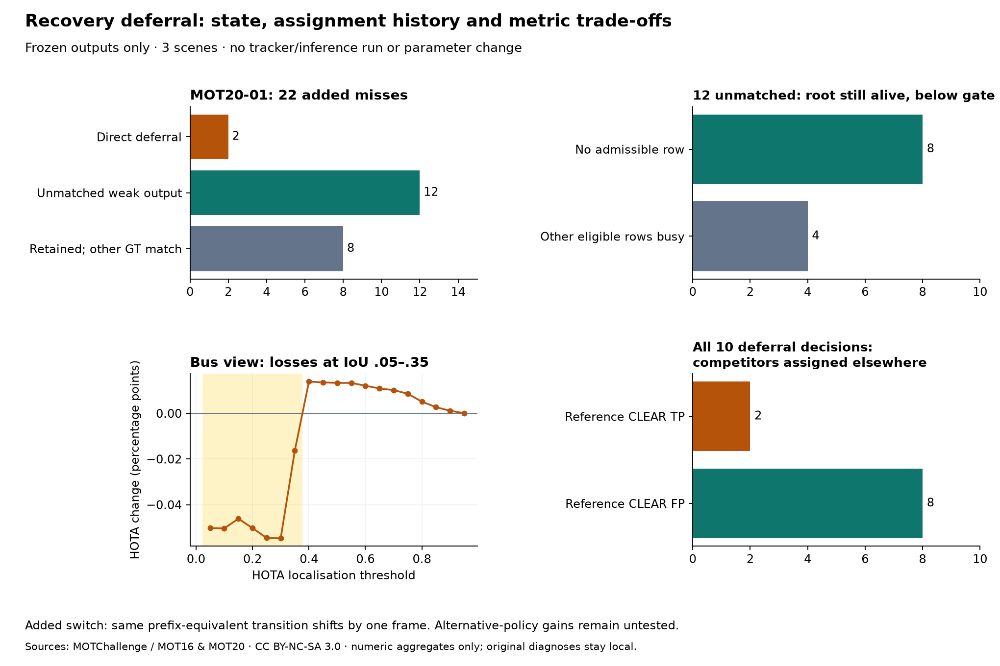

# Recovery-deferral state and association-history diagnosis — 2026-10-19

[繁體中文](../zh-TW/tracking-recovery-history.md) · [ROADMAP](../../ROADMAP.md) · [Previous replication](tracking-recovery-moving.md) · [Aggregate record](../validation/v0.3-recovery-history.json)

**No retuning, tracking or inference; the original control/defaults remain unchanged.** Three mechanisms are separated: retained hypotheses losing geometric support, CLEAR continuity priority reallocating GT matches, and removed low-localisation observations creating a HOTA/CLEAR trade-off. The next control point is **whether competition evidence is actually exclusive and available**. These data do not justify a new numeric gate or a fix claim.



## Scope and validation

Read only frozen MOT20-01 / MOT17-11/13 detections, predictions, GT and full traces. No detector/tracker run, threshold search, ReID, CMC, buffer or confirmation change. Active weak continuation, uncontested recovery and all raw weak inputs remain unchanged. This is post-hoc diagnosis of known failures, not independent acceptance or preregistration.

Check original policy/runner/probe, inputs, predictions, traces, evaluator files and published-record hashes. Every scene's official CLEAR/Identity/HOTA reproduces exactly. An isolated audit process observes the original solver arguments/results in pinned [TrackEval HOTA](https://github.com/JonathonLuiten/TrackEval/blob/12c8791b303e0a0b50f753af204249e622d0281a/trackeval/metrics/hota.py), restoring the function on exit/failure; every HOTA field is exactly equal to unobserved evaluation. No replacement metric implementation.

Two analysis runs produce identical aggregate JSON and all local solver/history JSON hashes. This does not add independent samples. Public output contains fixed-label counts, cost distributions and threshold-level numbers only; matrices, correspondence bridges, frame/ID/GT locations stay local. Retain [prior source terms](tracking-recovery-moving.md): MOTChallenge / MOT16 and MOT20, applicable CC BY-NC-SA 3.0, local non-commercial research. No media/GT redistribution; application AGPL does not relicense inputs.

## Align histories without comparing native IDs

Use immutable (frame, cache-detection index) observations. Find a target hypothesis through its last common input, then require **equal nonempty complete observation histories before intervention**. Native ID numbers are never compared across arms; already-diverged histories are not forced into a bridge. This establishes equal input histories, not real-person identity.

Join GT only after tracking. Official ownership, geometric support and proximity remain diagnostic contexts, not physical causal labels. The reference can already contain identity errors.

## The earlier 22 added misses follow three paths

Keep the original **2 direct / 12 unemitted weak / 8 still emitted** classification and add history evidence:

- **12 unemitted observations:** all bridge to one hypothesis with equal pre-intervention history. At every miss the candidate remains confirmed in the weak stage, predicted age **6–18 frames**, not expired. Its IoU to the reference observation is **below the original .10 gate in all 12**; a short retention budget is not the explanation.
- **Eight** have no admissible row; **four** have other admissible rows already assigned elsewhere, with no idle eligible row. Geometric support is not an available one-to-one association or evidence for a residual-rematching repair.
- The reference hypothesis supplies these observations while matching **four distinct GT owners** over the linked history. Its updates and candidate geometry diverge after deferral. Coverage loss is accompanied by reference cross-GT handoffs; these are not all established same-person recoveries being destroyed. No evidence for blanket IoU relaxation or longer retention.
- **Eight still emitted:** all survive official preprocessing and match another GT under CLEAR; that owner has continuity priority in every case. Separate per-frame IoU .5 matching without continuity would match the original GT in **5/8**. This diagnostic does not replace official scores; it identifies association-history/competition effects rather than a missing current raw detection.

The remaining **two** are genuinely direct deferrals and remain harms in the record. Counts are correlated observations, not 22 independent people/events.

## The added switch is a one-frame timing shift

The earlier **one added IDSW location** pairs with the reference's same-GT transition one frame earlier. Both sides of the transition have equal pre-intervention observation histories across arms; the candidate misses one frame and performs the prefix-equivalent transition **one frame later**.

Thus (frame,GT) pairing registers an added and a removed location. This case supports **timing displacement of an existing transition**, not an additional demonstrated physical identity error. Keep original official totals/location counts and do not generalise to other events.

## Bus-view HOTA: locate the localisation-threshold trade-off

Bus HOTA remains **24.9588→24.9473%**, not a pass. Observing the original solver reproduces official TP at all 19 thresholds and every HOTA field:

- Lost matches occur only at **α=.05–.35**: **five distinct GT-frame locations** after removing cross-threshold repetition. Reference IoUs are about **.3038–.3857**. These boxes are not TP under CLEAR .5 but provide matches at lower HOTA thresholds.
- All five original observations disappear from candidate output: **two at deferral**, **three later on hypotheses bridged by equal pre-intervention histories**. This is loss of confirmed-ID observations, not filtering raw weak inputs; the cache is unchanged. All three later hypotheses remain present: two have admissible edges but are assigned elsewhere; one falls below gate. They are not all expiry or another direct veto.
- Other geometric support can remain, but official globally weighted one-to-one assignment does not give it to that GT. HOTA uses sequence-level association alignment before localisation filtering. A current box is not necessarily an available replacement, and CLEAR .5 alone cannot explain all effects.
- α=.05–.35 contributes about **−.01697 percentage points** to the overall mean; α=.40–.95 about **+.00552**, net **−.01145**. Higher-threshold gains do not offset lower-threshold losses.

There is a trade-off between reducing CLEAR FP and retaining low-localisation pedestrian observations. Removed CLEAR FP are not proof of nonexistent people. MOT17-11 loses no match and gains one at each .60/.65 threshold; keep scenes separate and do not cancel acceptance failures with pooled scores.

## Next control point: effective exclusive competition

Across all **10 deferrals** (reference CLEAR **2 TP / 8 FP**), each decision has only active competitors **already assigned to other detections**. The current same-column margin still treats occupied hypotheses as blocking evidence; it does not establish an idle contender that will take this box.

Measure, on original matrices only, the total assignment opportunity cost of forcing a competitor onto the column and solving the remaining one-to-one problem. Preserve upstream assignment-then-gate semantics; do not feed results back into tracking. This is not a probability, real identity loss or a common calibrated cross-matrix gate. Static TP cost range is about **.0292–.5298**; scene-level FP ranges together span about **.0070–.6697**. They overlap; no new threshold is selected from them.

**Decision: prioritise competitor occupancy/assignment alternatives as the next isolated control point, rather than activation, retention or blanket weak-input removal.** Requiring an unmatched competitor would reject all ten recorded veto decisions. A changed rule also changes subsequent histories and may create other exposures: do not infer an entire-run zero-trigger result, equality to reference or retained FP benefit by deleting recorded events. Freeze effective-competition definitions/risk criteria and choose licensed scenes with genuine exposure before another control experiment. No new gate is implemented here. Geometry-state continuation, GT competition and low-localisation observation retention require separate controls.

## Implementation checks

Application suite: **336 passed / 13 optional skipped**; related pinned-library/diagnostic contracts: **37 passed**. With SciPy deliberately unavailable: **30 passed / 7 opt-in skipped**. Tests cover GT-free prefix bridges, occupied alternatives, solver argument/result preservation and restoration after failure, and HOTA match-count reconciliation. Public manifest/links, reviewed source archive and synthetic-only site build pass. No deployment or release publication.

## Reproduction and limits

Use the fixed separate NumPy 2 environment and clean pinned evaluator with existing local inputs; no network or raw-diagnostic upload:

```bash
python tools/diagnose_tracking_recovery_history.py \
  --study local/static-manifest.json docs/validation/v0.3-recovery-deferral.json artifacts/static/run \
  --study local/moving-manifest.json docs/validation/v0.3-recovery-moving.json artifacts/moving/run \
  --trackeval-root local/TrackEval --work-dir artifacts/history/run \
  --output artifacts/history/aggregate.json
```

The tool verifies frozen code/inputs/outputs/evaluator files and rejects score mismatches. Full solver costs, bridges and cases are written locally. This explains algorithm/evaluator mechanisms, not physical occlusion or identity causality; these are not new blind scenes. Long occlusion, physical RTSP, Windows inference/worker, calibrated 3D, endurance and throughput remain unverified. Existing releases/tags/defaults remain unchanged.

Follow-up: [separate frozen occupancy/equivalent-assignment controls](tracking-exclusive-competition.md). New static scene has zero effective exposure; this historical diagnosis is not rewritten as acceptance.
