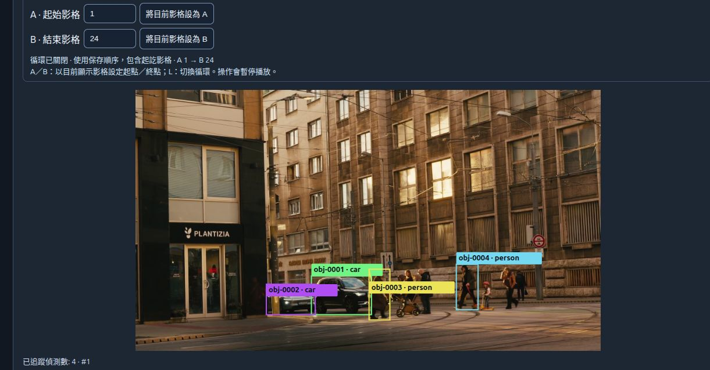
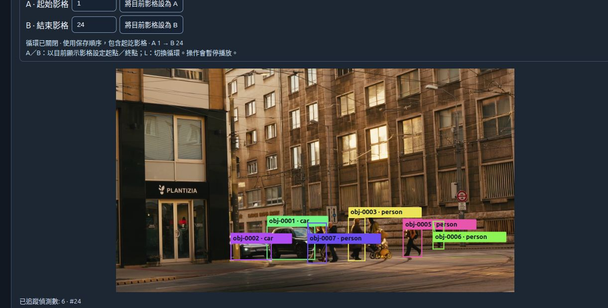

# Real v0.3 tracking replay example
[繁體中文](../zh-TW/tracking-replay-example.md) · [Home](../../README.md) · [Session guide](sessions.md)

These are **actual browser screenshots with real model outputs**, captured on 2026-10-19 from DepthPort `28d7b8f` (v0.3.0-alpha.2 code). They are separate from the generated version schematics and synthetic viewer preview. Documentation was added after Alpha.2; its tag and download assets were not replaced.

## Source and permitted presentation

**Lukas Kosc via Pexels**, [Urban Street Scene with People Crossing / Busy city street with people crossing at sunset](https://www.pexels.com/video/urban-street-scene-with-people-crossing-34597902/), page ID **34597902**, published 2025-11-04. The original download is 1920×1080, 228 decoded frames at 24000/1001 fps (about 9.51 s); video SHA-256: `9b77a4264bb59290335184b77c6300ba43aa6642cb65b594550c44359fd57d4b`.

The [Pexels License](https://www.pexels.com/license/) and [Terms §5–6](https://www.pexels.com/terms-of-service/) were reviewed on 2026-10-19 (Terms page dated 2024-11-15). They permit use and modification, including combining footage with other media/text in a new work, while restricting standalone redistribution and misleading endorsement. These documentation screenshots combine selected frames with DepthPort's actual interface, model boxes/IDs and explanation; they are not an unmodified stock-footage download. The author retains the footage rights under the Pexels terms; the application's AGPL does **not** relicense that footage. No affiliation or endorsement by depicted people, businesses, the author or Pexels is implied. Only the three edited documentation screenshots and curated evidence are published; the original MP4 is not redistributed.

## What each screen shows

All three views come from **one analysis**, with no ID renumbering or manual box correction. Source frames **32–55 inclusive** were selected before capture: 24 consecutive frames, no skipped source frames, covering timestamps 1.293–2.252 s. The screenshot footer's `#index` is the **saved Session index**, not the original video frame number. Boxes cover **all detector classes**, not just people.

### Start: Session #1 → source frame 32, 1.293 s

Four associated detections are shown. Several visible people have no box: this is not a complete ground-truth annotation.

### Crossing and partial occlusion: Session #12 → source frame 43, 1.752 s

Opposing pedestrians overlap in the central group near the stroller and cars. The interface displays five associated detections and their actual local Object IDs. It does not draw an inferred hidden body or fill missing detections.

### Later: Session #24 → source frame 55, 2.252 s

Six associated detections are shown. `obj-0004` is no longer returned here, and `obj-0007` is visible. The full 24-frame analysis contains 7 local IDs, 230 detector observations, 125 associated observations and 105 unassociated detections. **Unassociated is not the same as a ground-truth missed detection.** These membership changes are review cues, not a verified ID switch: this source has no identity ground truth, and both detector confidence and association can remove observations.

## Actual execution and reproduction conditions

- Code: [v0.3.0-alpha.2](https://github.com/JShengP/depthport/tree/28d7b8f1038872735195acc68272162050226026). A clean, loopback-only runtime copy contained only this public example; no existing personal Session was opened.
- Frames were resized to **960×540** with OpenCV `INTER_AREA`. A local offline harness called the existing `V2Adapter.predict`, `prepare_cloud`, `bundle_bytes` and `SessionStore.capture` helpers for each selected frame, preserving source indices, source-relative timestamps and real depth. It did not synthesize depth or detections. This is explicit offline preparation, not a video-import button or automatic camera recording feature.
- Depth: genuine **Depth Anything V2 Small HF**, revision `5426e4f0f36572d16453bbda7a8389317b1bef99`, CUDA FP32, input size 518; HFOV estimate 65°. V2 retains relative output and maps it to virtual display geometry **not metres**. No calibrated measurement is established.
- Application runtime used for this example: Linux, PyTorch `2.10.0+cu128`, torchvision `0.25.0+cu128`, NumPy `1.26.4`, OpenCV `4.11.0.86`, Transformers `4.57.6`, Ultralytics **8.4.176**, FastAPI `0.143.3`, Uvicorn `0.54.0`. This reused CUDA environment is **not a fresh installation of the complete Alpha.2 requirements** (which specify a newer torch/torchvision pair). This example does not replace that recipe's separate API CI.
- Semantic analysis used genuine cached **YOLO26n Detect**, CPU, input size 640, confidence 0.25, at most 20 detections/frame, all classes. Weight SHA-256: `9b09cc8bf347f0fc8a5f7657480587f25db09b34bf33b0652110fb03a8ad4fef`.
- The running application's actual tracking endpoint was explicitly called with `{"mode":"detect","backend":"roboflow-botsort","confidence":0.25,"max_frames":24}`. Its isolated worker used **Trackers 2.6.1 / Supervision 0.27.0 / NumPy 2.2.6 / OpenCV 4.11.0.86**, original detections and default BoT-SORT settings, without ReID. The UI's Analyze button currently selects the last **12** saved frames; this 24-frame example used the documented API, not a changed UI default.
- Browser verification: open `/sessions?lang=zh-TW`, load the saved report with **Replay analysed frames**, select Session indices 1, 12 and 24 and replay; verify overlay footer and report frame identity before capture. Actual playback advanced from #1 through subsequent frames to #24 and stopped at the end. Screenshots retain the real A/B controls and overlay footer; no IDs were retouched. See [local worker setup](tracking-worker.md) and [Session API](sessions.md).

To reproduce, download the named original from the source page and check its hash; use the code revision and runtime above with local cached depth/detector weights. Prepare source frames 32–55 through the named existing helpers into a **new local Session**, enable local storage, configure the isolated worker, and call the tracking endpoint for 24 frames. Open that report in the UI. Changing source encoding, frames, resolution, runtime, weights or tracker settings can change detections and IDs. The [curated record](../validation/v0.3-public-replay-example.json) preserves the source/screenshot hashes, settings and aggregate counts; local Session archives, full reports and weights are intentionally not distributed.

## Limits

This is an illustrative **partial-occlusion/crossing replay**, spanning only 23 frame intervals (about **0.959 s**), not a long-occlusion benchmark or proof of ID retention. A stable number is not proof of correct person identity; Object IDs are local associations, not face recognition. No IDSW/IDF1/HOTA or accuracy score is claimed without ground truth. Confidence filtering, unconfirmed tracks and association can omit visible objects.

The source is 23.976 fps, but the existing Session worker still advances a **fixed 30-Hz step per saved frame**, and the replay UI's **1× targets 5 saved frames/s**. Neither equals the original playback timing; there is no real-time, speed, metric 3D or world-trajectory claim. The short clip includes some camera movement but does not validate camera-motion robustness. Physical RTSP, Windows inference/worker integration, long occlusion, endurance, hardware WebGL and calibrated accuracy remain open. No application default or historical tracking benchmark is changed by these screenshots.
