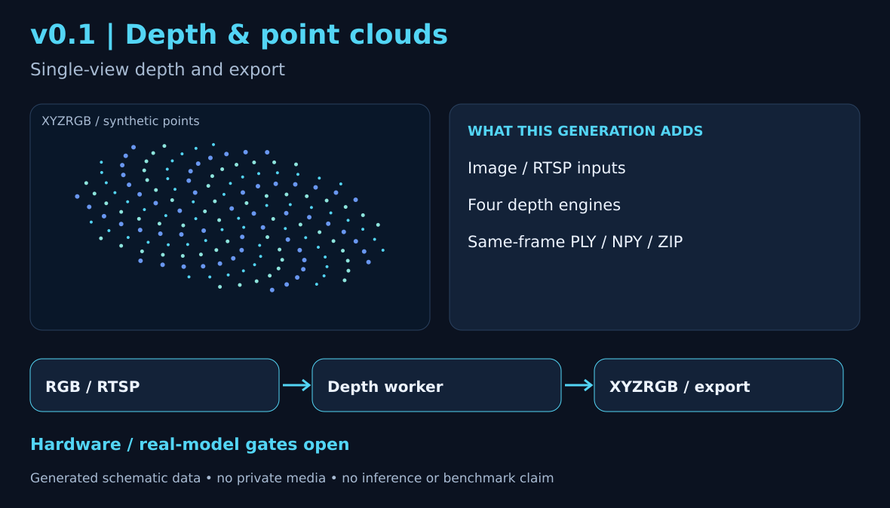
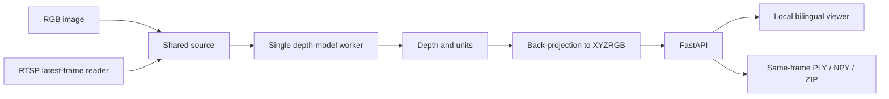
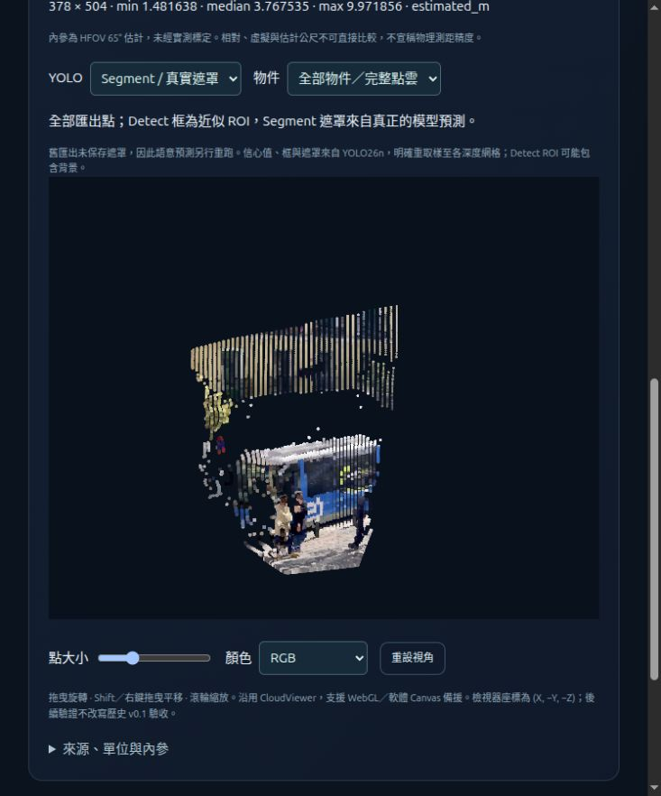

# v0.1 · Depth & Point Cloud Viewer

**深度與點雲檢視器** 
Historical Alpha / 歷史 Alpha

[Project](../../../README.md) · [繁體中文首頁](../../../README.zh-TW.md) · **v0.1** · [v0.2](../v0.2/README.md) · [v0.3](../v0.3/README.md)

[Results Index / 測試結果總覽](https://jshengp.github.io/depthport/results/?lang=zh-TW) · Models, trackers, platforms & limits / 模型、追蹤器、平台與限制

The viewer foundation retained in later versions: images/RTSP → four depth engines → interactive single-view geometry.
後續版本延續的檢視器基礎：圖片／RTSP → 四套深度引擎 → 互動式單視角幾何。

**Open-source scope / 開源定位：** implemented features and recorded evidence are available; [#8](https://github.com/JShengP/depthport/issues/8) tracks follow-up research and [#6](https://github.com/JShengP/depthport/issues/6) optional validation. These do not block source/Alpha maintenance; multi-user hosting is outside the current goal. 功能與紀錄已提供，研究及選用驗證分開追蹤，不阻擋開源更新；多人服務不列必要門檻，原失敗、限制與 Tag 快照保留。[Project status / 專案狀態](../../../ROADMAP.md#open-source-project-status--開源專案定位)

**Release / 發布快照:** [v0.1.0-alpha.1](https://github.com/JShengP/depthport/releases/tag/v0.1.0-alpha.1) · [Exact source / 對應程式](https://github.com/JShengP/depthport/tree/v0.1.0-alpha.1) · [Original README](https://github.com/JShengP/depthport/blob/v0.1.0-alpha.1/README.md) · [原版繁中 README](https://github.com/JShengP/depthport/blob/v0.1.0-alpha.1/README.zh-TW.md)

[Differences / 差異](#differences--差異) · [Architecture / 架構](#architecture--架構) · [Examples / 範例](#examples--範例) · [Getting started / 使用入口](#getting-started--使用入口) · [Validation / 驗證紀錄](#validation--驗證紀錄) · [Limits / 驗證限制](#limits--驗證限制)

> [!IMPORTANT]
> This snapshot has application-contract and synthetic-UI evidence; pretrained inference and hardware acceptance were still unverified.
> 本版證據限應用契約與合成 UI，真權重推論與實機驗收當時仍未完成。

This maintained guide may include later illustrations/documentation; the tagged source, original READMEs and release assets stay fixed. 本頁可補充後續插圖／文件，既有 Tag、原版 README 與下載包不變。

## Differences / 差異

- **Foundation / 本版基礎:** RGB images and RTSP latest-frame input, with no growing application inference queue. 圖片與 RTSP 最新影格處理，不累積應用層待推論佇列。
- **Depth & export / 深度與匯出:** four switchable presets, bilingual XYZRGB viewer and same-frame PLY/NPY/ZIP with raw depth and unit metadata. 四模型、雙語點雲與可追溯匯出。
- **Later additions / 後續版本才有:** [v0.2](../v0.2/README.md) adds Spatial Analysis; [v0.3](../v0.3/README.md) adds manual Sessions, cross-frame local Object IDs and replay review. 本版尚無空間分析或 Session／跨影格追蹤回放。

Capability illustration / 展開功能示意圖

*Generated schematic, not a UI screenshot, model output or acceptance evidence. 程式生成的功能示意，不是實際介面、推論結果或驗收證據。*

## Architecture / 架構

**Flow / 主流程:** RGB image or latest RTSP frame → one depth-model worker → aligned depth/units → XYZRGB → local viewer/export.

- `app.py` launches the service; `depthport/api.py` owns the shared FastAPI lifecycle. 啟動與共用 API 生命週期。
- `capture.py` reads frames; adapters run inference; `cloud.py` back-projects and exports. 影格讀取、模型推論與幾何匯出。
- `static/` contains the bilingual UI; generation checks reject stale source/model results. 雙語介面及來源／模型切換後的過期結果防護。

**Contract / 邊界:** one shared source/model, one loaded engine at a time; browser clients do not get isolated users or independent model workers. 單一共用來源／模型，不是多人隔離架構。

Flowchart / 展開架構流程圖

## Examples / 範例

**Current demo roles / 目前展示分工（2026-10-22）：** v0.1 = full-cloud navigation only; v0.2 = exact pixel/native-depth/XYZ and real object-mask inspection, same saved source. v0.1只瀏覽完整點雲，v0.2才提供像素／XYZ／物件遮罩分析。下圖保留原拍攝狀態，不重授歷史驗收；目前頁面分工已更新。

**[Open interactive website / 開啟互動網站](https://jshengp.github.io/depthport/v0.1/?lang=zh-TW)** · [English demo](https://jshengp.github.io/depthport/v0.1/?lang=en)

**Current Pages, later real-model validation / 目前網站，後續真模型驗證。** The current CloudViewer reads the original saved bus XYZRGB; switch four engines, orbit/zoom/pan, and adjust point size/color. The image shows **DA3 Metric Large**, estimated metres, RGB coloring and a rotated view. 目前網站沿用原始 CloudViewer，讀取同一張 bus.jpg 的真實保存點雲；可切四模型、旋轉／縮放／平移及調整點大小／顏色，圖中為 DA3 Metric Large 的估計公尺、RGB 與旋轉視角。

Source / 來源：[Ultralytics bus.jpg](https://github.com/ultralytics/assets/blob/53d4e2a8fd15f473c29a148c317a8477be559327/im/bus.jpg). The four original CUDA exports were validated on **2026-10-17**, after v0.1; this website is a capability demonstration, not the historical tag's runtime or acceptance. 這是後續能力展示，不是 v0.1 Tag 當時的真權重驗收。65° HFOV intrinsics are estimated; relative/virtual values are not metres and estimated metres are not independently verified distances. 內參未實測標定，各單位不可直接比較，不宣稱測距精度。

[Data, hashes and limits](../../en/real-ai-pages.md) · [繁中來源與限制](../../zh-TW/real-ai-pages.md) · [Screenshot state / 截圖狀態](../../validation/readme-real-pages.json) · [Demo status & next gates / 展示進度與下一步](../../../ROADMAP.md#current-pages--目前互動展示) · [Scoped browser checks / 限定瀏覽器檢查](../../zh-TW/pages-browser-compatibility.md) · [Independent headless follow-up / 獨立無頭補驗](../../zh-TW/pages-standalone-browsers.md) · [Native headed study / 原生有視窗補驗](../../zh-TW/pages-headed-browsers.md)

Historical synthetic screenshot / 歷史合成截圖

[Original v0.1 screenshot](https://github.com/JShengP/depthport/blob/v0.1.0-alpha.1/docs/assets/preview.zh-TW.png) is unchanged. It shows the actual historical UI with explicitly synthetic points; no model or camera generated them. 原圖保持不變，為實際歷史 UI 的明示合成資料；後續 CUDA／追蹤證據不回填為本版驗收。

## Getting started / 使用入口

1. Download the v0.1 release or check out its exact tag. 下載本版或使用對應 Tag。
2. Follow the tagged [installation guide](https://github.com/JShengP/depthport/blob/v0.1.0-alpha.1/docs/en/installation.md) / [繁中安裝](https://github.com/JShengP/depthport/blob/v0.1.0-alpha.1/docs/zh-TW/installation.md).
3. Start the local server and open `/` for the viewer. 啟動本機服務後開啟 `/`。

Model weights and local camera settings are separate from the public source package. 權重與本機相機設定不包含在公開原始碼包。

## Validation / 驗證紀錄

- **Recorded / 已記錄:** application contracts and synthetic browser/UI checks, as documented in the tagged record. 已完成當時記錄的應用契約與合成介面檢查。
- **Scope / 證據範圍:** application integration, not pretrained accuracy, installation acceptance or physical-camera operation. 證明應用整合，不表示真模型精度、安裝或相機驗收。

[Tagged validation record](https://github.com/JShengP/depthport/blob/v0.1.0-alpha.1/docs/en/validation.md) · [本版繁中紀錄](https://github.com/JShengP/depthport/blob/v0.1.0-alpha.1/docs/zh-TW/validation.md)

## Limits / 驗證限制

- **Unverified in this snapshot / 本版當時未驗證:** pretrained inference, fresh Windows/target installation and GPU execution. 真權重、全新目標環境與 GPU。
- **Optional hardware validation / 選用實機驗證:** physical RTSP, reconnect/codecs, endurance/VRAM and calibrated metric accuracy remain unverified. 實體串流、重連／編碼、長時穩定性與標定測距。
- **Geometry / 幾何:** visible-surface 2.5D only; V2 virtual depth and DA3 relative depth are not metres. No hidden-surface reconstruction, SLAM or certified distance claim. 僅可見表面 2.5D，相對／虛擬深度不能當公尺。

[Original release scope / 原版範圍](https://github.com/JShengP/depthport/releases/tag/v0.1.0-alpha.1) · [Current roadmap / 目前路線圖](../../../ROADMAP.md)
