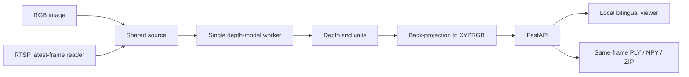

# v0.1 · Depth & Point Cloud Viewer

**深度與點雲檢視器** 
Historical Alpha / 歷史 Alpha

[Project](../../../README.md) · [繁體中文首頁](../../../README.zh-TW.md) · **v0.1** · [v0.2](../v0.2/README.md) · [v0.3](../v0.3/README.md)

The viewer foundation retained in later versions: images/RTSP → four depth engines → interactive single-view geometry.
後續版本延續的檢視器基礎：圖片／RTSP → 四套深度引擎 → 互動式單視角幾何。

**Release / 發布快照:** [v0.1.0-alpha.1](https://github.com/JShengP/depthport/releases/tag/v0.1.0-alpha.1) · [Exact source / 對應程式](https://github.com/JShengP/depthport/tree/v0.1.0-alpha.1) · [Original README](https://github.com/JShengP/depthport/blob/v0.1.0-alpha.1/README.md) · [原版繁中 README](https://github.com/JShengP/depthport/blob/v0.1.0-alpha.1/README.zh-TW.md)

[Differences / 差異](#differences--差異) · [Architecture / 架構](#architecture--架構) · [Examples / 範例](#examples--範例) · [Getting started / 使用入口](#getting-started--使用入口) · [Validation / 驗證紀錄](#validation--驗證紀錄) · [Limits / 驗證限制](#limits--驗證限制)

> [!IMPORTANT]
> This snapshot has application-contract and synthetic-UI evidence; pretrained inference and hardware acceptance were still unverified.
> 本版證據限應用契約與合成 UI，真權重推論與實機驗收當時仍未完成。

This maintained guide may include later illustrations/documentation; the tagged source, original READMEs and release assets stay fixed. 本頁可補充後續插圖／文件，既有 Tag、原版 README 與下載包不變。

## Differences / 差異

- **Foundation / 本版基礎:** RGB images and RTSP latest-frame input, with no growing application inference queue. 圖片與 RTSP 最新影格處理，不累積應用層待推論佇列。
- **Depth & export / 深度與匯出:** four switchable presets, bilingual XYZRGB viewer and same-frame PLY/NPY/ZIP with raw depth and unit metadata. 四模型、雙語點雲與可追溯匯出。
- **Later additions / 後續版本才有:** [v0.2](../v0.2/README.md) adds Spatial Analysis; [v0.3](../v0.3/README.md) adds manual Sessions, cross-frame local Object IDs and replay review. 本版尚無空間分析或 Session／跨影格追蹤回放。

Capability illustration / 展開功能示意圖

*Generated schematic, not a UI screenshot, model output or acceptance evidence. 程式生成的功能示意，不是實際介面、推論結果或驗收證據。*

## Architecture / 架構

**Flow / 主流程:** RGB image or latest RTSP frame → one depth-model worker → aligned depth/units → XYZRGB → local viewer/export.

- `app.py` launches the service; `depthport/api.py` owns the shared FastAPI lifecycle. 啟動與共用 API 生命週期。
- `capture.py` reads frames; adapters run inference; `cloud.py` back-projects and exports. 影格讀取、模型推論與幾何匯出。
- `static/` contains the bilingual UI; generation checks reject stale source/model results. 雙語介面及來源／模型切換後的過期結果防護。

**Contract / 邊界:** one shared source/model, one loaded engine at a time; browser clients do not get isolated users or independent model workers. 單一共用來源／模型，不是多人隔離架構。

Flowchart / 展開架構流程圖

## Examples / 範例

**Synthetic UI example / 合成 UI 範例.** The screenshot is identical to the image shipped in the v0.1 tag; it demonstrates the actual viewer with explicitly synthetic data. No camera or pretrained model produced these points. 此圖與 v0.1 Tag 內圖片相同，是真實介面的明示合成資料，不是真模型推論。

View screenshot / 展開範例畫面

  

[Tagged screenshot / 本版圖片](https://github.com/JShengP/depthport/blob/v0.1.0-alpha.1/docs/assets/preview.zh-TW.png) · [Asset provenance / 素材說明](../../assets/README.md)

Later v0.2 CUDA results and v0.3 tracking examples must not be attributed to this snapshot. 不把後續版本的 GPU 或追蹤證據回填成 v0.1 驗收。

## Getting started / 使用入口

1. Download the v0.1 release or check out its exact tag. 下載本版或使用對應 Tag。
2. Follow the tagged [installation guide](https://github.com/JShengP/depthport/blob/v0.1.0-alpha.1/docs/en/installation.md) / [繁中安裝](https://github.com/JShengP/depthport/blob/v0.1.0-alpha.1/docs/zh-TW/installation.md).
3. Start the local server and open `/` for the viewer. 啟動本機服務後開啟 `/`。

Model weights and local camera settings are separate from the public source package. 權重與本機相機設定不包含在公開原始碼包。

## Validation / 驗證紀錄

- **Recorded / 已記錄:** application contracts and synthetic browser/UI checks, as documented in the tagged record. 已完成當時記錄的應用契約與合成介面檢查。
- **Scope / 證據範圍:** application integration, not pretrained accuracy, installation acceptance or physical-camera operation. 證明應用整合，不表示真模型精度、安裝或相機驗收。

[Tagged validation record](https://github.com/JShengP/depthport/blob/v0.1.0-alpha.1/docs/en/validation.md) · [本版繁中紀錄](https://github.com/JShengP/depthport/blob/v0.1.0-alpha.1/docs/zh-TW/validation.md)

## Limits / 驗證限制

- **Unverified in this snapshot / 本版當時未驗證:** pretrained inference, fresh Windows/target installation and GPU execution. 真權重、全新目標環境與 GPU。
- **Hardware gates / 實機項目:** physical RTSP, reconnect/codecs, endurance/VRAM and calibrated metric accuracy remain unverified. 實體串流、重連／編碼、長時穩定性與標定測距。
- **Geometry / 幾何:** visible-surface 2.5D only; V2 virtual depth and DA3 relative depth are not metres. No hidden-surface reconstruction, SLAM or certified distance claim. 僅可見表面 2.5D，相對／虛擬深度不能當公尺。

[Original release scope / 原版範圍](https://github.com/JShengP/depthport/releases/tag/v0.1.0-alpha.1) · [Current roadmap / 目前路線圖](../../../ROADMAP.md)
