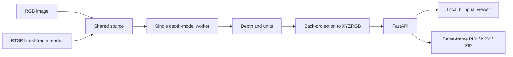

# v0.1 — Depth & Point Cloud Viewer / 深度與點雲檢視器

[Project / 主 README](../../../README.md) · [繁體中文首頁](../../../README.zh-TW.md) · [v0.2](../v0.2/README.md) · [v0.3](../v0.3/README.md)

**Historical Alpha / 歷史 Alpha:** [v0.1.0-alpha.1 Release](https://github.com/JShengP/depthport/releases/tag/v0.1.0-alpha.1) · [exact source / 對應程式](https://github.com/JShengP/depthport/tree/v0.1.0-alpha.1) · [original README](https://github.com/JShengP/depthport/blob/v0.1.0-alpha.1/README.md) · [原版繁中 README](https://github.com/JShengP/depthport/blob/v0.1.0-alpha.1/README.zh-TW.md)

This is a maintained guide to the v0.1 snapshot, not a rewrite of its tag. It establishes the viewer foundation later retained in v0.2/v0.3.
本頁整理 v0.1 快照，未改寫既有 Tag；這是 v0.2／v0.3 延續的檢視器基礎。

## Contents / 功能內容

- RGB image and RTSP inputs; latest-frame capture without a growing application queue.
- Four switchable depth presets: YOLO26 Depth, DA V2 Small, DA3 Small and DA3Metric Large. One shared source/model, one active model at a time.
- Single-view XYZRGB point cloud, bilingual browser controls and same-frame PLY/NPY/ZIP exports with original depth/unit metadata.
- 圖片／RTSP、四模型切換、可互動點雲、雙語與同影格匯出；此版尚無 v0.2 空間分析或 v0.3 Session／追蹤回放。

## Architecture / 架構

`app.py` launches the service; `depthport/api.py` owns FastAPI, `capture.py` reads camera frames, engine adapters run inference, and `cloud.py` handles geometry/export. `static/` contains the browser UI. Generation checks reject stale results after source/model changes. This is shared application state, not isolated users.
`app.py` 啟動、`api.py` 提供 API、`capture.py` 讀影格、adapter 執行模型、`cloud.py` 做幾何／匯出，`static/` 顯示 UI；來源與模型共用，不是多人隔離架構。

## Entry and evidence / 使用與證據

Use the v0.1 source or download, follow its [installation guide](https://github.com/JShengP/depthport/blob/v0.1.0-alpha.1/docs/en/installation.md), then open `/`. The [v0.1 validation record](https://github.com/JShengP/depthport/blob/v0.1.0-alpha.1/docs/en/validation.md) records application contracts and synthetic UI checks; real pretrained inference, target installation, GPU/physical RTSP/endurance/metric accuracy were unverified in that snapshot. Later v0.2 evidence must not be attributed to v0.1.
使用對應 Tag 安裝並開啟 `/`。v0.1 當時只完成應用契約／合成 UI 等檢查，真權重、目標環境、GPU、實體 RTSP、長時穩定性與距離精度尚未驗證；不能把後來 v0.2 的結果回填成本版證據。

All versions remain experimental 2.5D visible-surface tools; V2 virtual depth and DA3 relative depth are not metres. No hidden-surface reconstruction, SLAM or certified distance claim.
各版均屬實驗性可見表面 2.5D；V2 虛擬深度與 DA3 相對深度不能當公尺，也不代表遮擋還原、SLAM 或認證測距。
