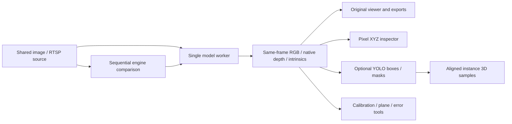

# v0.2 · Spatial Analysis Lab

**空間分析工作台** 
Historical Alpha / 歷史 Alpha

[Project](../../../README.md) · [繁體中文首頁](../../../README.zh-TW.md) · [v0.1](../v0.1/README.md) · **v0.2** · [v0.3](../v0.3/README.md)

Adds same-frame inspection, model comparison, semantic fusion and calibration/error tools to the v0.1 viewer.
在 v0.1 檢視器上加入同影格檢查、模型比較、語意融合與標定／誤差工具。

**Release / 發布快照:** [v0.2.0-alpha.1](https://github.com/JShengP/depthport/releases/tag/v0.2.0-alpha.1) · [Exact source / 對應程式](https://github.com/JShengP/depthport/tree/v0.2.0-alpha.1) · [Original README](https://github.com/JShengP/depthport/blob/v0.2.0-alpha.1/README.md) · [原版繁中 README](https://github.com/JShengP/depthport/blob/v0.2.0-alpha.1/README.zh-TW.md)

[Differences / 差異](#differences--差異) · [Architecture / 架構](#architecture--架構) · [Examples / 範例](#examples--範例) · [Getting started / 使用入口](#getting-started--使用入口) · [Validation / 驗證紀錄](#validation--驗證紀錄) · [Limits / 驗證限制](#limits--驗證限制)

> [!IMPORTANT]
> Real single-image CUDA execution was recorded on one Ubuntu host; physical-camera and calibrated-accuracy acceptance remain open.
> 已記錄單台 Ubuntu 的真單圖 CUDA 執行；實體相機與標定精度仍待驗證。

This maintained guide may include later illustrations/documentation; the tagged source, original READMEs and release assets stay fixed. 本頁可補充後續插圖／文件，既有 Tag、原版 README 與下載包不變。

## Differences / 差異

- **New inspection / 新增檢查:** `/spatial` provides pixel raw depth/camera-space XYZ and sequential same-image four-engine comparison with native-unit distributions. 像素深度／XYZ 與同圖四模型原生單位比較。
- **New analysis / 新增分析:** optional YOLO Detect/Segment instance-to-point fusion, pinhole checkerboard calibration, candidate planes and independent metric-error tools. 選配語意融合、棋盤格標定、候選平面與獨立量測誤差工具；工具存在不表示精度已通過。
- **Retained / 延續:** v0.1 viewer, images/RTSP, four engines, bilingual UI and exports. 保留原檢視器、輸入、四模型、雙語與匯出。
- **Later additions / 後續版本才有:** [v0.3](../v0.3/README.md) adds manual Sessions, cross-frame local Object IDs and tracking replay. 本版尚無 Session 與跨影格追蹤回放。

Capability illustration / 展開功能示意圖

*Generated schematic, not a UI screenshot, model output or acceptance evidence. 程式生成的功能示意，不是實際介面、推論結果或驗收證據。*

## Architecture / 架構

**Flow / 主流程:** shared source → one model worker → same-frame RGB/depth/intrinsics → viewer, inspector and explicit analysis jobs.

- **Shared worker / 共用 worker:** depth/model operations remain serialized. 深度與模型工作仍依序執行。
- **Same-frame analysis / 同影格分析:** pixel inspection, engine comparison and semantic fusion operate on retained aligned results. 像素檢查、比較與融合使用保留且對齊的資料。
- **Geometry tools / 幾何工具:** calibration, plane fitting and error checks operate around those results; model units stay explicit. 標定／平面／誤差工具保留模型單位，不混用相對深度與公尺。

**Contract / 邊界:** semantic fusion samples aligned source depth; this version adds neither continuous object tracking nor camera-pose estimation. 語意融合取對齊深度，沒有新增連續追蹤或相機位姿估計。

Flowchart / 展開架構流程圖

## Examples / 範例

**Real single-image CUDA example / 真單圖 CUDA 範例.** Four sequential depth engines and YOLO26n segmentation were run on one public Ultralytics bus image, captured through local HTTP on **2026-10-17**. The screenshot is identical to the image in the v0.2 tag. 同一張公開公車圖的四模型與分割真推論，截圖與 v0.2 Tag 相同。

View screenshot / 展開範例畫面

  

Source / 來源：[Ultralytics Assets bus example](https://github.com/ultralytics/assets/blob/53d4e2a8fd15f473c29a148c317a8477be559327/im/bus.jpg). Its upstream AGPL attribution, input hash and model notices are retained in [asset provenance](../../assets/README.md) / [第三方聲明](../../../THIRD_PARTY_NOTICES.md).

[Tagged screenshot / 本版圖片](https://github.com/JShengP/depthport/blob/v0.2.0-alpha.1/docs/assets/spatial-preview.zh-TW.png). This is neither a physical IPCam capture nor a calibrated distance/throughput benchmark. 不是實體相機影像，也不是標定測距或吞吐量 benchmark。

## Getting started / 使用入口

1. Download the v0.2 release or check out its exact tag. 下載本版或使用對應 Tag。
2. Follow the tagged [installation guide](https://github.com/JShengP/depthport/blob/v0.2.0-alpha.1/docs/en/installation.md) / [繁中安裝](https://github.com/JShengP/depthport/blob/v0.2.0-alpha.1/docs/zh-TW/installation.md).
3. Open `/` for the original viewer and `/spatial` for Spatial Analysis. `/` 為原檢視器，`/spatial` 為空間分析。

[Versioned feature guide](https://github.com/JShengP/depthport/blob/v0.2.0-alpha.1/docs/en/spatial-analysis.md) · [本版繁中操作](https://github.com/JShengP/depthport/blob/v0.2.0-alpha.1/docs/zh-TW/spatial-analysis.md)

## Validation / 驗證紀錄

- **Recorded / 已記錄:** four genuine CUDA depth calls plus YOLO Detect/Segment on one public still image in one fresh Ubuntu GPU environment. 單台全新 Ubuntu GPU 環境的一張公開圖真推論。
- **Browser / 瀏覽器:** actual local HTTP/browser checks; WebGL used **SwiftShader software rendering**, not the NVIDIA display GPU. 實際本機 HTTP 操作，WebGL 為軟體繪圖。
- **Scope / 證據範圍:** pipeline execution under those dated conditions, not camera, calibrated accuracy or throughput acceptance. 只證明當時條件下鏈路可執行。

[Tagged 2026-10-17 record](https://github.com/JShengP/depthport/blob/v0.2.0-alpha.1/docs/en/validation.md) · [本版繁中紀錄](https://github.com/JShengP/depthport/blob/v0.2.0-alpha.1/docs/zh-TW/validation.md)

## Limits / 驗證限制

- **Hardware gates / 實機項目:** physical RTSP/codecs/reconnect, fresh Windows pretrained inference, endurance/VRAM and NVIDIA hardware WebGL remain unverified. 實體串流／編碼／重連、Windows 真權重、長時穩定性與硬體繪圖。
- **Accuracy / 精度:** measured intrinsics and independent ground-truth distances are still needed; model-estimated metres and calibration tools do not establish metric accuracy. 仍需實測內參與獨立真值，估計公尺與工具不代表精度。
- **Geometry / 幾何:** visible-surface 2.5D only; relative/virtual outputs are not metres. No hidden-surface reconstruction, SLAM or certified distance claim. 相對／虛擬深度不能當公尺，不提供遮擋還原或認證測距。

[Original release scope / 原版範圍](https://github.com/JShengP/depthport/releases/tag/v0.2.0-alpha.1) · [Current roadmap / 目前路線圖](../../../ROADMAP.md)
