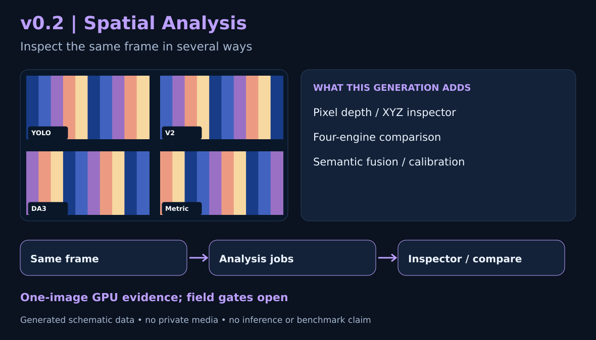
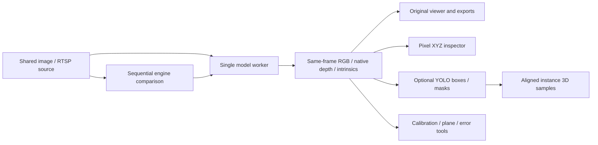

# v0.2 — Spatial Analysis Lab / 空間分析工作台

[Project / 主 README](../../../README.md) · [繁體中文首頁](../../../README.zh-TW.md) · [v0.1](../v0.1/README.md) · [v0.3](../v0.3/README.md)

**Historical Alpha / 歷史 Alpha:** [v0.2.0-alpha.1 Release](https://github.com/JShengP/depthport/releases/tag/v0.2.0-alpha.1) · [exact source / 對應程式](https://github.com/JShengP/depthport/tree/v0.2.0-alpha.1) · [original README](https://github.com/JShengP/depthport/blob/v0.2.0-alpha.1/README.md) · [原版繁中 README](https://github.com/JShengP/depthport/blob/v0.2.0-alpha.1/README.zh-TW.md)

## Visual overview / 視覺導覽

*程式生成的功能示意圖；不是實際 UI 截圖、模型輸出或追蹤品質證據。 / Generated schematic data, not an application screenshot, model output or tracking benchmark.*

The maintained guide and illustrations can be newer than the tagged snapshot; the original release/source links above stay fixed.
本導覽與插圖可隨文件維護更新，對應舊版本的原始碼與原版 README 仍以各自 Tag 為準。

## Changes from v0.1 / 相對 v0.1 新增

- `/spatial`: pixel raw-depth/camera-space XYZ inspection and sequential same-image four-engine comparison with native-unit distributions.
- Optional YOLO Detect/Segment instance-to-point fusion, retaining source-frame and mask/depth alignment.
- Pinhole checkerboard calibration, candidate-plane fitting and independent metric-error checks; tools do not imply measured accuracy has passed.
- Retains v0.1 viewer, images/RTSP, four engines, bilingual UI and exports. This snapshot does not include v0.3 manual Sessions, persistent Object IDs or tracking replay review.
- 新增像素深度／XYZ、同圖四模型比較、選配偵測／分割 2D→3D 融合與標定／平面／獨立誤差工具；保留 v0.1，尚無 v0.3 Session 與跨影格追蹤回放。

## Architecture / 架構

The shared worker still serializes depth/model operations. Spatial Analysis adds explicit single-job workflows around retained same-frame results; semantic fusion samples aligned depth rather than treating every model as metrically interchangeable. It does not add continuous object tracking or camera-pose estimation.
延續單一共用模型 worker，空間分析以明確的單工作流程檢查同影格結果；語意融合取對齊深度，不把各模型單位混用，也不提供連續追蹤或相機位姿估計。

## Entry and evidence / 使用與證據

Open `/` for the original viewer and `/spatial` for analysis after installing the tagged source. [Versioned feature guide](https://github.com/JShengP/depthport/blob/v0.2.0-alpha.1/docs/en/spatial-analysis.md) · [繁體中文操作](https://github.com/JShengP/depthport/blob/v0.2.0-alpha.1/docs/zh-TW/spatial-analysis.md)
安裝本版後，`/` 是原檢視器，`/spatial` 是空間分析。

The [2026-10-17 record](https://github.com/JShengP/depthport/blob/v0.2.0-alpha.1/docs/en/validation.md) documents four genuine CUDA depth calls and YOLO Detect/Segment on one public still image in one fresh Ubuntu GPU environment, plus browser/HTTP checks. Browser WebGL used SwiftShader. It is pipeline execution evidence, not a camera, calibrated accuracy or throughput benchmark.
2026-10-17 已在單台全新 Ubuntu GPU 環境，以一張公開圖完成四套真深度模型 CUDA、真 YOLO 偵測／分割及瀏覽器 HTTP 操作；WebGL 採 SwiftShader。這只證明鏈路可執行。

Physical RTSP/codecs/reconnect, full Windows pretrained inference, endurance/VRAM, NVIDIA hardware WebGL and independent calibrated distance accuracy remain unverified in this release. See [release limitations](https://github.com/JShengP/depthport/releases/tag/v0.2.0-alpha.1).
實體 RTSP／編碼／重連、Windows 真權重、長時穩定性／VRAM、NVIDIA WebGL 與獨立標定測距仍未驗證。
