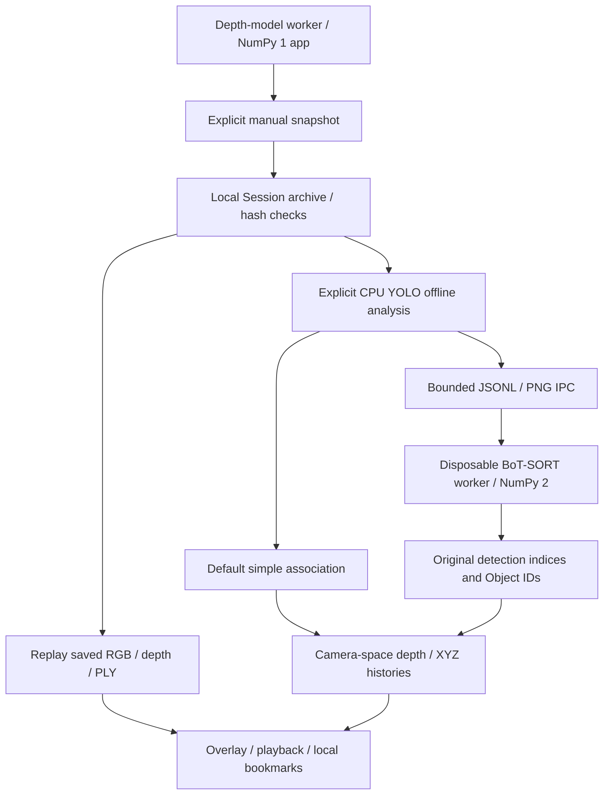
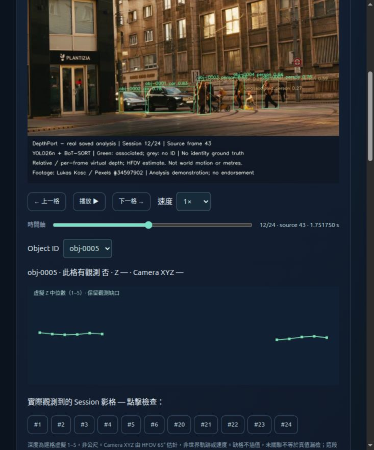

# v0.3 · Sessions, Replay & Offline Tracking

**工作階段、回放與離線追蹤** 
Experimental Alpha / 實驗性 Alpha

[Project](../../../README.md) · [繁體中文首頁](../../../README.zh-TW.md) · [v0.1](../v0.1/README.md) · [v0.2](../v0.2/README.md) · **v0.3**

[Results Index / 測試結果總覽](https://jshengp.github.io/depthport/results/?lang=zh-TW) · Models, trackers, platforms & limits / 模型、追蹤器、平台與限制

Adds opt-in local Sessions, replay review and offline Object IDs while retaining the viewer and Spatial Analysis.
保留檢視器與空間分析，新增選用本機 Session、回放檢查與離線 Object ID。

**Release / 發布快照:** [v0.3.0-alpha.2](https://github.com/JShengP/depthport/releases/tag/v0.3.0-alpha.2) · [Exact source / 對應程式](https://github.com/JShengP/depthport/tree/v0.3.0-alpha.2) · [Original README](https://github.com/JShengP/depthport/blob/v0.3.0-alpha.2/README.md) · [原版繁中 README](https://github.com/JShengP/depthport/blob/v0.3.0-alpha.2/README.zh-TW.md)

[Differences / 差異](#differences--差異) · [Architecture / 架構](#architecture--架構) · [Examples / 範例](#examples--範例) · [Getting started / 使用入口](#getting-started--使用入口) · [Validation / 驗證紀錄](#validation--驗證紀錄) · [Limits / 驗證限制](#limits--驗證限制)

> [!IMPORTANT]
> Session storage is off by default; simple association remains default. Short replay examples and API CI do not close tracking/hardware acceptance.
> Session 儲存預設關閉、預設仍為簡易關聯；短片範例與 API CI 不代表追蹤或實機驗收通過。

This maintained guide may include later illustrations/documentation; the tagged source, original READMEs and release assets stay fixed. 本頁可補充後續插圖／文件，既有 Tag、原版 README 與下載包不變。

## Differences / 差異

- **New local archive / 新增本機封存:** opt-in manual same-frame RGB/depth/PLY/raw NPY, SHA-256 replay and model-grouped summaries; no automatic recording or inference during replay. 選用手動保存與完整性回放，不自動錄影，回放不重新推論。
- **New offline association / 新增離線關聯:** explicitly requested YOLO Detect/Segment analysis creates local Object IDs and camera-space depth/XYZ histories. Simple association stays default; optional BoT-SORT uses an isolated NumPy 2 worker. 明確操作才分析，NumPy 1 應用與 worker 隔離，原預設不變。
- **New review controls / 新增檢查操作:** boxes/IDs, playback/speed/timeline/A-B loops, searchable bookmark notes/tags, JSON backup and editor/IME guards. 疊圖、回放、書籤備註與輸入／中文組字防誤觸。
- **Retained & research scope / 延續與研究範圍:** retains v0.1/v0.2 features; Baseline/ByteTrack/BoT-SORT comparison tools support offline studies. **ByteTrack is a benchmark backend, not another Session UI selector.** 保留前版；ByteTrack 僅屬研究後端，沒有新增 UI 選項或 ReID。

Capability illustration / 展開功能示意圖

*Generated schematic, not a UI screenshot, model output or acceptance evidence. 程式生成的功能示意，不是實際介面、推論結果或驗收證據。*

## Architecture / 架構

**Flow / 主流程:** explicit snapshot → integrity-checked local archive → offline YOLO → association → replay overlays and local review.

- **Application / 主應用:** NumPy 1 depth runtime and saved RGB/depth remain aligned. 深度、RGB 與保存資料對齊。
- **Optional worker / 選配 worker:** one disposable stdio subprocess isolates NumPy 2; bounded JSONL/PNG IPC returns original detection indices and IDs. 單次工作子程序透過有界 IPC 回傳原始偵測索引與 ID。
- **Review / 回放檢查:** the parent samples original boxes/masks and saved depth, not Kalman-predicted locations; notes and JSON backups stay local. 依原框／遮罩取深度，不用預測位置代替，備註與備份留在本機。

**Contract / 邊界:** manual snapshots advance a fixed tracker step; elapsed snapshot gaps are not modelled. Camera-space XYZ histories do not establish motion-compensated world tracking or speed. 手動快照採固定步長，未建模真實時間間隔，也不是世界軌跡或速度。

Flowchart / 展開架構流程圖

## Examples / 範例

**[Open interactive website / 開啟互動網站](https://jshengp.github.io/depthport/v0.3/?lang=zh-TW)** · [English demo](https://jshengp.github.io/depthport/v0.3/?lang=en)

**Current Pages, new saved replay run / 目前網站，新保存回放執行。** Play/pause, step/seek, change speed, choose local Object IDs and inspect saved depth/XYZ with observation gaps. The image shows **saved frame #12 = source #43 at 1.751750 s**, with `obj-0005` unobserved: depth/XYZ are blank and the history is not interpolated. 可播放／暫停、逐格／拖曳、調速及選擇 ID；圖中 `obj-0005` 在此格無觀測，深度／XYZ 留白，歷史缺口不補值。

**Keep the two runs separate / 新舊執行分開：**

- **New Pages / 新網站（2026-10-20）：9 IDs / 209 detections / 152 associated / 57 unassociated**, YOLO26n **8.4.115**. The original Session could not be recovered; the same hash-checked Pexels source frames **32–55** were rerun with DA V2 CUDA FP32 and isolated BoT-SORT 2.6.1, no ReID. 原 Session 未找回才重跑，不強迫新數值符合舊結果。
- **Earlier screenshots / 舊截圖（2026-10-19）：7 IDs / 230 detections / 125 associated / 105 unassociated**, YOLO26n **8.4.176**, using Alpha.2 code. [Original three screenshots and conditions](../../en/tracking-replay-example.md) / [原三張截圖與條件](../../zh-TW/tracking-replay-example.md) remain unchanged. IDs are local to each run; equal strings do not prove equal objects. 不把兩次執行的同名 ID 視為同物件，也不把不同版本的數量差異當成受控精度提升。

Footage / 素材：**[Lukas Kosc / Pexels](https://www.pexels.com/video/urban-street-scene-with-people-crossing-34597902/)**, combined with actual analysis UI and explanation under the [Pexels terms](https://www.pexels.com/terms-of-service/). Underlying footage is not AGPL; no endorsement. 素材保留自身條款，不因程式 AGPL 改授權或暗示背書；不提供原 MP4、私人 Session 或備註。

**Limits / 限制:** both runs span only **0.959 s** without identity GT; no long-occlusion, verified ID-switch or tracking-accuracy acceptance. Unassociated is not ground-truth FN. V2 depth is per-frame virtual 1–5, not metres; HFOV camera XYZ is not world motion or speed. Source 23.976 fps, fixed tracker 30-Hz steps and UI 1× at 5 saved frames/s are separate. 沒有身分真值，不因缺格／新 ID 判定換 ID 正確或長遮擋恢復通過；深度、時間及座標限制維持。

[Current data, hashes and limits](../../en/real-ai-pages.md) · [目前資料與限制](../../zh-TW/real-ai-pages.md) · [Screenshot state / 截圖狀態](../../validation/readme-real-pages.json) · [Demo status & next gates / 展示進度與下一步](../../../ROADMAP.md#current-pages--目前互動展示) · [Scoped browser checks / 限定瀏覽器檢查](../../zh-TW/pages-browser-compatibility.md) · [Independent headless follow-up / 獨立無頭補驗](../../zh-TW/pages-standalone-browsers.md) · [Native headed study / 原生有視窗補驗](../../zh-TW/pages-headed-browsers.md)

## Getting started / 使用入口

1. Install the tagged application, then set `ENABLE_SESSION_STORAGE=1` **locally** and restart. Storage defaults off; open `/sessions`. 安裝本版、明確開啟本機 Session 設定並重啟，再進入 `/sessions`。
2. For BoT-SORT, install the [isolated worker](../../en/tracking-worker.md) / [繁中 worker](../../zh-TW/tracking-worker.md), configure its local Python interpreter and explicitly select that backend. 選配 worker 需獨立安裝並主動選取。
3. Follow the [Session/replay guide](../../en/sessions.md) / [繁中操作](../../zh-TW/sessions.md). `/` and `/spatial` remain available. 保留原檢視器與空間分析。

Private snapshots, bookmarks, notes and JSON backups stay local and are excluded from the public Repo/Release. 私人快照、書籤、備註與備份不加入公開 Repo／Release。

## Validation / 驗證紀錄

- **CI / 跨平台檢查:** Ubuntu/Windows × Python 3.11/3.12 application contracts and real model API installation/import. No pretrained weights or inference in CI. 應用契約與實際 API 匯入，不含真權重推論。
- **Replay example / 回放範例:** the recorded short public clip exercises genuine depth, CPU detection, the isolated worker and the actual browser replay. It has no identity ground truth. 已記錄真深度／偵測／worker／瀏覽器操作，沒有身分真值。
- **Research / 研究證據:** public-sequence studies keep their fixed detection caches and recorded versions. New dependencies do not inherit those accuracy results; lower activation can add coverage and ID switches/FP together. 舊快取與舊分數不能當新版精度，原預設不變，長遮擋恢復未通過。
- **Admission controls / 新 ID 控制:** [1,179 frames / 72 runs](../../en/tracking-admission-acceptance.md) / [繁中](../../zh-TW/tracking-admission-acceptance.md) separately test confirmation and birth competition using fresh 8.4.176 detections on previously studied scenes. Fewer FP trade off more FN/lower combined IDF1/HOTA; birth veto never triggers. No candidate passes the research screen; defaults and independent acceptance gates remain unchanged. 完成本輪控制實驗，不等於獨立序列或可靠性驗收通過。
- **Association diagnosis / 關聯診斷:** [16 observed reruns](../../en/tracking-association-diagnosis.md) / [繁中](../../zh-TW/tracking-association-diagnosis.md) reproduce exact outputs/scores, recording promotion/recovery costs and competition locally. The diagnosis motivated the subsequent ByteTrack missed-hypothesis weak-stage control; its flagged cohort includes valid same-GT recoveries, so no control/default is promoted. 成本／競爭診斷已記錄，原始矩陣／ID 留本機，尚未修復或通過獨立驗收。
- **Recovery control / 恢復控制:** [Frozen new MOT20-01 experiment](../../en/tracking-recovery-acceptance.md) / [繁中](../../zh-TW/tracking-recovery-acceptance.md): 429 frames / six runs, FP −3/FN −102/IDSW −8; passes the research screen with ordinary weak continuation preserved. Recall 13.98%, fragmentation increases and 0/9 long-event endpoint pairs are complete. 研究達標仍有新增失敗，更多場景／移動相機與長遮擋驗收待補，維持離線選用及原預設。
- **Moving replication / 移動重驗:** [Unchanged 11/13 control and added-error audit](../../en/tracking-recovery-moving.md) / [繁中](../../zh-TW/tracking-recovery-moving.md): 1,650 frames / 12 runs, FP −8 with zero added FN/IDSW; scene-13 HOTA slightly decreases, so the group fails its screen. No long-event recovery gain. 未調參、未升預設，補析前輪直接延後與後續關聯失敗，原始診斷留本機。
- **History evidence / 歷史證據:** [Frozen-output diagnosis](../../en/tracking-recovery-history.md) / [繁中](../../zh-TW/tracking-recovery-history.md) separates retained-state gating, CLEAR ownership and low-threshold HOTA losses. All ten flagged competitors already have other assignments; costs do not support a new cutoff. 不重跑追蹤或調參，下一控制點為有效排他競爭，弱延續與預設保留。
- **Exclusive controls / 排他控制:** [Frozen fresh-cache comparison](../../en/tracking-exclusive-competition.md) / [繁中](../../zh-TW/tracking-exclusive-competition.md), 1,050 frames / 12 runs. Availability and equivalent assignment tested separately, both zero vetoes and exactly reference; legacy adds six misses with unchanged FP. 完成實作／比較，尚缺有效曝光，不升預設；弱偵測延續保留。
- **GT-free exposure / GT-free 曝光:** [Complete frozen discovery/confirmation](../../en/tracking-exposure-selection.md) / [繁中](../../zh-TW/tracking-exposure-selection.md), 16 sources / 17,984 frames / 144 runs. Availability vetoes eight times in six discovery sources, none in reserved confirmation; equivalent assignment never triggers. 無獨立曝光重現或品質驗收，不調參，完整陰性紀錄保留。
- **Alternative structure / 替代結構:** [197 frozen reference alternatives](../../en/tracking-competition-structure.md) / [繁中](../../zh-TW/tracking-competition-structure.md): 188 occupied competitors, 56 lost missed-row updates, 12 equal-count row replacements, 39 below-gate cost contributions. Exact equality is not validated identity ambiguity; next study component-level update displacement and temporal stability. 不調參、不讀 GT，原始診斷留本機，預設不變。
- **Temporal support / 跨格支援:** [Frozen risk groups/history definitions](../../en/tracking-temporal-support.md) / [繁中](../../zh-TW/tracking-temporal-support.md), all 197 reference alternatives. +1 gate 114 / signed-gap 19 / selected-no-update 69; all eight groups and unknowns retained. No time veto or fitted N; next candidate uses past accepted-observation support, active/retained roles and update protection. 不調參／不讀 GT，出生索引未記錄，原始歷史本機保留。
- **Causal support/protection / 因果支援與保護:** [New KITTI factorial](../../en/tracking-past-support.md) / [繁中](../../zh-TW/tracking-past-support.md),978 original frames/ four arms × three equal repeats. Zero active alternatives/vetoes, unchanged scores and no added FN/IDSW; every treatment fails exposure/quality. Next freeze GT-free actual-trigger discovery and untouched reserved confirmation. 已完成規則凍結與獨立執行，不是介入效益驗收；原封存／報表修補公開，原始診斷留本機，弱延續與預設保留。
- **Same-rule exposure / 同規則曝光:** [Complete GT-free discovery/confirmation](../../en/tracking-past-exposure.md) / [繁中](../../zh-TW/tracking-past-exposure.md):16 seen MOT discovery sources, treatment vetoes 40/8/2; original-order selections 09/10/MOT20-06 seal before new KITTI 0004/0005 outputs. Both reserved sources zero, no independent exposure/quality acceptance. 全18段／216次對照與18次未掛參考完成，不讀GT、不調參，原始診斷本機、弱延續與預設保留。
- **Applicability diagnosis / 適用性診斷:** [Full frozen-history funnel](../../en/tracking-exposure-gap.md) / [繁中](../../zh-TW/tracking-exposure-gap.md): all 18 sources, four histories; KITTI 0004's13 weak-input missed rows have no gate-supported column,0005 has 46 weak-only inputs and no hypotheses. Past/protection tests are not reached; no new gate, run or GT score. 原計數／決策核對，下一步補只讀預測／出生／到期記錄並要求輸出不變；buffer語意勘誤，原配置／結果保留。
- **Upstream lifecycle / 上游生命週期:** [Frozen reference observation](../../en/tracking-upstream-lifecycle.md) / [繁中](../../zh-TW/tracking-upstream-lifecycle.md):611 original KITTI frames; original canonical reference and new native outputs/final states unchanged. 0004:13 zero-overlap missed weak-input rows,6 non-positive predictions,3 immature/7 expired removals;0005:46 weak-only inputs/no births. 不讀GT、不推論、不調參，弱延續／預設保留；只讀記錄完成，後續先診斷狀態估計健康／觀測空窗，效益與獨立曝光未驗證。
- **State/observation health / 狀態與觀測健康:** [Frozen full-history audit](../../en/tracking-state-observation-health.md) / [繁中](../../zh-TW/tracking-state-observation-health.md):4 first invalid predictions after valid accepted states,18 invalid rows overall;52/77 terminal row frames lack input,5 high gate-supported rows unaccepted;0005 never initializes. 原參考檔／原生雜湊及268階段不變，不重跑追蹤、不讀GT、不調參；後續已完成下項數值影子與高階段指派稽核，弱延續／預設保留，原案例與邊界距離本機。
- **Numerical shadow / 數值影子:** [Frozen numerical replay and independent assignment](../../en/tracking-estimator-shadow.md) / [繁中](../../zh-TW/tracking-estimator-shadow.md):611 frames/six equal complete native references,124 exact shadow operations, four constant corner-velocity collapses; five occupied high-stage edges would replace accepted rows without adding updates.0005 has no estimator exposure. 不讀GT、不推論、不調參／改介入，原state與病例本機；後續幾何控制已完成下項驗證，弱延續／預設保留，品質與獨立曝光未驗證。
- **Geometry control / 幾何控制:** [Frozen source-held-out comparison](../../en/tracking-geometry-validity.md) / [繁中](../../zh-TW/tracking-geometry-validity.md):1,070 new frames/611 seen frames,20 equal repeated passes;0006 invalid predictions9→0 with one retained-confirmed projection,0007 zero trigger. All scene proxy-harm gates pass and outputs remain equal, but both-source exposure gate fails. 不讀GT／調參，弱延續與預設不變；沒有新增恢復／身分效益，另凍結的實際投影曝光選取及未見確認見下項，原始資料本機。
- **Geometry exposure / 幾何曝光：** [Frozen complete discovery and unseen confirmation](../../en/tracking-geometry-exposure.md) / [繁中](../../zh-TW/tracking-geometry-exposure.md):24 seen sources retained,20 complete exact comparisons and four Session-wrapper whole-file failures.584 projected rows split active-confirmed3/retained-confirmed581/tentative0; original-order candidates12-DPM/09-DPM. Unseen0008/0009 execute only after public discovery sealing:2/1 retained-confirmed projections, invalid predictions8→0/3→0 and unchanged complete outputs; active/tentative confirmation0. Four retained discovery failures keep all formal replication flags false. 四失敗保留並阻擋重現，完整影格相同不改判整檔通過；不調參／新GT計分，弱階段／預設不變，原診斷本機，品質未驗證。
- **Carrier/role audit / 外層與角色：** [Read-only frozen contracts and results](../../en/tracking-carrier-roles.md) / [繁中](../../zh-TW/tracking-carrier-roles.md):four carrier reconstructions exact,22 observed sources/88 existing histories reconciled;681/678 active zero-velocity tentative rows, high395/392 + weak264/264 promotions,22/22 immature removals. Retained-tentative/candidate/projection0 under the pinned lifecycle. 四段缺歷史仍未量測，原整檔失敗／重現不改判；不追蹤／推論、GT、調參或改預設，病例本機，品質未驗證。
- **Accepted-event audit / 接受事件集合：** [Read-only memberships and lineage](../../en/tracking-accepted-events.md) / [繁中](../../zh-TW/tracking-accepted-events.md): all three changed outputs/2,010 original frames; accepted inputs+4/+15/+5 with no lost weak/confirmed inputs. Seed-lineage changes51/39/0 explain active-edge losses51/38/0; two original strict proxies remain failed, not proof of true identity harm. 434封存不變，四失敗／null保留；不讀GT、調參或改弱延續／預設，品質與未見確認仍Open，原病例本機。
- **Past observation bridge / 決策前共同觀測橋接：** [Frozen causal chain audit](../../en/tracking-observation-bridge.md) / [繁中](../../zh-TW/tracking-observation-bridge.md):1,425 original frames/eight histories;89 original lost-active keys split85 supported merge relations,3 empty reference histories and1 unbridged known-chain event. Broader common inputs contain10 split relations despite unchanged birth keys. Two proxies remain failed; this is no identity/quality acceptance. 434封存／四失敗／null不變；不調參、不讀GT或改弱延續／預設，後續交接證據見下項，原病例本機。
- **Handoff evidence / 交接證據：** [Strictly prior birth/accepted/removal audit](../../en/tracking-handoff-audit.md) / [繁中](../../zh-TW/tracking-handoff-audit.md): four fixed boundaries/full1,425 frames; three previous-frame reference births versus continued active-confirmed control ownership, one established unbridged pair with zero later same-pair common updates. Historical neighbors separate retained/active/expired. 434原檔／21前輪紀錄相符，當格／後續不補前綴，弱更新與原失敗／null保留；兩段代理仍未過，不讀GT／調參，候選控制與未見確認仍Open，原病例本機。
- **Separate causal candidates / 分開因果候選：** [Birth/continuation and past-competition handoff](../../en/tracking-handoff-controls.md) / [繁中](../../zh-TW/tracking-handoff-controls.md): two rules/scene harm gates frozen before unseen KITTI0010/0011 images;667 full frames/18 complete processes, exact native/repeat seals. Both candidates have0/0 actual actions, so both exposure/replication gates fail even though inputs and0011's64 weak updates are preserved. 不讀GT／調參或改弱階段／預設，434歷史封存與原失敗保留；兩來源現已見，後續同規則曝光選取已完整完成但仍零觸發，不把相同輸出當控制效益／安全。

[Validation history](../../en/validation.md) · [繁中紀錄](../../zh-TW/validation.md) · [Alpha.2 release notes / 發布說明](../../releases/0.3.0-alpha.2.md)

Research evidence / 展開研究紀錄

- [Expanded comparison](../../en/tracking-expanded-acceptance.md) / [三場景比較](../../zh-TW/tracking-expanded-acceptance.md)
- [Parameter study](../../en/tracking-parameter-acceptance.md) / [參數研究](../../zh-TW/tracking-parameter-acceptance.md)
- [Error diagnosis](../../en/tracking-error-diagnosis.md) / [錯誤診斷](../../zh-TW/tracking-error-diagnosis.md)
- [Confirmation/competition ablation](../../en/tracking-admission-acceptance.md) / [確認／競爭控制實驗](../../zh-TW/tracking-admission-acceptance.md)
- [Promotion/recovery cost diagnosis](../../en/tracking-association-diagnosis.md) / [升格／恢復成本診斷](../../zh-TW/tracking-association-diagnosis.md)
- [Competing-recovery deferral experiment](../../en/tracking-recovery-acceptance.md) / [競爭時延後接回實驗](../../zh-TW/tracking-recovery-acceptance.md)
- [Moving-camera replication and error audit](../../en/tracking-recovery-moving.md) / [移動相機重驗與失敗補析](../../zh-TW/tracking-recovery-moving.md)
- [GT-free exposure selection and reserved confirmation](../../en/tracking-exposure-selection.md) / [GT-free 曝光選取與保留確認](../../zh-TW/tracking-exposure-selection.md)
- [Exclusive competition controls](../../en/tracking-exclusive-competition.md) / [排他競爭控制](../../zh-TW/tracking-exclusive-competition.md)
- [State/association-history diagnosis](../../en/tracking-recovery-history.md) / [狀態與關聯歷史診斷](../../zh-TW/tracking-recovery-history.md)
- [Alpha.2 dependency record / 依賴驗證](../../validation/v0.3-dependency-followup.json)

Alpha.2 packages reviewed dependency compatibility updates and workflow illustrations. [Alpha.1](https://github.com/JShengP/depthport/releases/tag/v0.3.0-alpha.1) remains available; publication does not close acceptance gates. Alpha.2 封裝相容性更新與流程圖，發布不等於驗收完成。

- **Causal-candidate exposure / 因果候選曝光：** [Frozen full discovery/reserved ledger](../../en/tracking-handoff-exposure.md) / [繁中](../../zh-TW/tracking-handoff-exposure.md): KITTI0012–0016 discovery publicly sealed before0017/0018 reserved; all7 sources/1,593 frames/63 full processes complete with exact native/repeat receipts. All active/retained continuation and handoff actions0; selectionsnull/all3 confirmation gatesfalse.1,027 weak updates per arm retained;434 old/772 prior raw files unchanged. 不看GT／調參或改弱階段／預設，完整清單不等於有效曝光／品質通過；後續只讀資格與操作可達性稽核已完成下項，原診斷本機。

## Limits / 驗證限制

- **Tracking / 追蹤:** generalised long occlusion, crossing/camera-motion ID stability and independent confirmation/competition/localisation/recovery tests remain open. The example spans only 0.959 s between first/last frames and is not long-occlusion acceptance; missing/new IDs are not verified ID switches. 短片不代表長遮擋或確認換 ID。
- **Timing / 時間:** worker steps are fixed at 30 Hz per saved frame; replay 1× targets 5 saved frames/s. These do not represent the source's 23.976 fps or real-time speed. worker 步長與 UI 回放速度不同於此來源影片，不宣稱即時性或物體速度。
- **Hardware gates / 實機項目:** physical RTSP, fresh Windows pretrained depth/semantic inference and real worker integration, endurance/VRAM and NVIDIA hardware WebGL remain unverified. 實體串流、Windows 真權重／worker、長時穩定性與硬體繪圖仍待驗證。
- **Geometry / 幾何:** measured intrinsics and independent calibrated distance accuracy remain open. Relative/virtual depth is not metres; camera-space IDs/XYZ are not identities, world trajectories, hidden-surface reconstruction, SLAM or certified measurement. 深度與相機座標不能視為身分、世界軌跡或認證測量。

[Release scope / 本版範圍](../../releases/0.3.0-alpha.2.md) · [Acceptance roadmap / 驗收路線圖](../../../ROADMAP.md)

- **Read-only eligibility / 只讀資格：** [Seven-source action reachability](../../en/tracking-handoff-reachability.md) / [繁中](../../zh-TW/tracking-handoff-reachability.md): public method freeze before28 complete archived reads/6,372 trace frames (1,593 unique); all repeats/native seals match.192 qualified free birth edges fail current gate;3 past-supported handoff triples fail current margin. No formed proposals/qualified claim vetoes/conditional weak exclusions; broad weak-blocked rows are separate.1,027 weak updates,434 old/772 previous/1,956 seven-source files unchanged; no extraction failure/retry. 缺前提不當被拒提案，原失敗／null／false保留；不看GT／調參、不重跑推論／追蹤或改弱階段／預設，獨立曝光／品質仍未驗證。下一步另凍結決策前時序幾何／競爭稽核。
