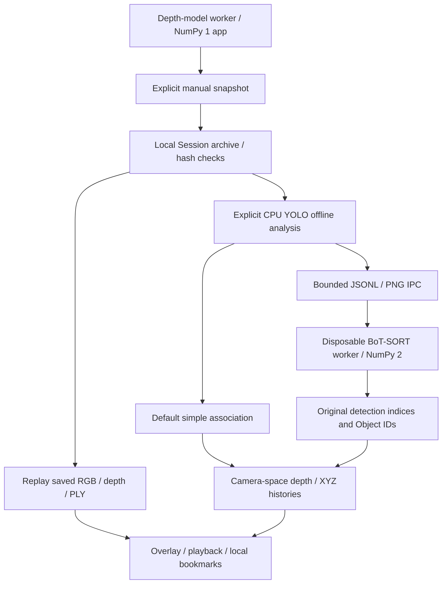

# v0.3 — Sessions, Replay & Offline Tracking / 工作階段、回放與離線追蹤

[Project / 主 README](../../../README.md) · [繁體中文首頁](../../../README.zh-TW.md) · [v0.1](../v0.1/README.md) · [v0.2](../v0.2/README.md)

**Alpha pre-release / experimental development preview — Alpha 預發行版／實驗性開發預覽**

[v0.3.0-alpha.1 Release](https://github.com/JShengP/depthport/releases/tag/v0.3.0-alpha.1) · [exact source / 對應程式](https://github.com/JShengP/depthport/tree/v0.3.0-alpha.1) · [bilingual release notes / 雙語版本說明](../../releases/0.3.0-alpha.1.md)

## Visual overview / 視覺導覽

*程式生成的功能示意圖；不是實際 UI 截圖、模型輸出或追蹤品質證據。 / Generated schematic data, not an application screenshot, model output or tracking benchmark.*

The maintained guide and illustrations can be newer than the tagged snapshot; the original release/source links above stay fixed.
本導覽與插圖可隨文件維護更新，對應舊版本的原始碼與原版 README 仍以各自 Tag 為準。

## Changes from v0.2 / 相對 v0.2 新增

- Opt-in manual local Session snapshots: indexed same-frame RGB/depth/PLY/raw NPY, SHA-256-checked offline replay and model-grouped depth summaries. No automatic camera recording; replay never reruns depth inference.
- Explicit offline YOLO Detect/Segment analysis associates saved observations with local Object IDs and camera-space depth/XYZ histories. Default: Simple association. Optional: Roboflow BoT-SORT in a separate NumPy 2 worker; the depth application stays on NumPy 1.
- Replay boxes/Object IDs, playback/speed/seeking/A-B loops, local bookmark notes/tags/search/JSON backup, keyboard help and editor/IME guards.
- Baseline/ByteTrack/BoT-SORT continuous-sequence comparison and diagnosis tools. **ByteTrack is a benchmark backend, not an additional Session UI selector.** No ReID, world trajectories or speed claim.
- Retains the v0.1 viewer and v0.2 Spatial Analysis. 新增手動本機 Session、完整性回放、離線 Object ID／深度歷史與書籤檢查；簡易關聯仍為預設，BoT-SORT 使用獨立 worker，ByteTrack 用於獨立研究比較工具，未加入 Session 選單。

## Architecture / 架構

Saved RGB/depth stay aligned. The worker returns IDs and original detection indices; the application samples original detections/masks, not predicted boxes. A disposable subprocess isolates incompatible NumPy requirements. Manual snapshots advance a fixed tracker step and do not represent continuous elapsed time or motion-compensated world tracking.
保存影像與深度維持對齊；worker 只回傳 ID 與原始偵測索引，應用對原框／遮罩取深度，不用預測框代替。獨立子程序隔離 NumPy 相容性；手動快照採固定追蹤步長，不代表連續真實時間或世界座標運動。

## Entry / 使用入口

1. Install the application, then set `ENABLE_SESSION_STORAGE=1` **locally** and restart. Session storage defaults off; open `/sessions`. `/` and `/spatial` remain available.
2. For BoT-SORT, follow the [isolated worker guide](../../en/tracking-worker.md) / [繁中安裝](../../zh-TW/tracking-worker.md), set the local worker interpreter, then explicitly choose that backend for saved-frame analysis.
3. Use the [Session/replay guide](../../en/sessions.md) / [繁體中文操作](../../zh-TW/sessions.md) for overlays, notes and keyboard controls. User snapshots, bookmarks, notes and JSON backups stay local and are excluded from releases.

在本機開啟 Session 設定並重啟，進入 `/sessions`；選配 BoT-SORT 需另外安裝獨立 worker。私人快照、書籤、備註與備份不加入公開 Repo／Release。

## Evidence and open gates / 驗證與未完成項目

[Validation record](../../en/validation.md) · [繁中紀錄](../../zh-TW/validation.md) · [Expanded study](../../en/tracking-expanded-acceptance.md) · [Parameter study](../../en/tracking-parameter-acceptance.md) · [Error diagnosis](../../en/tracking-error-diagnosis.md) · [Roadmap](../../../ROADMAP.md)

Cross-platform application/model API CI does not run pretrained inference. Public-sequence studies retain their fixed detector caches and recorded versions; newer dependency versions do not inherit those accuracy results. Lower activation can increase coverage and ID switches/FP together; defaults remain unchanged, and long-occlusion recovery is unaccepted.
跨平台應用／模型 API CI 不執行真權重推論。公開序列保留原偵測快取與版本條件，不能把舊分數當新版精度；降低啟用門檻可能同時增加覆蓋與換 ID／FP，原預設不變，長遮擋恢復未通過。

Independent occlusion/crossing/moving-camera tests, confirmation/competition/localisation/recovery controls, physical RTSP, Windows pretrained inference/real worker integration, endurance, NVIDIA WebGL and calibrated metric accuracy remain open. A published Alpha does not close these gates.
獨立遮擋／交會／移動相機測試、確認／競爭／框品質／恢復控制、實體 RTSP、Windows 真權重／真 worker、長時穩定性、NVIDIA WebGL 與標定精度仍待驗證，發布 Alpha 不表示通過。
