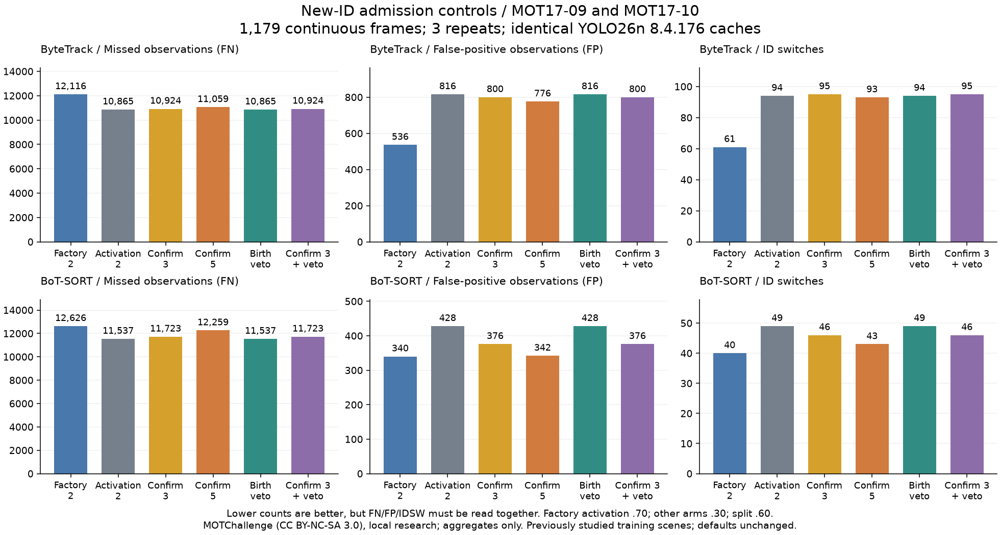

# 新 ID 確認與競爭控制實驗 — 2026-10-19

[English](../en/tracking-admission-acceptance.md) · [路線圖](../../ROADMAP.md) · [v0.3 README](../versions/v0.3/README.md)

**決定：維持應用與 worker 原預設。** 延長確認能減少部分誤追，卻增加漏追並降低整體 IDF1／HOTA；只在新軌跡建立時使用的 IoU 競爭閘門完全未觸發，輸出與對照相同。沒有候選通過事前訂定的不退步研究篩選，追蹤可靠性與長遮擋驗收仍未通過。

[凍結實驗配置](../validation/v0.3-tracking-admission-protocol.json) · [完整彙總結果](../validation/v0.3-mot17-admission.json)



## 輸入、條款與證據範圍

這是**已研究場景上的新控制實驗，不是新的獨立序列組**：MOT17-09-DPM 固定視角 525 格、MOT17-10-DPM 移動相機 654 格，共 **1,179 格連續影格、18,164 筆受評行人觀測**。使用官方壓縮預覽與官方 GT，不是原 benchmark JPEG 或保留測試集／排行榜提交，也不與舊研究混算分數。

[MOTChallenge 官方資料頁](https://motchallenge.net/data/MOT17/)明列 [CC BY-NC-SA 3.0](https://creativecommons.org/licenses/by-nc-sa/3.0/)，有原始來源的序列仍可能有附加條件。署名：MOTChallenge；Milan、Leal-Taixé、Reid、Roth、Schindler 的 [MOT16 benchmark](https://arxiv.org/abs/1603.00831)。本次限本機非商業研究，protocol 保留取得的條款頁雜湊、官方網址與輸入雜湊。不公開原始影像、GT、精確事件位置或個別 ID，程式 AGPL 不改授權資料集。

以 **YOLO26n CPU／Ultralytics 8.4.176** 重建兩份共同快取：尺寸 640、信心 .10、NMS .70、行人 class 0、每格上限 64，沒有影格碰到上限。所有配置讀取完全相同的偵測；舊 8.4.115 快取／分數不是本輪對照。CPU 推論沿用 torch 2.10.0+cu128／NumPy 1.26.4 環境與獨立的 8.4.176 套件層，不是完整 Alpha.2 配方的全新安裝；追蹤仍在獨立 NumPy 2 環境，確切套件與權重／影片／GT／快取雜湊均列於紀錄。

## 分開測什麼

兩後端各六組配置、每組重複三次，共 **2 場景 × 2 後端 × 6 配置 × 3 次＝72 次**。正式序列追蹤前已在本機凍結時間戳與雜湊，並非獨立預註冊；看過結果後沒有改配置或搜尋其他門檻。

- **原套件預設參考：** 啟用 .70、強弱分流 .60、保留 30、確認值 2。
- **降低啟用對照：** 僅將啟用設為 .30，其餘不變。
- **確認 3／5：** 相對降低啟用對照，只改上游確認參數為 3／5。
- **單獨競爭控制：** 確認值維持 2；只在尚未配對的高信心偵測要建立新軌跡時，若與已確認、仍保留的軌跡框普通 IoU ≥.50，阻擋這次建立。比較在上游 CMC／關聯之後進行，使用已更新或尚未匹配的預測狀態；不把未確認軌跡當競爭者。被擋的原偵測仍以 ID -1 回傳，後續影格可重新考慮。
- **確認 3＋競爭：** 合併兩項控制，分別與降低啟用對照、單獨確認 3 比較。

研究介面保留上游高／低信心關聯、輸入框／分數、CMC、保留時間與 ReID 設定，**弱偵測仍可延續既有軌跡**。BoT-SORT 上游弱關聯本來就不包含已 lost 的軌跡，本輪沒有新增弱偵測找回 lost 軌跡的能力；也未改動已確認軌跡之間的後續競爭。

參數雖名為 `minimum_consecutive_frames`，ByteTrack 使用連續成功計數，BoT-SORT 使用成功更新計數，且 BoT-SORT 首格立即啟用的例外保留。因此 **3／5 是確認計數設定，不保證每次恰好等待 3／5 格**。真套件契約已測延遲啟用、低分延續、重複新軌跡阻擋、輸入不變及上游 registry 不變；Session worker、選單與應用預設都不變。

## 整段比較結果

每列依序為 **FN／FP／IDSW；Recall／Precision／IDF1／HOTA（%）**。FN／FP 是觀測數，不是人數；評分上的 FP 不代表現場一定沒有這個人，不能只挑一個指標看。

**ByteTrack**

- 原套件預設：**12,116／536／61；33.30／91.86／35.32／29.72**。
- 降低啟用對照：**10,865／816／94；40.18／89.94／38.28／31.80**。
- 確認 3：**10,924／800／95；39.86／90.05／38.14／31.64**。
- 確認 5：**11,059／776／93；39.12／90.15／37.77／31.30**。
- 單獨競爭：輸出與降低啟用對照完全相同。
- 確認 3＋競爭：輸出與單獨確認 3 完全相同。

**BoT-SORT**

- 原套件預設：**12,626／340／40；30.49／94.22／36.80／30.91**。
- 降低啟用對照：**11,537／428／49；36.48／93.93／40.23／32.91**。
- 確認 3：**11,723／376／46；35.46／94.48／39.70／32.48**。
- 確認 5：**12,259／342／43；32.51／94.53／37.51／31.43**。
- 單獨競爭：輸出與降低啟用對照完全相同。
- 確認 3＋競爭：輸出與單獨確認 3 完全相同。

相對降低啟用對照，確認 3 的 FN／FP／IDSW 差為 ByteTrack **＋59／−16／＋1**、BoT-SORT **＋186／−52／−3**；確認 5 則為 **＋194／−40／−1**、**＋722／−86／−6**。所有延長確認配置的整體 IDF1／HOTA 都下降，誤追或換 ID 減少不足以單獨判定改善。

## 新增／移除案例、閘門觸發與事件限制

24 份場景／配置輸出的診斷數量均與官方 TrackEval CLEAR 精確一致。FP 依 **（影格、固定快取偵測索引）** 配對，FN／IDSW 依 **（影格、GT）** 配對，不跨執行比較追蹤 ID 數字；相同換 ID 位置仍可能有不同轉換。

- ByteTrack 確認 3：FN **新增 59／移除 0**、FP **1／17**、IDSW **35／34**；確認 5：FN **215／21**、FP **1／41**、IDSW **38／39**。
- BoT-SORT 確認 3：FN **186／0**、FP **0／52**、IDSW **24／27**；確認 5：FN **722／0**、FP **0／86**、IDSW **25／31**。
- 兩場景／兩後端的競爭閘門都阻擋 **0 次**。每次重複、跨兩場景的合格新軌跡候選為 ByteTrack **77**、BoT-SORT **123**；合併確認 3 後為 **77／149**，重複計數一致。標準化預測雜湊證明與無競爭組完全相同。這表示**所選出生閘門沒有觸發機會**，不能推論關聯競爭不存在或已解決；本輪不事後降低門檻來製造改善。
- 原套件預設 ByteTrack 在 **21 個長低可見度主體中保留 1 個同 ID 端點**；原預設 BoT-SORT、降低啟用對照與所有介入配置均為 **0／21**。缺少端點與較低事件覆蓋保留於 JSON；這些是 GT 可見度／順序診斷，不是實體遮擋、全程正確身分或獨立情境 IDF1／HOTA 的證明。

凍結的**研究篩選**要求：各場景 FN／FP／IDSW 不增加、整體 IDF1／HOTA 不降低，且整體 FP 或 IDSW 至少一項改善。確認組不符覆蓋／身分條件，競爭組沒有改善；JSON 逐條保留失敗條件。所有候選及降低啟用對照都不升為應用預設。

## 評估、重現與下一步

使用乾淨且固定的 [TrackEval commit](https://github.com/JonathonLuiten/TrackEval/tree/12c8791b303e0a0b50f753af204249e622d0281a)、官方 MOT17 distractor／zero-mark 前處理、CLEAR IoU .5、Identity 與 HOTA；核對預覽到 GT 的等比例 2 倍縮放及 MOT 座標原點＋1。整體分數使用官方 combiner；三次新建追蹤器輪替執行順序，OpenCV seed 0／單執行緒，標準化預測完全一致。耗時包含第一次直接函式庫 update，不含偵測／解碼／啟動，**也不含 worker IPC**；只是單機描述，不是端到端吞吐量驗收。

依[既有重現說明](../en/tracking-expanded-acceptance.md#reproduce-locally)準備有授權的本機輸入及 manifest，兩份偵測快取須以 **8.4.176** 和 protocol 旗標重建。原始資料不加入公開清單，在獨立追蹤環境執行：

```bash
python tools/validate_mot_tracking.py \
  --manifest local/mot17-admission.json --trackeval-root local/TrackEval \
  --work-dir outputs/admission --output outputs/admission.json \
  --repeats 3 --admission-study

RUN_TRACKERS_CONTRACTS=1 python -m pytest -q tests/test_tracking_admission.py
python tools/plot_tracking_admission.py \
  --record docs/validation/v0.3-mot17-admission.json \
  --output outputs/admission-counts.png
```

下一步先記錄**未確認軌跡升格與遮擋恢復時的競爭**、關聯成本、保留假設的重疊及年齡，再選控制方式；獨立分離框品質與關聯，用新的授權序列組重驗。不直接刪除所有低分偵測，也不預設 ReID 能解決偵測錯誤。泛化長遮擋、實體 RTSP、Windows 真推論／worker、長時穩定性、硬體 WebGL 與標定 3D 精度均仍待驗證；既有 Release／Tag 及歷史研究不改寫。
