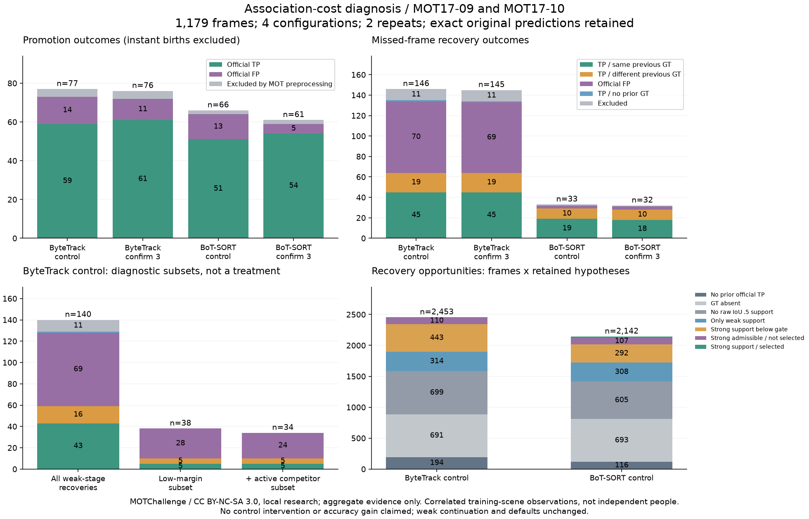

# 未確認升格與恢復關聯成本診斷 — 2026-10-19

[English](../en/tracking-association-diagnosis.md) · [ROADMAP](../../ROADMAP.md) · [前次新 ID 控制實驗](tracking-admission-acceptance.md)

**下一個研究控制點：ByteTrack 漏格後進入弱關聯時，與活躍已確認假設的低差距競爭。** 保留一般活躍軌跡的弱偵測延續，以及弱偵測供恢復研究使用。這只是觀察所得的測試目標，不是已實作修復或通過的策略；被標記的群組也包含同 GT 恢復。應用／worker 預設及預測不變。

[凍結擷取配置](../validation/v0.3-association-diagnosis-protocol.json) · [成本／計數彙總與階段拆分](../validation/v0.3-association-diagnosis.json)



> 後續已另完成[新 MOT20-01 延後接回控制](tracking-recovery-acceptance.md)。本篇保留當時純觀察結果；後續研究篩選通過不代表一般可靠性驗收。

## 輸入與實際重跑範圍

沿用[前次實驗](tracking-admission-acceptance.md)完全相同的 **YOLO26n CPU／Ultralytics 8.4.176** 偵測快取、官方 GT 與有授權的 MOT17-09／10 壓縮預覽，共 **1,179 格連續影格**，涵蓋固定視角與移動相機。這是已研究訓練場景，不是新的獨立驗收組；偵測設定／權重、關聯門檻、確認值及來源 FPS 均不變。

兩後端各觀察「降低啟用對照」（啟用 .30／分流 .60／確認 2）與「確認 3」，維持一秒參考保留時間及原 CMC：**2 場景 × 2 後端 × 2 配置 × 2 重複＝16 次／9,432 次影格更新**。不可把重複或相關配置當獨立樣本。8 份不同場景／配置輸出皆精確重現原標準化預測與官方 CLEAR／Identity／HOTA，兩次完整探針紀錄雜湊也一致，不宣稱新精度改善。

[MOTChallenge 官方頁](https://motchallenge.net/data/MOT17/)明列 [CC BY-NC-SA 3.0](https://creativecommons.org/licenses/by-nc-sa/3.0/)，原始來源可能另有條件。署名：MOTChallenge；Milan、Leal-Taixé、Reid、Roth、Schindler 的 [MOT16 benchmark](https://arxiv.org/abs/1603.00831)。限本機非商業研究，不散布原影像、GT 或原始診斷，程式 AGPL 不改授權資料集。條款頁、輸入／快取／GT／權重雜湊、原環境與沿用配方限制均由 protocol／參考紀錄連結保留。

## 記錄原決策，不改決策

選用探針只包裝 **Roboflow Trackers 2.6.1 的單一實例**：原矩陣、原門檻及原指派結果原樣傳遞；失敗時也恢復原屬性，不修改上游 registry。追蹤只接收原影格／偵測，GT 在完成追蹤後才加入分析。弱偵測延續維持上游行為，包括 BoT-SORT 弱階段原本就不接受已 lost 假設。

本機 JSONL 保存每階段完整相似度／成本矩陣、門檻、已選／未配對列欄、原偵測索引、私有軌跡 token／ID、確認計數及保留年齡；BoT-SORT 的列欄對照與原偵測另做核對。完整矩陣／案例留本機，公開僅有檢查過的計數、分布與雜湊。

- **成本：** `1 − 實際相似度` 是等價的固定配對數目指派目標。ByteTrack 用 IoU；BoT-SORT 高信心／未確認階段融合信心分數，弱階段不融合。不是外觀／Mahalanobis 成本或校準機率，不能用跨階段／後端通用成本門檻。
- **升格：** 已配對的未確認假設獲得確認 ID。BoT-SORT 每配置 6 次首格立即啟用另外計數，不混入升格成本。
- **恢復：** 已確認且仍保留的假設，在至少一格完整漏配後再次匹配。這是漏格代理，不代表確實發生物理遮擋；已到期假設沒有矩陣列，不在此機會群組。
- **低差距：** 選中相似度減去同行／同欄其他過門檻候選的最佳值 ≤.05，可為負；候選可能已配給其他對象。.05 是事前固定的診斷定義，不是建議上線門檻。
- **弱恢復的活躍競爭者：** 已確認且前一格有匹配的假設，在本階段預測後年齡為 1；不表示目前偵測就應歸它所有。
- **端點標籤：** 目前觀測的官方 CLEAR TP／FP／排除。恢復 TP 再比較目前 GT 與該軌跡上次官方 TP 的 GT；不同 GT 不等同一次官方換 ID，也不保證物理身分錯誤，先前歸屬可能已錯。升格時 TP 也不保證後續軌跡純度。

## 升格：沒有證據支持再加一個全面成本閘門

以下依降低啟用對照／確認 3 排列：

- **ByteTrack：** 升格 **77／76** 次，TP **59／61**、FP **14／11**、排除 **4／4**；升格低差距標記全為 **0**。對照組 TP／FP 成本中位數 **.1351／.1044**，成本更低在這裡不能當成純度標籤。
- **BoT-SORT：** 升格 **66／61** 次，TP **51／54**、FP **13／5**、排除 **2／2**，另有首格立即啟用 **6／6**；升格低差距全為 **0**。對照 TP／FP 中位數 **.4034／.4239**，確認 3 則為 **.3883／.3815**。分布重疊，不能據此直接選更嚴的單一成本切點。
- BoT-SORT 升格時，前一高信心階段仍有過門檻已確認假設的情況，TP 有 **1／3** 次、FP 為 **0**；全面阻擋這些競爭會碰到 TP，沒有辨識 FP 升格的證據。

這些是**升格事件數**，不是上輪整段 FP／FN 觀測數。延長確認的覆蓋／身分品質代價仍保留，不升為預設。

## 恢復：競爭訊號出現在哪裡

降低啟用對照的總數，不跨後端或重複執行混算：

- **ByteTrack 共 146 次恢復：** 同先前 GT 的 TP **45**、不同 GT 的 TP **19**、沒有先前官方身分的 TP **1**、FP **70**、排除 **11**。其中弱階段 **140** 次：同 GT **43**、不同 GT **16**、未知先前 TP **1**、FP **69**、排除 **11**。同 GT 與 FP 成本重疊，整體中位數 **.4379／.6429**，同 GT 成本 P95 **.8600**。
- **BoT-SORT 共 33 次恢復，均在高信心階段：** 同 GT **19**、不同 GT **10**、FP **3**、排除 **1**。低差距群組為同 GT **2**、不同 GT **1**、FP **0**，不應照搬 ByteTrack 標記。確認 3 為 32 次、少一筆同 GT 端點；完整數量保留在 JSON。

ByteTrack 的**弱階段恢復**進一步拆分：

1. 低差距子群組 **38** 筆：FP **28**、不同 GT **5**、同 GT **5**。
2. 再要求有**活躍已確認的競爭假設**，剩 **34** 筆：FP **24**、不同 GT **5**、同 GT **5**。競爭型態可和其他候選偵測同時出現，每事件只計一次。
3. 確認 3 也有相同的 34 筆組成。09 場景為 **12／5／1**，10 為 **12／0／4**（依 FP／不同 GT／同 GT 排列）；同片相關觀測不當成獨立重現。

因此優先研究**對漏格假設採取考慮競爭的延後重新接回**，執行時只用可觀測狀態／歷史及分階段成本，保留一般活躍軌跡的弱延續。這**不表示刪除這些輸出就會改善**：全面阻擋也會影響 **5 筆同 GT 恢復**，後續指派、FP／FN／換 ID 都會改變；本輪沒有反事實分數收益或物理因果診斷。

## 沒接回的機會與沒有發現的問題

機會分母是**影格 × 保留中已確認假設**，不是人數或獨立事件。對照組 ByteTrack **2,453**、BoT-SORT **2,142**，以下均依此順序：

- 沒有先前官方 TP：**194／116**；目前沒有先前 GT 標註：**691／693**。
- 有先前 TP 且目前有 GT 的 **1,568／1,333** 個機會中，原始框沒有 IoU≥.5 幾何支持：**699／605**；只有弱支持：**314／308**。
- 有強幾何支持但對應高信心邊未過門檻：**443／292**；有過門檻支持但未選給該假設：**110／107**；選中強支持邊：**2／21**。
- BoT-SORT 的 **308** 個弱支持 lost 機會不在上游弱階段。這是生命週期規則的紀錄，不表示打開弱 lost 恢復就會安全或成功。
- 所有擷取階段在指派／過濾後，**雙方都未匹配而仍過門檻的邊均為 0**；本組沒有觀察到可供「剩餘邊重配」修補的觸發機會。

幾何支持使用上次已知 GT 框，沒有一對一指派保證，也可能反映半身／全身框品質、預測漂移、競爭歸屬或標註限制，不能直接判定偵測器漏人或改閘門便能找回。早已到期的長遮擋假設不在矩陣裡，長遮擋泛化驗收仍未通過。

## 重現與下一個控制實驗

使用[上輪研究](tracking-admission-acceptance.md)相同的有授權輸入、manifest 及獨立 NumPy 2／Trackers 2.6.1 環境，搭配乾淨固定的 [TrackEval](https://github.com/JonathonLuiten/TrackEval/tree/12c8791b303e0a0b50f753af204249e622d0281a)。工具核對輸入／配置雜湊、官方 GT／metadata、原預測、重複紀錄雜湊與全部官方分數，不做網路操作。擷取程式在重跑前凍結；階段拆分為原本機矩陣／案例的確定性後處理，不是新的控制或參數搜尋。公開整理版另補 protocol 連結、解讀與驗證。

```bash
python tools/diagnose_tracking_association.py \
  --manifest local/mot17-admission.json \
  --admission-record docs/validation/v0.3-mot17-admission.json \
  --trackeval-root local/TrackEval --work-dir outputs/association \
  --output outputs/association.json --repeats 2
python tools/summarize_association_stages.py \
  --record outputs/association.json --work-dir outputs/association \
  --output outputs/association-stages.json
RUN_TRACKERS_CONTRACTS=1 python -m pytest -q tests/test_tracking_association_probe.py
python tools/plot_association_diagnosis.py \
  --record docs/validation/v0.3-association-diagnosis.json \
  --output outputs/association-counts.png
```

行為變更前，先為 ByteTrack 漏格假設的弱階段競爭點另凍結控制配置，保留不變對照，用**新的授權獨立序列組**比較 FP／FN／IDSW／IDF1／HOTA 及配對恢復收益／損失。執行時不可用 GT 做啟用／恢復決策；框品質與假設到期另行研究，不刪除全部弱偵測、不全面提高升格門檻、不盲目加 buffer／ReID，也不據診斷改預設。實體 RTSP、Windows 真推論／worker、長時穩定性、硬體 WebGL 與標定 3D 精度仍待驗證；不另發 Release 或替換 Tag。
