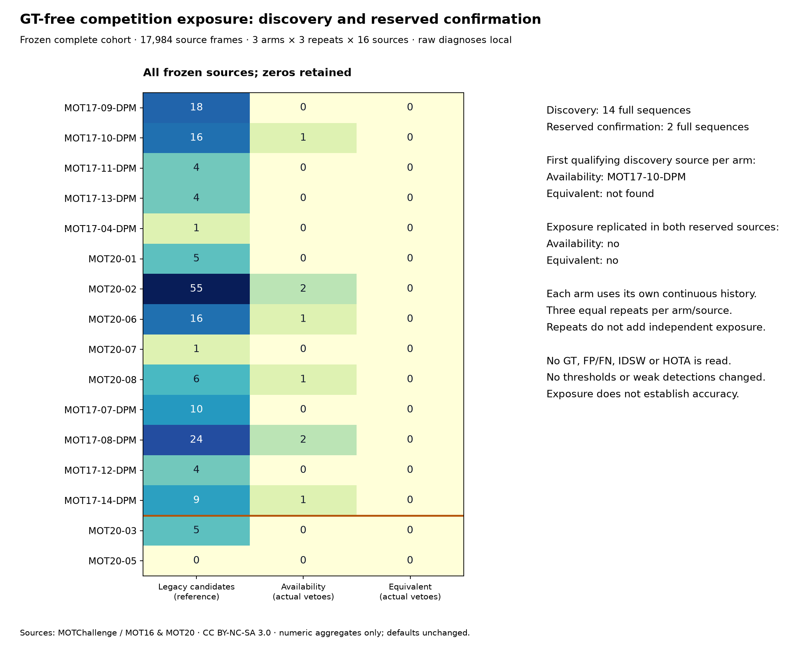

# 不靠 GT 分數的競爭曝光選取 — 2026-10-19

[English](../en/tracking-exposure-selection.md) · [ROADMAP](../../ROADMAP.md) · [前輪控制](tracking-exclusive-competition.md) · [凍結規則](../validation/v0.3-exposure-selection-protocol.json) · [輸入鎖定](../validation/v0.3-exposure-input-lock.json) · [發現紀錄](../validation/v0.3-exposure-discovery.json) · [保留確認](../validation/v0.3-exposure-confirmation.json) · [事後機制摘要](../validation/v0.3-exposure-audit.json)

**完成預先凍結的完整搜尋與分離確認，但沒有找到兩個控制都能獨立重現曝光的場景。** 未配對競爭者控制在發現階段 6 段中觸發共 8 次，依固定順序選到 MOT17-10；兩段保留確認皆零觸發。等價替代控制在全部 16 段皆零觸發，發現選取保持 `null`。這是完整陰性結果，不是可靠性驗收或修復通過；控制、弱偵測延續與預設不變。

**後續診斷：**[凍結成本／競爭結構分析](tracking-competition-structure.md)已在不調參、不讀 GT 下檢查全部 197 個參考替代。等價值尚不代表身分歧義，下一點為分量內有效更新置換與跨格穩定性；不改寫下列曝光結果。



## 先凍結規則，再找曝光

本機凍結 SHA-256：`279e5d8d81fceb2409a0259a84d78ceee1a48ca4d04d81e2e1be91364ad4f36c`。在本輪任何曝光掃描前記錄候選、順序、來源群、保留組、全部程式／套件／上游類別雜湊與選取定義；輸入在快取準備完成後另鎖定，仍早於發現掃描。這是本機凍結，不是外部預註冊。

- **候選與停止規則：** 固定 14 段發現序列，全部跑完，不因提早觸發而停止，也不在看完結果後換片或追加有利場景。所有零值、失敗都保留；本輪沒有失敗。
- **選取：** 各新控制分開選「固定順序中，自己的完整歷史至少 1 次實際 veto／1 個觸發影格，且三次預測／完整 trace／計數一致」的第一段。參考流的假設性曝光不算控制真的觸發，不用事件多寡排名；沒有合格者就保留 `null`。
- **資料隔離：** 掃描輸入 schema 只允許影片、偵測快取及雜湊，拒絕 GT 欄位。掃描／選取沒有 evaluator，不讀 GT、FP／FN、IDSW、IDF1、HOTA，不以準確度挑序列。部分歷史場景分數本來已知，所以只能當發現資料；本輪不重新評分。
- **保留確認：** 發現完整 JSON 及選取名單先封存，雜湊 `fe8b549aab7da1ab9a4434c6475418bebde75bedb4528e36159bb18163563ac5`。之後才對預定 MOT20-03／05 執行三組，不按發現成功與否換保留組。規則要求發現有合格例，且兩個保留場景都實際觸發，才算曝光重現；確認組不能回填成發現候選。

來源群依官方場景描述預先分配；發現與確認的序列 ID／宣告來源群分離，但共用資料集、偵測器與執行環境，沒有隨機抽樣。不能宣稱跨獨立資料集、攝影地點或人物獨立性。

## 不變的控制與完整連續輸入

保留原啟用 `.3`、高信心 `.6`、buffer `30`、確認 `2`、弱階段 IoU `.10`、同欄差 `.05`、等價 solver 誤差容許 `1e-12`；占用與等價兩組各自沿用[原定義](tracking-exclusive-competition.md#四個獨立實驗組)，不把兩條件混成另一個控制，不重配剩餘邊，不加入 ReID／CMC、GT 或生命週期修改。

所有弱偵測仍送進原庫；一般活躍弱延續與無競爭弱接回保留。固定 YOLO26n／Ultralytics 8.4.176 CPU、confidence .10、imgsz 640、class 0、max_det 64、NMS .7、原權重雜湊與 NumPy 2 研究環境；應用／worker 未更新或註冊新控制。

**完整 17,984 格、371,458 筆快取偵測，0 格達到偵測數上限。** 發現 12,264 格／14 段、確認 5,720 格／2 段；每段三組各三次，共 **144 次完整序列執行**。重複不增加獨立樣本數，計數只取每組一份一致結果。

長序列改用有界儲存分片：每份仍遵守既有 ≤1,800 格／≤32 MiB／每格 ≤64 偵測，不提高限制；直接解碼原完整預覽，沒有截片、重編碼或抽格。跨片保持同一追蹤器、來源影格索引及 probe 狀態，不重設軌跡。分片契約涵蓋弱延續與漏格接回；新寫入器另在既有 429 格上精確重現全部偵測／中繼資料，MOT17-04 三組完整預測與 trace 也精確重現前輪雜湊。

## 全部檢查紀錄

| 階段 | 序列 | 格數 | 舊規則候選邊¹ | 未配對控制觸發² | 等價控制觸發² |
| --- | --- | ---: | ---: | ---: | ---: |
| 發現 | MOT17-09-DPM | 525 | 18 | 0 | 0 |
| 發現 | MOT17-10-DPM | 654 | 16 | 1 | 0 |
| 發現 | MOT17-11-DPM | 900 | 4 | 0 | 0 |
| 發現 | MOT17-13-DPM | 750 | 4 | 0 | 0 |
| 發現 | MOT17-04-DPM | 1,050 | 1 | 0 | 0 |
| 發現 | MOT20-01 | 429 | 5 | 0 | 0 |
| 發現 | MOT20-02 | 2,782 | 55 | 2 | 0 |
| 發現 | MOT20-06 | 1,008 | 16 | 1 | 0 |
| 發現 | MOT20-07 | 585 | 1 | 0 | 0 |
| 發現 | MOT20-08 | 806 | 6 | 1 | 0 |
| 發現 | MOT17-07-DPM | 500 | 10 | 0 | 0 |
| 發現 | MOT17-08-DPM | 625 | 24 | 2 | 0 |
| 發現 | MOT17-12-DPM | 900 | 4 | 0 | 0 |
| 發現 | MOT17-14-DPM | 750 | 9 | 1 | 0 |
| 保留確認 | MOT20-03 | 2,405 | 5 | 0 | 0 |
| 保留確認 | MOT20-05 | 3,315 | 0 | 0 | 0 |

¹ 原對照完整歷史中符合舊同欄規則的候選邊，不是實際 veto。² 各新控制自己的完整歷史，不相加當作獨立事件或不同真實人物；影格／ID／位置只留本機。三次完整預測／trace／計數均一致。

- 未配對控制有曝光：MOT17-10、MOT20-02、MOT20-06、MOT20-08、MOT17-08、MOT17-14，共 8 次。固定順序選 MOT17-10（已研究的發現場景），不是事後挑最多觸發的 MOT20-02／MOT17-08。這僅證明規則可在自然輸入到達，沒有 GT 判定它是否該刪除關聯。
- MOT20-03 的 5 個舊規則候選，競爭者都已配到其他框，兩個新組都不觸發；MOT20-05 連舊規則候選也沒有。兩組在保留確認都與原對照一致，**未重現曝光**，不把保留組改成發現或重新選其他確認片。
- 等價控制在所有 16 段與原對照的預測相同，沒有自然觸發，不能宣稱已確認有效、沒副作用或會改善 HOTA。

## 為何等價控制仍沒有曝光

選取封存後才另作**不參與選取的事後機制摘要**，只讀雜湊核對的本機 trace，不重追蹤或讀 GT。參考流共有 **178 個候選邊／197 個競爭替代**：發現 192 個替代的總相似度機會成本全部為正，約 `.0002982–.9673191`；保留確認 5 個也全部為正，約 `.1547125–.8074592`。沒有「目標值相等但少合格配對」或合格等價替代。

等價控制要求替代指派幾乎不損失完整目標值，故這個候選群沒有滿足條件的例子；不等於所有矩陣都不存在同分最優解，也不證明程式失效。不同矩陣的成本不是校準機率或通用風險分數，不能依最小值挑一個新容差來製造觸發。未配對組歷史改變後的替代數也另記，沒有硬套原對照的反事實結果。

## 來源、使用條款與歷史更正

來源為 [MOT17](https://motchallenge.net/data/MOT17/)／[MOT20](https://motchallenge.net/data/MOT20/)官方完整壓縮預覽，各入選列皆沒有額外第三方來源連結。官方 [CC BY-NC-SA 3.0](https://creativecommons.org/licenses/by-nc-sa/3.0/)適用本機非商業研究；原始影片、GT、偵測、追蹤及矩陣不散布。來源頁雜湊、完整順序、排除理由、每片／每快取雜湊與準備狀態都已列入協議／輸入鎖定。署名：MOTChallenge；Milan、Leal-Taixe、Reid、Roth、Schindler，[MOT16](https://arxiv.org/abs/1603.00831)；Dendorfer 等，[MOT20](https://arxiv.org/abs/2003.09003)。程式 AGPL 不改資料集授權。

MOT17-01／02／03／05／06 的額外來源條款未另核實，未掃描；MOT20-04 的廣場來源群保留給 MOT20-05 確認，未掃描；FRCNN／SDP 是同影像變體，未當新序列重複計數。公開 test 預覽只用來看曝光，沒有官方隱藏 GT 或 leaderboard 提交。

**更正前輪來源描述：** MOT17-04 已出現在[早期一般比較](tracking-expanded-acceptance.md)，前輪稱它為「新場景」不準確；新增的是 8.4.176 快取。已修正文案與圖，原凍結協議／原數值保留並加註說明，不回填獨立性或修改歷史分數。

## 決定與下一步

**未找到兩個控制皆可獨立重現曝光的場景；不調參、不升預設，也不宣稱可靠性通過。** 未配對控制已有本機自然觸發案例可供下一輪固定機制／錯誤分析，但保留組沒有曝光，不能推論泛化效果。等價控制應先檢查「等價目標值」所代表的歧義機制是否具有足夠自然發生率；任何放寬成本的想法都屬另一個需要另行凍結的控制，不能改寫本輪結果。

若進行準確度驗證，需另先凍結完整比較組與逐場景風險標準，再讀 GT，同報 FN／FP／IDSW／IDF1／HOTA 與失敗，不用曝光陽性代表有益，也不挑有利片段。低召回、定位／解析度、長遮擋、先前公車 HOTA、實機／Windows／worker／3D／吞吐量仍未驗收。

應用測試 **349 通過／20 選配略過**；固定 NumPy 2 曝光／摘要／恢復／歷史契約 **32 通過**。涵蓋拒絕 GT 欄位、缺漏／重排／重複清單、保留來源群洩漏、陽性／零值選取、分片間隙／雜湊／設定，以及真套件弱延續／漏格接回、舊 runner／完整快取／分片的預測與 trace 完全一致。公開清單／連結、來源封裝及純合成網站建置通過，沒有部署網站或上傳 Release。

## 重現與公開範圍

```bash
python tools/select_tracking_exposure.py --phase discovery \
  --protocol docs/validation/v0.3-exposure-selection-protocol.json \
  --inputs local/inputs.json --input-lock docs/validation/v0.3-exposure-input-lock.json \
  --work-dir artifacts/exposure/discovery --output artifacts/exposure/discovery.json
python tools/select_tracking_exposure.py --phase confirmation \
  --protocol docs/validation/v0.3-exposure-selection-protocol.json \
  --inputs local/inputs.json --input-lock docs/validation/v0.3-exposure-input-lock.json \
  --discovery artifacts/exposure/discovery.json \
  --work-dir artifacts/exposure/confirmation --output artifacts/exposure/confirmation.json
```

公開僅程式、凍結規則、全序列彙總計數／雜湊、數值圖與上述限制。原片、GT、偵測、逐格 ID／位置、矩陣、完整指派、例外詳細資訊及原始診斷留本機；不含私人路徑、帳密或使用者影像／書籤。Release／Tag 不變。
