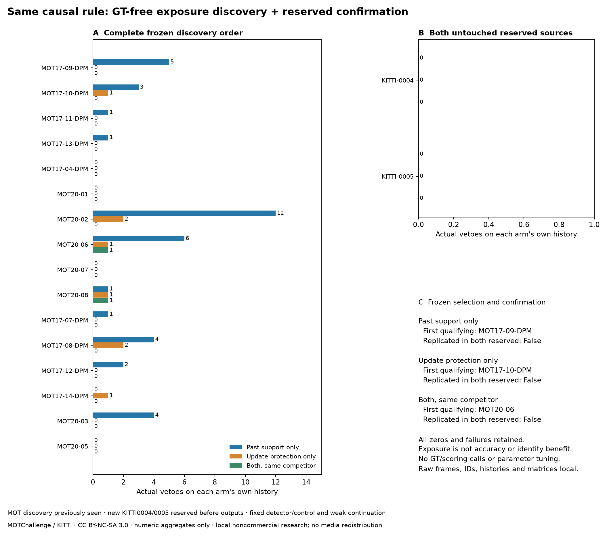

# 同一規則的 GT-free 曝光發現與保留確認 — 2026-10-19

[English](../en/tracking-past-exposure.md) · [ROADMAP](../../ROADMAP.md) · [前輪因果控制](tracking-past-support.md) · [Protocol](../validation/v0.3-past-exposure-protocol.json) · [Discovery](../validation/v0.3-past-exposure-discovery.json) · [Confirmation](../validation/v0.3-past-exposure-confirmation.json) · [Pre-inference seal](../validation/v0.3-past-exposure-confirmation-seal.json)

後續：[只讀適用性診斷](tracking-exposure-gap.md)確認兩段保留來源均停在已接受漏格弱更新之前，沒有到達過去支援／保護測試，不新增門檻或預設；下文buffer文字勘誤，原凍結紀錄保留。

**三個機制都在發現組實際觸發，但均未在獨立保留組重現曝光。** 完整16段發現組，過去支援／更新保護／同時符合分別 **40／8／2次veto**，依順序選出 **MOT17-09-DPM／MOT17-10-DPM／MOT20-06**；原先保留的兩段KITTI各控制都零觸發。所有排定來源完成、零值完整保留，沒有讀取本輪GT、分數或評分器。曝光不是身分效益或發布驗收。



## 事前凍結與各組選取

協定於 `2026-10-19T14:48:52.951961+00:00` 本機封存，SHA-256 **`573b76a8019ce5bb069a6140d2070c26ca7c4071dace026dcef3ea8eba255082`**；11項合成／固定套件契約先通過，早於新偵測／追蹤輸出。來源意圖先記錄，保留ID及完整格數只查原ZIP目錄；下載原圖可在實作／凍結期間繼續，沒有先推論。這是本機事前凍結，不是外部預註冊；過去MOT診斷與部分歷史分數已見，沒有作為選取輸入，不把發現組冒稱盲測。

[同一因果控制](tracking-past-support.md)程式逐位元不變：`d760faddc836de6e299240d84ff3046c559e5b52e55d6a56c0a70a1aa5b251e1`。只用決策前已接受觀測、區分活躍／保留／未確認與缺證據、保護其他每筆已接受列／偵測更新，同時符合須是同一競爭者。每組各有連續歷史，不轉移參考歷史、不靠原生ID串接、不用未來支援或新門檻；三控制及無veto參考不變。

1. 完整檢查固定順序的**每一段**，找到後也不停。各控制分開選第一段完整成功且自身歷史≥1次實際veto／≥1個veto影格、三次canonical預測／完整trace／計數一致、未掛控制參考一致、無偵測上限影格的來源。參考組的假設機會不能替控制選片，不依品質排名或挑好片段。
2. 全部零值及失敗保留。失敗是未知、不能填零，公開安全原因碼，完整例外留本機。其他來源失敗時仍可列第一段成功合格片，但搜尋標為未完整，不能通過重現；不因結果重試、替換或放寬規則。
3. **整份發現清單／雜湊／選取結果先封存，才開始任何保留組偵測或追蹤**。確認輸入另鎖，綁定發現雜湊及事前準備封存。兩段保留來源不論發現結果都跑完整，不能拿來補發現名額。
4. 每個控制須發現有選出來源、所有排定來源都完成，且**兩段**保留片都實際veto，三次／未掛參考／偵測上限核對皆過，才稱機制曝光重現；否則false，發現無曝光就保持null。全程不讀GT、FP／FN／IDSW／Identity／HOTA或精度分數，這個門檻不能代替前輪逐景傷害、追蹤品質／可靠性或產品驗收。

## 來源與獨立性

發現組沿用原曝光研究**全部16段**MOT來源與原順序，共17,984格；原保留MOT20-03／05已見，明確改列發現，不能再當未見確認。這是完整預定清單，不宣稱窮盡所有公開資料。沿用不可變8.4.176快取，不重做偵測或依分數篩來源。

保留 **KITTI-0004（314格）／0005（297格）**，為先前0000–0003之後字典順序前兩個訓練ID，事前固定；其他KITTI ID預先排除，前四段陰性紀錄保留。這兩段此前沒有本專案推論／追蹤或GT成員讀取，與MOT發現組屬不同資料集／來源類別；但共用預訓練模型／runtime、非隨機選取、兩段車載片不證明獨立場地／人物或統計效力。現在已看過，不能再作未來未見保留組。

兩段原PNG核對ZIP CRC／雜湊，以原10Hz FFV1 BGR回放；**611格全部與原圖逐像素相同**，不裁切、重採樣或有損編碼。[準備紀錄](../validation/v0.3-past-exposure-prepared-sources.json)保留圖片清單／影片雜湊、尺寸、格數，並由[推論前封存](../validation/v0.3-past-exposure-confirmation-seal.json)綁定。[發現輸入鎖](../validation/v0.3-past-exposure-discovery-inputs.json)及[確認輸入鎖](../validation/v0.3-past-exposure-confirmation-inputs.json)綁定每個來源／快取雜湊、完整格數、FPS、分段數及偵測／上限數。本輪不下載、開啟或傳入標註；以前本機的KITTI標註ZIP也不讀取。

保留原FPS：MOT25／30Hz、KITTI10Hz。**勘誤：** lost_track_buffer30以30Hz為基準，固定helper在MOT配置25／30原生格、KITTI為10格，名目均約一秒；先前1–1.2秒／3秒解讀有誤。[勘誤紀錄](../validation/v0.3-buffer-semantics-erratum.json)保留原凍結文字／程式／輸出雜湊，不調buffer。YOLO26n行人0／Ultralytics8.4.176 CPU／confidence.10／imgsz640／NMS.70／max64／同權重及啟用.30／高.60／buffer30／確認2／margin.05、弱延續／預設不變。

## 全清單、零值與確定性選取

數字為實際被移除的原選配對，不是獨立人物或事件；各欄在自己分歧後的歷史計數，不是可以相減求因果效果的巢狀配對集合。無veto參考全零；失敗會列unknown，**本輪沒有失敗**。

| Source | Phase | Frames | Status | Past only | Protection only | Both |
| --- | --- | ---: | --- | ---: | ---: | ---: |
| MOT17-09-DPM | discovery | 525 | completed | 5 | 0 | 0 |
| MOT17-10-DPM | discovery | 654 | completed | 3 | 1 | 0 |
| MOT17-11-DPM | discovery | 900 | completed | 1 | 0 | 0 |
| MOT17-13-DPM | discovery | 750 | completed | 1 | 0 | 0 |
| MOT17-04-DPM | discovery | 1050 | completed | 0 | 0 | 0 |
| MOT20-01 | discovery | 429 | completed | 0 | 0 | 0 |
| MOT20-02 | discovery | 2782 | completed | 12 | 2 | 0 |
| MOT20-06 | discovery | 1008 | completed | 6 | 1 | 1 |
| MOT20-07 | discovery | 585 | completed | 0 | 0 | 0 |
| MOT20-08 | discovery | 806 | completed | 1 | 1 | 1 |
| MOT17-07-DPM | discovery | 500 | completed | 1 | 0 | 0 |
| MOT17-08-DPM | discovery | 625 | completed | 4 | 2 | 0 |
| MOT17-12-DPM | discovery | 900 | completed | 2 | 0 | 0 |
| MOT17-14-DPM | discovery | 750 | completed | 0 | 1 | 0 |
| MOT20-03 | discovery | 2405 | completed | 4 | 0 | 0 |
| MOT20-05 | discovery | 3315 | completed | 0 | 0 | 0 |
| KITTI-0004 | confirmation | 314 | completed | 0 | 0 | 0 |
| KITTI-0005 | confirmation | 297 | completed | 0 | 0 | 0 |


| Treatment | Discovery vetoes / exposed sources | First qualifying source | Reserved vetoes (0004 / 0005) | Exposure replicated in both |
| --- | --- | --- | --- | --- |
| Past support only | 40 / 11 | MOT17-09-DPM | 0 / 0 | False |
| Update protection only | 8 / 6 | MOT17-10-DPM | 0 / 0 | False |
| Both, same competitor | 2 / 2 | MOT20-06 | 0 / 0 | False |


16段發現組各組三次完整結果一致，新參考的canonical預測與原歷史封存及另跑的未掛控制上游一致。兩段保留參考與未掛控制一致；其 `historical_reference_equal:false` 表示沒有舊參考可比較，不是比較失敗。全部18段四組完整計數／雜湊、零值角色／資格及重複證據保留在JSON，沒有影格碰到偵測上限。

## 執行、決定與下一步

**18段／18,595格／216次因子對照追蹤**，另18次未掛控制參考；快取分段不重置tracker。四個隔離來源程序，每來源／組別／重複獨立tracker／control／probe，OpenCV單執行緒／seed0、輪換組別順序。各階段輸入嚴格拒絕GT／分數／評分器欄位，重用影片工具會匯入手動評分模組，但流程不呼叫其評分函式，也不匯入官方TrackEval；先核對凍結程式／套件及輸入雜湊。研究套件trackers2.6.1／NumPy2.2.6／SciPy1.18.1／supervision0.27.0／OpenCV4.11.0.86。新保留快取沿用CPU模型環境，並非全配方新安裝或GPU／即時效能驗收。

**決定：三機制的發現曝光已建立，兩段保留組均未重現，三個控制的獨立曝光門檻都未過。** 不拿正例發現片替補確認，不從兩個共同資格觸發調規則，也不把確認零值當精度／安全成功。弱延續／預設與原公車HOTA／長遮擋失敗保留；本輪沒有新分數、身分效益、物理ID有效性、產品／發布／實機或長事件驗收。

下一步先記錄固定規則在已見密集行人發現與車載確認間的適用曝光落差，**不改資格／門檻**。若需再找來源，先另凍結GT-free有序發現清單及真正未見確認，保留這次陰性與所有檢查來源；只有獨立曝光的控制才適合進入另行宣告的GT逐景／配對傷害評估。前輪傷害標準仍待通過，沒有豁免。

## 重現、條款與公開範圍

```bash
# Pinned trackers/NumPy 2 environment; strict local video/cache-only manifests.
# Original freeze already exists: do not overwrite it or reuse the recorded output directories.
python tools/select_tracking_past_exposure.py scan \
  --protocol docs/validation/v0.3-past-exposure-protocol.json \
  --seal artifacts/tracking-past-exposure/freeze.local.json \
  --phase discovery \
  --inputs artifacts/tracking-past-exposure/discovery-inputs.local.json \
  --input-lock docs/validation/v0.3-past-exposure-discovery-inputs.json \
  --work-dir artifacts/reproduction/discovery \
  --output artifacts/reproduction/discovery.json
# Seal complete discovery before reserved inference; bind the resulting source/cache hashes.
python tools/select_tracking_past_exposure.py scan \
  --protocol docs/validation/v0.3-past-exposure-protocol.json \
  --seal artifacts/tracking-past-exposure/freeze.local.json \
  --phase confirmation \
  --discovery docs/validation/v0.3-past-exposure-discovery.json \
  --preparation-seal artifacts/tracking-past-exposure/confirmation-preparation-seal.local.json \
  --inputs artifacts/tracking-past-exposure/confirmation-inputs.local.json \
  --input-lock docs/validation/v0.3-past-exposure-confirmation-inputs.json \
  --work-dir artifacts/reproduction/confirmation \
  --output artifacts/reproduction/confirmation.json
```

`freeze`拒絕覆寫協定／封存。重現使用原固定套件及相同來源／快取位元組，另設忽略追蹤的工作／輸出目錄，標為重現而非新預註冊。確認綁定原公開發現檔，重產生任何發現檔改變雜湊時，須明確另建準備封存／輸入鎖；重複雜湊是執行一致性，不增加獨立樣本。

[MOT17](https://motchallenge.net/data/MOT17/)／[MOT20](https://motchallenge.net/data/MOT20/)／[KITTI](https://www.cvlibs.net/datasets/kitti/)官方條款為 **CC BY-NC-SA3.0**；選用MOT列沒有額外第三方Source連結，仍保留原來源附加條件。署名MOTChallenge／Milan、Leal-Taixe、Reid、Roth、Schindler（MOT16），Dendorfer等（MOT20），Geiger、Lenz、Urtasun，Are we ready for Autonomous Driving?，CVPR2012（KITTI）。只在本機非商業研究，不提交leaderboard、不散布原媒體；程式AGPL不重新授權資料，現行條款頁有雜湊。

應用測試 **408通過／33選配略過**，固定相關契約 **98通過**，其中11項新選取／隱私／失敗／真實競爭分段契約。公開白名單／連結／明顯祕密樣式、來源封裝、純合成網站建置已查，統計圖目視確認。公開只含程式、合成契約、來源雜湊／計數、完整有序清單、安全原因與數字圖；原圖／GT、逐格預測／矩陣、原影格位置／ID、觀測歷史及本機路徑留在忽略追蹤artifacts。
