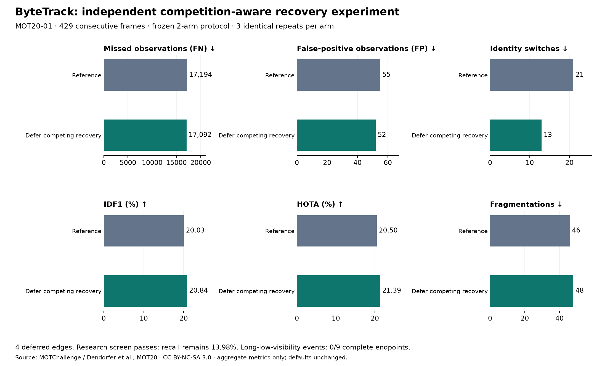

# ByteTrack 競爭時延後接回控制實驗 — 2026-10-19

[English](../en/tracking-recovery-acceptance.md) · [ROADMAP](../../ROADMAP.md) · [前次成本診斷](tracking-association-diagnosis.md)

**本輪通過事前凍結的研究篩選，但追蹤可靠性仍未驗收。** 延後 4 筆有競爭的弱階段恢復後，FP **55→52**、FN **17,194→17,092**、換 ID **21→13**。召回率仍只有 **13.98%**，碎裂 **46→48**，9 個長低可見度事件都沒有完整端點。保留為選用離線實驗，應用／worker 預設不變。

[凍結配置](../validation/v0.3-recovery-deferral-protocol.json) · [公開彙總紀錄](../validation/v0.3-recovery-deferral.json) · [圖表產生器](../../tools/plot_tracking_recovery.py)



## 新序列與使用條款

完整 **MOT20-01 訓練預覽，429 格連續影格／25 fps**，固定相機的擁擠室內車站。與先前 MOT17-04／09／10／11／13 都不同；是新選取的一個場景，不是多場景盲測、原始 JPEG 榜單成績或移動相機驗收。

[MOT20 官方頁](https://motchallenge.net/data/MOT20/)明列 [CC BY-NC-SA 3.0](https://creativecommons.org/licenses/by-nc-sa/3.0/)，並提醒原始來源可能有額外條件；MOT20-01 的 Source 欄沒有額外第三方連結。署名：MOTChallenge；Dendorfer、Rezatofighi、Milan、Shi、Cremers、Reid、Roth、Schindler、Leal-Taixé，[MOT20](https://arxiv.org/abs/2003.09003)。限本機非商業研究，不散布原影像、GT 或原始結果；程式 AGPL 不改授權資料集，彙總圖／紀錄保留來源與適用的 CC BY-NC-SA 3.0 聲明。

曾考慮 ETH／MOT17-05，但無法確認額外原始來源條款，因此未採用；不能把網頁無法開啟當成許可，也沒有看到追蹤分數後更換序列。

共用 **YOLO26n CPU／Ultralytics 8.4.176** 快取：信心 .10、輸入 640、class 0、NMS .70、上限 64，共 **7,529 筆偵測**，達上限影格 **0**。壓縮預覽 **960×540**，官方 GT **1920×1080**；核對等比例 2 倍還原及 MOT 一起算座標，官方前處理後 **19,870 筆行人觀測**。影片、GT、metadata、快取、權重及條款雜湊均記錄；沿用環境加 8.4.176 overlay，不等於全新安裝完整 Alpha.2 配方。

## 先凍結，再執行獨立控制

配置在**共用快取與合成機制測試完成後、新序列的任何追蹤輸出／GT 評分之前**存成本機檔案；是本機凍結，不是外部預註冊。兩組都固定 Roboflow **Trackers 2.6.1**、啟用 .30、強弱分流 .60、確認 2、IoU 門檻 .10、保留 30 參考格（一秒，依來源 FPS 換算）。只有候選組加上單一實例控制：

1. 原樣執行高信心關聯與弱階段指派。
2. 僅檢查已選中的弱階段配對：該列已有確認 ID、預測年齡 ≥2，代表至少完整漏配過前一格。
3. 同一偵測欄若另有**仍在本階段的已確認列、年齡恰為 1**，相似度 ≥.10，且 `選中分數 − 競爭者分數 ≤ .05`，延後這筆接回。差距可為負；競爭者可能已配到別的偵測，不代表它才是正確歸屬。
4. 只把該配對改回未匹配：原偵測仍輸出 ID −1，漏格假設保留原預測／到期規則；不重配、不把偵測轉交競爭者。下一格重新判斷，可連續延後，不保證只延一格。

高信心階段、出生／確認、一般活躍軌跡的弱更新、無競爭的弱接回、全部原弱偵測及生命週期保持上游行為。沒有 GT、ReID、延長 buffer 或 BoT-SORT 介入。`RecoveryDeferral` 只由明確執行的離線 runner 使用，離開／失敗後還原實例方法；tracker factory、Session 和 worker 不會安裝它。

**事前研究標準：** 有實際觸發；FP 必須降低；FN／換 ID 不增加；IDF1／HOTA 不降低；事件配對不得損失原有同 ID 恢復。全部成立才通過；這不保證每筆觀測都無退步，也不是 Release 驗收。看到結果後沒有調參。

## 整段結果與新增失敗

兩配置各重跑三次：**6 次／2,574 次影格更新**，輪替順序、OpenCV seed 0／單執行緒。每配置的標準化輸出與完整診斷雜湊三次一致；另外執行一次未加探針的上游對照，與觀察版輸出完全相同。重複執行不當成多個獨立場景。

固定 [TrackEval](https://github.com/JonathonLuiten/TrackEval/tree/12c8791b303e0a0b50f753af204249e622d0281a)，使用官方 MOT20 行人前處理、CLEAR IoU .5、Identity 與 HOTA；診斷計數精確核對官方 CLEAR。以下均為對照→候選：

- **漏追 FN 17,194→17,092（−102）、誤追 FP 55→52（−3）、換 ID 21→13（−8）。** TP 2,676→2,778；召回 **13.47→13.98%**、精確率 **97.99→98.16%**、MOTA **13.09→13.65%**。
- **IDF1 20.03→20.84%、HOTA 20.50→21.39%**；碎裂反而 **46→48**。只有 4 格各延後一筆，但後續關聯歷史也改變，不能把改善說成直接刪掉舊紀錄的 4 筆偵測。
- 固定位置配對：**FP 新增 0／移除 3；FN 新增 22／移除 124；換 ID 新增 1／移除 9**。整體淨改善仍伴隨新漏追與新換 ID。FP 依影格／快取偵測索引，FN／換 ID 依影格／GT；不跨配置比較原生追蹤 ID 數字。
- 記錄的恢復觀測 **31→30**：同先前 GT 的 TP **19→21**、不同 GT 的 TP **4→3**、FP **8→6**。這是兩條已分歧歷史中的相關事件，不是配對的實體人物恢復；先前官方歸屬也可能已錯。

全部事前條件在**本場景**成立，但覆蓋很低；僅值得繼續研究，不升為預設，也不能宣稱解決長遮擋。

## 遮擋與交會代理事件

沿用既定 GT 規則：可見度 ≤.30 持續至少一秒，前後一秒內有 ≥.60 錨點；交會以 GT 框重疊及左右順序交換判斷。這是影像框代理，不是已稽核的物理遮擋／3D 交會；端點採獨立全影格 IoU .5 配對，不當成官方分情境 HOTA／CLEAR。

- **9 個長低可見度事件／9 個主體：** 兩組完整端點均 **0**、同 ID 恢復 **0**，前端缺失 **8**、後端缺失 **9**；事件召回均 **16/340＝4.71%**。沒有長遮擋恢復改善證據；此處「零恢復損失」的篩選條件缺乏判別力。
- **36 個重疊順序交換事件／72 個主體：** 完整端點 **16→17**、同 ID **13→15**、換 ID **3→2**；前端缺失 **53→52**、後端缺失 **52→51**；事件匹配觀測 **235→252／1,342**。同 ID 配對改善：**換 ID 轉同 ID 1、缺端點轉同 ID 1、損失 0**，完整端點淨增 **1**。事件時間可能重疊，不視為獨立試驗。

## 程式驗證

本機應用測試 **327 通過／13 選配略過**；固定真套件的機制／出生控制／探針測試 **28 通過**。刻意移除 SciPy 可用性後，相關基礎測試 **21 通過／7 選配略過**。契約涵蓋一般弱延續、無競爭漏格接回、選擇性延後、保留原偵測、矩陣／其他配對不變及方法／registry 還原。公開清單／連結、開發來源封裝與合成網站建置均通過，未上傳 Release 資產或部署網站。實驗後凍結配置／核心程式及原輸入雜湊均未變。

## 重現與下一步

授權影片及官方 labels 放在忽略的本機資料夾，使用 `tools/cache_video_detections.py` 建共用快取。本機 manifest 含 `video`、`detections`、`gt`、`seqinfo`、`labels_archive` 路徑，不提交到公開 repo。使用凍結版本的獨立 NumPy 2 環境與乾淨 evaluator：

```bash
python tools/validate_tracking_recovery.py \
  --protocol docs/validation/v0.3-recovery-deferral-protocol.json \
  --manifest local/mot20-recovery.json \
  --trackeval-root local/TrackEval \
  --work-dir artifacts/recovery/run \
  --output artifacts/recovery/aggregate.json
```

runner 拒絕已改的程式／輸入／版本雜湊，核對 archive 與完整連續影格，先完成追蹤再加入 GT，原矩陣／ID／案例寫在本機。TrackEval 載入無關的選配 BURST 時提示缺 `pycocotools`；本次 MOT20 loader 與三個指標均實際完成。舊 evaluator 所需 NumPy alias 僅補在獨立程序內，與前次研究一致。

下一步先以不改參數的控制在更多授權場景、移動相機重現，並在本機檢查新增的 FN／換 ID；另外凍結偵測框品質／解析度實驗釐清低覆蓋，不把幾何支持直接當成偵測因果證據。不把新偵測器、buffer 或確認修改混進同一控制，也不沿用舊快取分數。實體相機、Windows 真推論／worker、3D、長時穩定性與吞吐量仍未驗收。既有 Release／Tag 不變；原影像、GT、原始矩陣／逐格 ID、備註及本機路徑都留本機。
