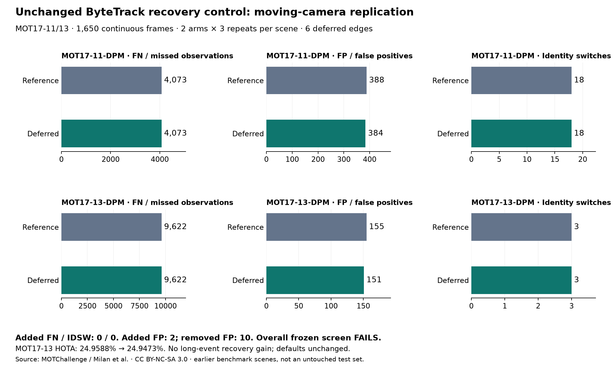

# 延後接回控制的移動相機重驗 — 2026-10-19

[English](../en/tracking-recovery-moving.md) · [ROADMAP](../../ROADMAP.md) · [前輪固定相機研究](tracking-recovery-acceptance.md)

**不調參重驗後，本組未通過逐場景研究標準，維持離線選用及原預設。** 商場／公車兩段合計 FP **543→535**，FN **13,695→13,695**、換 ID **21→21**；新增漏追／換 ID 均為 **0**。公車段 HOTA **24.9588→24.9473%** 小幅退步，不能用整體平均掩蓋；長低可見度事件沒有新增同 ID 恢復。

[凍結配置與修正紀錄](../validation/v0.3-recovery-moving-protocol.json) · [原始凍結快照](../validation/v0.3-recovery-moving-protocol.initial.json) · [重驗彙總](../validation/v0.3-recovery-moving.json) · [移動場景錯誤拆分](../validation/v0.3-recovery-moving-errors.json) · [前輪新增失敗補析](../validation/v0.3-recovery-static-errors.json)



> 後續[狀態與關聯歷史診斷](tracking-recovery-history.md)精確重現本篇分數，補齊保留狀態、連續性歸屬及低門檻 HOTA 損失；原控制／預設不變。

## 序列、條款與證據界線

完整 **MOT17-11-DPM 900 格／30 fps**（前進中的商場相機）及 **MOT17-13-DPM 750 格／25 fps**（公車拍攝路口），共 **1,650 格**。與前輪 MOT20-01 固定相機及政策發現用的 MOT17-09／10 分開；11／13 曾用於較早的一般基準，但**尚未測此控制**，不是從未看過的盲測場景。事前選定整段，不依本輪分數取片段或替換場景。

[MOT17 官方頁](https://motchallenge.net/data/MOT17/)明列 [CC BY-NC-SA 3.0](https://creativecommons.org/licenses/by-nc-sa/3.0/)，原始來源可能另有條件；這兩段的 Source 欄沒有額外第三方連結。署名：MOTChallenge；Milan、Leal-Taixé、Reid、Roth、Schindler，[MOT16](https://arxiv.org/abs/1603.00831)。僅在本機做非商業研究；原片、GT 與原始診斷不散布，程式 AGPL 不改授權資料。彙總圖／資料保留來源及適用的 CC BY-NC-SA 3.0 聲明。

重建 **YOLO26n CPU／Ultralytics 8.4.176** 共用快取，沿用信心 .10、640、NMS .70、class 0、上限 64 與同一權重：11 段 **8,558** 筆偵測、13 段 **8,285** 筆，達上限影格均 **0**。不以早期 8.4.115 快取作對照。兩段壓縮預覽皆 960×540、GT 1920×1080，核對 2× 還原及 MOT 一起算座標；官方評估行人觀測合計 **21,078**。沿用模型環境加版本 overlay，不代表全新安裝完整 Alpha.2。

## 配置不變與執行核對

完整保留前輪 `RecoveryDeferral`、原 runner 的 `run_arm`、IoU .10／差距 .05、啟用 .30、強弱分流 .60、確認 2、buffer 30 參考格（一秒）、套件版本及上游 ByteTrack 類別雜湊。只在弱階段延後已漏格且遇活躍已確認競爭者的選中配對；不重配、不延長生命週期。一般弱延續、無競爭弱恢復及全部原偵測保持上游行為；未加入 CMC／ReID、GT 或 Session／worker 預設變更。

兩場景 × 兩配置 × 三次重複＝**12 次／9,900 次影格更新**；另各跑一次未加探針的上游對照。每配置的三次標準化輸出／完整診斷雜湊一致，未加探針輸出也一致。重複次數不當成獨立場景。兩段各延後 **3 筆**，共 **6 筆**。

原配置檔在新追蹤輸出前凍結。第一次執行於 11 段六次追蹤完成後，報表因缺少 `frame_matches` 匯入而中止；只補匯入既有函式，保留[初版檔](../validation/v0.3-recovery-moving-protocol.initial.json)與 amendment，再整批重跑。控制、參數、輸入、分析定義與評分演算法未改；修正前後 11 段原始預測／診斷／事件檔雜湊完全相同。這是本機凍結，不是外部預註冊，修正不隱藏成一次無失敗執行。

使用原固定 [TrackEval](https://github.com/JonathonLuiten/TrackEval/tree/12c8791b303e0a0b50f753af204249e622d0281a)、官方 MOT17 行人前處理、CLEAR IoU .5／Identity／HOTA；計數精確核對。綜合分數使用官方 combiner，**不平均兩場景比率、不混入 MOT20 分數**。原研究條件逐場景及合併都檢查：實際觸發、FP 嚴格降低、FN／換 ID 不增、IDF1／HOTA 不減、同 ID 事件恢復無損失；全部成立才算通過。

## 結果與 HOTA 退步

以下均為對照→候選；百分比分數保留足夠小數，未加事後容許誤差：

- **商場 11：** FP **388→384**、FN **4,073→4,073**、換 ID **18→18**、碎裂 **31→31**；召回 **56.8355%** 不變，IDF1 **52.9400→52.9540%**、HOTA **47.1473→47.1596%**。該場景通過研究篩選。
- **公車 13：** FP **155→151**、FN **9,622→9,622**、換 ID **3→3**、碎裂 **47→47**；召回 **17.3510%** 不變，IDF1 **26.1851→26.1927%**、HOTA **24.9588→24.9473%**（約 **−.01145 個百分點**）。未通過 HOTA 不退步條件。
- **合併：** FP **543→535**、FN **13,695**／換 ID **21**／碎裂 **78** 均不變；召回 **35.0270%**，IDF1 **40.1945→40.2055%**、HOTA **36.8828→36.8842%**。合併篩選雖通過，但逐場景有失敗，因此**整組未通過**。

固定位置配對核對：兩段新增／移除 FN **0／0**、換 ID **0／0**；FP 合計新增 **2**、移除 **10**。公車新增的 2 筆 FP 都與評估行人框只有 **.10≤IoU<.50** 的部分重疊，對照在前處理後沒有輸出這兩個偵測，亦無 IoU≥.5 的排除標註重疊。這是指標誤追，不代表影像裡沒有真人。

後處理精確重現全部官方分數，再拆 HOTA 多門檻平均：公車 DetA **13.8574→13.8488%**、AssA **45.0321→45.0188%**，DetRe／AssRe 也略降，DetPr／AssPr 則上升。CLEAR 的 .5 門檻 FN／換 ID 不變，不能保證 HOTA 多門檻關聯品質不變；也不能把全部 HOTA 變化直接歸因於那 2 筆 FP。沒有因此調低驗收門檻或改控制。

## 長遮擋、交會與前輪新增失敗

沿用 GT 可見度／重疊左右順序的代理規則與獨立 IoU .5 端點配對，不宣稱已確認的物理遮擋或 3D 交會：

- **長低可見度：** 11 段 6 個事件，完整端點 **4**、同 ID **0**、換 ID **4**；13 段 3 個事件，完整端點 **0**。兩配置完全相同，**9 個事件沒有新增同 ID 恢復**。11 事件匹配觀測 **18/369**，13 為 **0/126**，長遮擋可靠性仍未通過。
- **交會代理：** 合計 19 個事件／38 個主體，完整端點 **19**、同 ID **14**；兩配置一致，配對改善／損失均 **0**。不能用零新增錯誤宣稱已改善交會恢復。

本輪新增 FN／換 ID 皆為零，因此沒有可供該分類的新增案例。另對前輪 MOT20-01 的既有原始輸出做**事後診斷，不重新追蹤／調參**，精確重現原官方分數：

- **22 筆新增 FN：** 2 筆是當格直接延後；12 筆原對照偵測在候選弱階段未匹配／未輸出；8 筆偵測仍以已確認 ID 輸出，但沒有取得原 GT 的官方匹配，需區分前處理、連續性優先與其他 GT 競爭。不是全部 22 筆都在當格被閘門擋掉。
- 22 筆均有 IoU≥.5 的**弱偵測支持，沒有強支持**；都處於其他 GT 框重疊，11 筆低可見度。依同 GT 連續漏格合成 **5 段**，最長 **9 格**。這些是相關觀測與幾何支持，不保證有可行的一對一正確關聯。
- **1 次新增換 ID：** 有缺口但缺口中存在原始偵測支持；目前使用與對照**同一個輸入偵測**，當格沒有延後，並有交會／重疊及一秒內支持同 GT 的延後情境。更符合需檢查後續關聯歷史的線索，不能直接判為當格偵測缺失；時間接近與先前 GT 歸屬不構成物理因果證明。

## 程式驗證

本機應用測試 **330 通過／13 選配略過**；固定真套件的延後接回／出生控制／探針／診斷測試 **31 通過**。刻意移除 SciPy 可用性後，相關基礎測試 **24 通過／7 選配略過**。測試區分直接延後、未匹配弱輸出、保留偵測及歷史換 ID，不跨配置比原生 ID；一般弱延續與方法還原契約持續通過。公開清單／連結、開發來源封裝及合成網站建置通過，未發布 Release 資產或部署網站。

## 重現、限制與下一步

輸入／快取／GT／metadata／原程式雜湊全部不變，原始 trace、逐格 ID、確切事件位置與案例僅存本機。固定 runtime 的獨立 NumPy 2 環境執行：

```bash
python tools/validate_tracking_recovery_replication.py \
  --protocol docs/validation/v0.3-recovery-moving-protocol.json \
  --manifest local/mot17-moving.json --trackeval-root local/TrackEval \
  --work-dir artifacts/recovery-moving/run --output artifacts/recovery-moving/aggregate.json
python tools/audit_tracking_recovery_errors.py \
  --manifest local/mot17-moving.json --record artifacts/recovery-moving/aggregate.json \
  --runs-dir artifacts/recovery-moving/run --trackeval-root local/TrackEval \
  --work-dir artifacts/recovery-moving/audit --output artifacts/recovery-moving/errors.json
```

診斷工具另外支援前輪 MOT20-01 紀錄。HOTA 拆分與前輪案例分類是結果後的確定性分析，不回填為事前規則。無關 BURST 的 `pycocotools` 選配匯入提示仍有記錄；本次 loader／三指標都完成。公開只含檢查過的彙總、雜湊與數值圖，既有 Release／Tag 不變。

下一步先釐清弱恢復延後後的狀態／關聯歷史、未匹配與 GT 競爭，以及公車多門檻 DetA／AssA 的損失，再另凍結有明確風險範圍的新控制。偵測框品質／解析度另做獨立實驗，不混入這輪。一般弱延續不能整批刪掉；目前資料不足以採用新預設或宣稱長遮擋／移動相機普遍可靠。實體 RTSP、Windows 真推論／worker、3D、長時穩定性與吞吐量仍未驗收。
