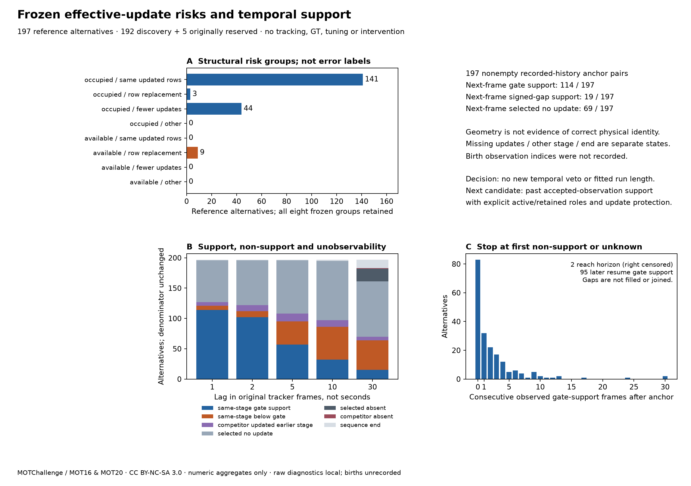

# 凍結有效更新風險分組與跨格支援 — 2026-10-19

[English](../en/tracking-temporal-support.md) · [ROADMAP](../../ROADMAP.md) · [前輪結構診斷](tracking-competition-structure.md) · [凍結定義](../validation/v0.3-temporal-support-protocol.json) · [彙總結果](../validation/v0.3-temporal-support.json)

**先封存定義再抽取跨格資料，目前仍不足以加入新的時間 veto。** 197 個參考替代中，下一格有 114 個仍具同階段過門檻支援，但只有 19 個也符合原有號分差條件；69 個因原選假說未接受更新而無法比較。未知證據與幾何陰性分開。下一候選選為另行凍結的**只用過去已接受觀測的支援資格，搭配活躍／保留角色與更新置換保護**；不從這批結果挑連續影格門檻。



## 先凍結、保留範圍與行為

本機定義／實作封存 SHA-256：**`cb70d22d5c28875d7edd00126720fbda21500350c1aeec2e438de9554fb020be`**，時間 `2026-10-19T13:44:41.838423+00:00`，早於工具第一次抽取本輪跨格結果；合成契約先通過才封存。協定鎖定新工具／測試、原控制／probe、前輪結構紀錄、完整發現／確認紀錄及原 NumPy／SciPy 版本。成本與結構結果先前已知，這是後續定義的本機事前凍結，不是外部預註冊或新的未見資料組。

固定使用全部 **197 個參考替代／178 個已選邊／177 格**，遍歷原 16 段的完整 **17,984 格** trace；原發現 192／原保留確認 5 分開，保留全部陰性來源與順序，以及既有 147 組有向本機假說配對資訊。它們是相關觀測，不能當獨立人物／事件；兩組都已檢查過，下一輪不能再充當未見保留組。

不重跑偵測／追蹤、不讀 GT／評分器、不下載新資料、不搜尋參數、不新增控制或應用／worker 註冊、不升預設。原弱偵測與延續、啟用 .30／高信心 .60／保留 30 格／確認 2、有號差 .05／目標值容差 1e-12 全保留。這是參考歷史的觀察性延續，不是實際安裝強制替代或執行 veto 後的結果；不改寫既有 FN／FP／IDSW／HOTA 與公車失敗。

## 八個固定結構風險組

以原合格弱配對中「競爭者有無其他更新」，交叉假設強制替代後的**合格更新集合變化**：相同更新列、數目相同但置換列、更新數減少、其餘歸 `other`。八格包含零值全保留；只代表潛在結構風險，不是正確／錯誤身分標籤，也不是實際 veto 效果。

| 凍結組別 | 替代數 | +1 過門檻 | +1 有號差 | +1 活躍已確認支援 | +1 原列未更新 |
| --- | ---: | ---: | ---: | ---: | ---: |
| `occupied/same_updated_rows` | 141 | 84 | 12 | 84 | 52 |
| `occupied/row_replacement` | 3 | 1 | 0 | 1 | 1 |
| `occupied/fewer_updates` | 44 | 20 | 4 | 20 | 16 |
| `occupied/other` | 0 | 0 | 0 | 0 | 0 |
| `available/same_updated_rows` | 0 | 0 | 0 | 0 | 0 |
| `available/row_replacement` | 9 | 9 | 3 | 0 | 0 |
| `available/fewer_updates` | 0 | 0 | 0 | 0 | 0 |
| `available/other` | 0 | 0 | 0 | 0 | 0 |

`available/row_replacement` 的 9 個競爭者下一格全有幾何支援，但沒有一個仍活躍。這是它們在參考組錨點未獲更新後，年齡從 1 變成保留中 2 的直接狀態結果；不是獨立證明競爭消失、身分錯誤，或介入後也必然如此。

## 不可變歷史與跨格支援定義

將高／弱階段已接受關聯重建為僅附加的 **（原影格、不可變完整快取偵測索引）** 的歷史。probe token 維持本機物件所有權；保留非空前綴，核對後續延伸、連續更新計數與漏更新年齡。不用原生 ID 數字、最近框或跨流對號來串接；後續跟隨同一原選假說當格新接受的觀測，不能把錨點偵測索引數字搬到別格，亦不換成其他假說。

197 個錨點兩方都有非空的已記錄前綴。完整 trace 共 **120,360 次年齡核對及 120,360 次連續更新計數核對**通過。固定 ByteTrack 沒有累計成功更新計數（`null`），沒有虛構它。**原 probe 未記出生觀測索引**：640 個本機物件 token 的出生未索引，因此這是完整已記錄關聯邊歷史，不是從出生開始的完整觀測或物理身分真值。

每一後續格依凍結優先順序分類：

1. 原選假說不在，或仍在但未接受更新，分開標成無可比觀測。
2. 原選假說有更新、競爭者不在，另列缺席。
3. 原選假說在弱階段更新，但競爭者已在高階段配對，列 `competitor_other_stage_update`；缺少弱階段比較，不算低於門檻。
4. 兩者都在原選觀測階段，使用**該階段原門檻**區分過門檻支援／低於門檻。跨格可能切換高／弱階段，不能稱為固定弱階段 IoU 序列。
5. 次要有號分差支援還須滿足 `selected_score − competitor_score <= .05`，沿用原單邊規則；競爭者「已確認且年齡 1」另計。幾何支援可能來自保留假說，原選假說也不要求一直處於漏格狀態。

序列結束、歷史無錨點另外保留為設限／未知；本批沒有無錨點案例。主要延遲為**下一個原追蹤影格 +1**，固定次要觀察 +2／+5／+10／+30；完整分析至原 buffer 的 30 格，每格不跳過，不當 30 秒或新線上視窗。每個延遲分母都保留全部 197 個替代。

## 固定延遲與漏格前的結果

| 延遲 | 過門檻 | 低於門檻 | 競爭者較早階段更新 | 原列未更新 | 原列不在 | 競爭者不在 | 序列結束 | 有號差支援 |
| --- | ---: | ---: | ---: | ---: | ---: | ---: | ---: | ---: |
| +1 | 114 | 7 | 6 | 69 | 0 | 0 | 1 | 19 |
| +2 | 102 | 10 | 10 | 74 | 0 | 0 | 1 | 18 |
| +5 | 57 | 38 | 13 | 88 | 0 | 0 | 1 | 8 |
| +10 | 32 | 54 | 11 | 98 | 0 | 0 | 2 | 5 |
| +30 | 15 | 49 | 6 | 91 | 21 | 1 | 14 | 0 |

+1 只有 **121 個**有同階段分數可比較（114 支援／7 低於門檻）；其餘 **76 個**為原列未更新 69、競爭者較早階段更新 6、序列結束 1，不能改標成競爭陰性。114 個幾何支援中有 **105 個**競爭者仍已確認且活躍；19 個有號差支援是另一子集，不能直接當成活躍支援或原漏格介入資格。

回看原選假說在**錨點前最後一次已記錄接受觀測**：109 個過門檻、37 個低於門檻、49 個競爭者已在較早階段更新、2 個競爭者不在；只有 30 個也符合原有號分差。距錨點 2–26 格，中位 4，不能稱作緊鄰上一格，亦不補上中間缺觀測。

## 連續的是可見支援，不跨缺格補接

從 +1 開始計連續支援前綴，遇到**第一個陰性或未知**就停並保留原因。長度 0 有 83 個、1 有 32 個、2 有 22 個；2 個一路至 30 格屬右設限，不宣稱恰好在 30 格結束。停止原因為原列未更新 130、低於門檻 48、競爭者較早階段更新 16、序列結束 1、到觀察上限 2。**95 個**在固定範圍內稍後又出現支援，但不把這些片段串成連續支援。

次要有號差前綴為 **0 格：178／1 格：18／2 格：1**，沒有觀察到超過兩格的連續有號差支援。這只描述原分數規則在參考延續上的行為，不據此發明「兩格確認」或認定衝突長短即可安全刪除。

## 全來源與原階段清單

下表均為 +1 計數，完整原片長度見[曝光清單](tracking-exposure-selection.md)，零值來源保留。

| 來源 | 原階段 | 替代 | 過門檻 | 有號差 | 原列未更新 | 低於門檻 | 較早階段 | 結束 |
| --- | --- | ---: | ---: | ---: | ---: | ---: | ---: | ---: |
| MOT17-09-DPM | discovery | 27 | 19 | 2 | 6 | 1 | 1 | 0 |
| MOT17-10-DPM | discovery | 16 | 11 | 1 | 5 | 0 | 0 | 0 |
| MOT17-11-DPM | discovery | 4 | 0 | 0 | 4 | 0 | 0 | 0 |
| MOT17-13-DPM | discovery | 4 | 0 | 0 | 3 | 0 | 1 | 0 |
| MOT17-04-DPM | discovery | 1 | 0 | 0 | 1 | 0 | 0 | 0 |
| MOT20-01 | discovery | 5 | 4 | 1 | 0 | 0 | 0 | 1 |
| MOT20-02 | discovery | 59 | 36 | 5 | 21 | 1 | 1 | 0 |
| MOT20-06 | discovery | 16 | 7 | 3 | 8 | 1 | 0 | 0 |
| MOT20-07 | discovery | 1 | 0 | 0 | 0 | 1 | 0 | 0 |
| MOT20-08 | discovery | 6 | 5 | 1 | 1 | 0 | 0 | 0 |
| MOT17-07-DPM | discovery | 12 | 4 | 0 | 8 | 0 | 0 | 0 |
| MOT17-08-DPM | discovery | 26 | 17 | 4 | 6 | 1 | 2 | 0 |
| MOT17-12-DPM | discovery | 4 | 2 | 0 | 1 | 1 | 0 | 0 |
| MOT17-14-DPM | discovery | 11 | 7 | 2 | 2 | 1 | 1 | 0 |
| MOT20-03 | confirmation | 5 | 2 | 0 | 3 | 0 | 0 | 0 |
| MOT20-05 | confirmation | 0 | 0 | 0 | 0 | 0 | 0 | 0 |

發現組下一格支援 112／192、有號差支援 19；原保留確認支援 2／5、**有號差支援零**、原列未更新 3；MOT20-05 無錨點。原保留組小且已檢查，不能稱為新介入的獨立驗證或有號差持續性的重現。

## 介入決定與下一道驗收

**本輪決定：保留現行對照，不新增時間 veto、不放寬等價值，也不挑 N 格連續條件。** 幾何支援持續時有號差條件常不持續，多數前綴中斷又是沒有接受觀測，不是可見的幾何陰性；只靠結構分組與保留預測不能識別哪條物理身分正確。

下一個候選機制為**只用過去已接受觀測的支援資格＋更新置換保護**：規則需區分真正有觀測的活躍競爭者與保留預測，只用決策當時已存在的索引／狀態，並分開已占用且同更新列、已占用且置換、已占用且減少，以及未占用且置換的風險。缺乏可比證據不足以做正／負身分判定。本報告 +1…+30 是診斷結果，禁止回灌成錨點當下的線上特徵。

實作前另凍結因果可用特徵、缺失／設限處理、適用條件與完整逐場景 FN／FP／IDSW／IDF1／HOTA 傷害標準，使用真正未見確認來源；任何不確定性／擾動模型需獨立依據。不能從這 197 個結果擬合時長、容差或風險排名；保留弱偵測、長遮擋支援流失與公車失敗。**分組定義與描述性分析完成；物理身分有效性、因果介入效益與獨立可靠性仍待驗證。**

## 重現、條款與公開邊界

沿用相同本機非商業研究的 [MOT17](https://motchallenge.net/data/MOT17/)／[MOT20](https://motchallenge.net/data/MOT20/) 與[來源／條款紀錄](tracking-exposure-selection.md)：MOTChallenge／Milan、Leal-Taixé、Reid、Roth、Schindler（MOT16），Dendorfer 等（MOT20），CC BY-NC-SA 3.0，保留額外原來源條件。不散布影像／GT、不提交 leaderboard，程式 AGPL 不重新授權來源資料。

最初的 `freeze` 子指令拒絕覆寫協定／封存檔，已於抽取前執行。重現已發布分析時保留原本機封存檔，或用公開協定雜湊建立本機核對封存並註明是重現，不冒稱新的事前封存。`analyze` 核對封存、完整有序來源紀錄、原 trace 雜湊、凍結實作／套件、原成本配對及每次歷史轉移；不公開絕對機器路徑。

```bash
# Use the original pinned NumPy 2.2.6 / SciPy 1.18.1 research environment.
# Frozen protocol is already published; do not overwrite or refreeze it.
python tools/diagnose_tracking_temporal_support.py analyze \
  --protocol docs/validation/v0.3-temporal-support-protocol.json \
  --seal artifacts/temporal/freeze.local.json \
  --phase docs/validation/v0.3-exposure-discovery.json artifacts/tracking-exposure-selection/discovery \
  --phase docs/validation/v0.3-exposure-confirmation.json artifacts/tracking-exposure-selection/confirmation \
  --output artifacts/temporal/summary.json \
  --local-details artifacts/temporal/histories.local.json
python tools/plot_tracking_temporal_support.py \
  --summary artifacts/temporal/summary.json --output artifacts/temporal/summary.png
```

公開輸出只採固定白名單計數／分布、程式、合成測試與數字統計圖；矩陣、token、原影格位置、逐例前綴與觀測關聯診斷皆在忽略追蹤的本機 artifacts。兩次完整抽取的公開／本機輸出逐位元相同，重複不增加獨立證據。應用測試 **377 通過／20 選配略過**（一項既有 Starlette／httpx 棄用提醒）；固定 NumPy 2 的跨格／結構／曝光／弱延續契約以 `RUN_TRACKERS_CONTRACTS=1` 執行 **60 通過**。凍結實作與紀錄雜湊、組別／延遲分母、公開原始欄位排除、公開清單／本機連結／明顯祕密樣式、來源封裝及純合成網站建置通過，統計圖已目視檢查；沒有部署網站或上傳 Release。
